# From raw captures to a Splunk dashboard: the IoT evidence pipeline

**Who this is for:** anyone with a networking background who wants to repeat this project's analysis on their own smart-home network, or check ours. You should know what a VLAN, a pcap and a firewall log are; you don't need to know Zeek or Splunk.

**What you end up with:** every recording and log turned into tidy, device-labelled events in Splunk, ready for a dashboard that answers questions like *"which device talked to the internet, how much, and was anything blocked?"*

**Status of this guide:** steps 1–6 (collect → process → ingest → verify) are tested on this project's data, including a full HEC load into Splunk. Step 7 (rules and dashboard) runs on Splunk Enterprise 10.6.1.1 with this project's data; section 7.3 is a guided tour with screenshots, and section 7.5 gives the reference numbers to check it against.

> **In short:** record traffic and logs on the router, describe your network once in a small config file, then run four commands. They turn the raw files into Splunk-ready events plus a Splunk app. Load both into Splunk, either by uploading the files in the web UI or by sending them over HTTP (HEC), and check the counts. On this project's 1 GB of recordings, the whole run takes about two minutes.

---

## Contents

1. [The pipeline at a glance](#1-the-pipeline-at-a-glance)
2. [What you need](#2-what-you-need)
3. [Collecting the raw evidence](#3-collecting-the-raw-evidence)
4. [Describing your network (`site.toml`)](#4-describing-your-network-sitetoml)
5. [Running the pipeline](#5-running-the-pipeline)
6. [Getting the data into Splunk](#6-getting-the-data-into-splunk)
7. [The dashboard and the detection rules](#7-the-dashboard-and-the-detection-rules)
8. [Field reference](#8-field-reference)
9. [Pitfalls and troubleshooting](#9-pitfalls-and-troubleshooting)
10. [Privacy and sharing](#10-privacy-and-sharing)
11. [How this relates to the project's evidence](#11-how-this-relates-to-the-projects-evidence)
12. [Command cheat sheet](#12-command-cheat-sheet)

---

## 1. The pipeline at a glance

> **In short:** four kinds of raw input go in, eleven kinds of event come out. Each event carries the device it belongs to, worked out from MAC addresses.

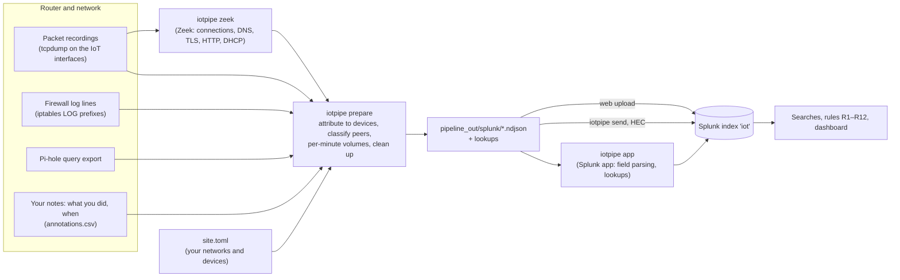

| Step | Command | Reads | Writes | Time (this project) |
|---|---|---|---|---|
| Check | `iotpipe check` | `site.toml`, the folders | nothing (prints what it found) | instant |
| Zeek | `iotpipe zeek` | every pcap | `pipeline_out/zeek/<capture>_<iface>/*.log` | 50 s |
| Prepare | `iotpipe prepare` | pcaps, Zeek logs, firewall logs, Pi-hole export, annotations | `pipeline_out/splunk/*.ndjson`, `pipeline_out/lookups/*.csv`, `prepare_report.json` | 60 s |
| App | `iotpipe app` | the lookups | `pipeline_out/splunk_app/iot_segmentation/` and `iot_segmentation.tgz` | instant |
| Send | `iotpipe send --url …` | `pipeline_out/splunk/*.ndjson` | events in Splunk (HEC) | ~10 s for 65k events |

`iotpipe` is `python3 pipeline/iotpipe.py`. Run it from the project folder. It uses only the Python standard library.

---

## 2. What you need

> **In short:** a router (or mirror port) you can record on, a Linux or macOS machine with Python 3.11+ and Zeek, and a Splunk instance. The free Splunk Enterprise trial or licence is enough.

| Item | Version used here | Notes |
|---|---|---|
| A router you can run `tcpdump` on, or a switch with a mirror port | ASUS RT-BE88U, Asuswrt-Merlin 3006.102.8 | Any Linux-based router with Entware works. Recording on the router itself needs hardware acceleration off (section 9). |
| Python | 3.12 (3.11 minimum) | standard library only |
| Zeek | 8.0.11 | **required.** Debian/Ubuntu: `bash tools/setup_env.sh` (adds the openSUSE Zeek repo). macOS: `brew install zeek`. |
| tshark | 4.4 | optional, for TLS client fingerprints (JA4). Debian: `apt install tshark`; macOS: `brew install wireshark`. |
| Splunk | Enterprise 10.6.1.1 tested (9.x should work; free licence fine) or Splunk Cloud trial | needs to accept HTTP Event Collector traffic (port 8088) if you use HEC |
| Pi-hole (optional) | FTL v5/v6 | any DNS filter works if you can export its query log as CSV with the same columns |
| Disk | ~1.5× the pcap size | Zeek logs and events are much smaller than the pcaps |

---

## 3. Collecting the raw evidence

> **In short:** record the IoT segment for at least 24 hours before and after any change, keep the router's firewall log lines, export the DNS log, and write down what you did and when. Hash everything before you analyse it.

### 3.1 Packet recordings

- **Where:** on every interface that carries the IoT segment. Here that's `wl0.2` (the IoT Wi-Fi) and `eth7` (the Hue Bridge's cable port). Together they see every IoT device.
- **How:** `iot-capture.sh` in the config repo runs one `tcpdump` per interface and writes this layout, which is the one `iotpipe` expects:

  ```
  20261010-002759_seg/              <- <YYYYMMDD-HHMMSS>_<label>: one folder per recording
      wl0.2_20261010-002759.pcap    <- <interface>_<timestamp>.pcap (or .pcap.gz)
      eth7_20261010-002759.pcap
      run.log                       <- settings, offload state, kernel drop counters
  ```

  The label (`seg`) is how the recording is named everywhere later. Use short, meaningful labels such as `baseline`, `after_change` or `update_test`.
- **How long:** 24 hours for a baseline, so daily patterns are covered. Shorter recordings are fine for a specific test, as long as you note what you did (section 3.4).
- **Turn off hardware acceleration while recording.** Otherwise most packets bypass the CPU and never reach `tcpdump`; the recording looks fine but is mostly empty. `iot-capture.sh` does this automatically. Details: `segmentation_report.md` section 3.2, "Major pitfall".
- **Check that it's complete:** `run.log` should say `0 packets dropped by kernel`, and the router's interface counters should roughly match the packet count.
- **Format:** classic pcap with Ethernet frames. If you have pcapng, convert it first: `editcap -F pcap in.pcapng out.pcap`.

### 3.2 Firewall log lines

The router's firewall rules can log a line whenever something interesting happens. This project uses four log prefixes (from `firewall-start`):

| Prefix | Rule | Meaning |
|---|---|---|
| `IOT_TO_WAN_NEW` | `-i br52 -o eth1 -m state --state NEW -j LOG` (30/min) | an IoT device opened a new connection to the internet (logged, still allowed) |
| `IOT_TO_LAN_DROP` | before the final DROP of IoT → main LAN (10/min) | an IoT device tried to reach the main network and was **blocked** |
| `IOT_TO_ROUTER_DROP` | at the end of the `IOT_INPUT` chain (10/min) | an IoT device tried a router service it may not use, **blocked** |
| `IOT_DNS_REDIRECT` | in nat PREROUTING before the DNAT to Pi-hole (10/min) | an IoT device asked a DNS server other than Pi-hole; **redirected** to Pi-hole |

`iotpipe` reads any prefix. Names that end in `DROP` are treated as "blocked", names containing `REDIRECT` as "redirected", everything else as "logged".

**Saving them:** the router keeps its syslog in RAM and rotates it, so lines get lost if you copy the log only at the end. That happened twice in this project. Start this on the router before a test and leave it running:

```sh
tail -F /tmp/syslog.log | grep --line-buffered -E 'IOT_' > /tmp/FW_live.log &
```

Then copy `/tmp/FW_live.log` off the router (`scp`) into `firewall_logs/`. Any file name works; the config lists which files to read.

### 3.3 DNS log (Pi-hole)

On the Pi-hole host:

```sh
sqlite3 -header -csv /etc/pihole/pihole-FTL.db "SELECT * FROM queries;" > pihole_export.csv
```

The export contains **every client's** browsing, not only the IoT devices'. `iotpipe` keeps only queries from the IoT segment or from known devices, and by default only during your recordings. Still, store the full export as private.

### 3.4 What you did, and when (annotations)

Detection results only mean something if you know what really happened. Keep a simple CSV, `pipeline/annotations.csv`:

```csv
time,capture,kind,label,text
2026-10-11 16:43:50,tapo,action,Tapo update,Firmware update started in the app
2026-10-31 17:37:33,upload,test,Run A start,Bulk upload: 100 MiB to cloud storage
```

`time` is local time in the site's timezone. `kind` is free text; this project uses `capture`, `action`, `test`, `change`, `event` and `check`. The dashboard shows these as markers on the timeline. Note unplanned events too: two Wi-Fi restarts in this project weren't written down at the time and had to be reconstructed from the recording.

### 3.5 Optional extras

- **Router counters and connection tables** before and after each test (`iptables -vnL`, `/proc/net/nf_conntrack`). These are useful for the report but not ingested yet.
- **Hashes:** `sha256sum` every raw file into a list before any processing (this project's `SHA256SUMS`). Then anyone can check later that the evidence wasn't changed.

---

## 4. Describing your network (`site.toml`)

> **In short:** one file tells the pipeline which networks are which, which MAC address belongs to which device, and which hosts are allowed to control them. Start from `pipeline/site.example.toml`.

```sh
cp pipeline/site.example.toml pipeline/site.toml
```

The sections, in the order you'll fill them in:

| Section | What to put there | Why |
|---|---|---|
| `[site]` | a name and your **router's timezone** | syslog lines carry no timezone or year |
| `[paths]` | where the recordings and logs are, where output goes | the defaults fit the layout in section 3 |
| `[networks]` | the IoT and main-LAN prefixes (v4 and v6), networks that are out of scope, router addresses and MACs, the DNS filter's addresses | every peer address is classified with these (section 8.2) |
| `[captures]`, `[capture.<label>]` | the default interface; per recording: the state of the configuration and whether it's a **baseline** | rules compare against the baseline recordings |
| `[[device]]` | one block per device: MAC, name, the interface it's counted on (`home_iface`), `baselined`, `local_only` | everything is attributed **by MAC**. Each device is counted on one interface only, so nothing is counted twice |
| `[[controller]]` | hub, phone or computer with the control app: name and IP addresses | firewall logs only show the source MAC, so controllers are matched by IP |
| `[firewall]`, `[pihole]`, `[annotations]` | file locations, the year of the syslog lines | |
| `[privacy]` | URL parameters to hide | e.g. the Hue's `sso` token in its plain-HTTP diagnostics |
| **`site.private.toml`** (separate file, optional) | your **own public addresses**: the delegated IPv6 prefix, the WAN-side /64, the WAN IPv4, each with a documentation-range mask (example in `site.example.toml`) | they turn up in events (devices with public IPv6 before segmentation, hairpin attempts to the router's WAN side). They're classified `own_public` and masked in every output. The file is read automatically if it sits next to `site.toml`; never share it |

**Finding the MACs:** the router's DHCP lease file (`/var/lib/misc/dnsmasq*.leases` on Asuswrt) or its client list. Use the MAC each device actually uses on the IoT network. Phones and laptops use a private MAC per network, so note the one they show there.

**Test hosts and stray devices:** give them a `[[device]]` block with `role = "test"` or `role = "personal"`. They then appear under their own name instead of "unknown", and the dashboard can keep them apart from real IoT devices. This project lists the two test MacBooks and two personal Apple devices that once joined the IoT Wi-Fi.

`python3 pipeline/iotpipe.py check` shows what the pipeline understood:

```
  devices: 11 (Hue Bridge, SwitchBot Hub 2, Tapo P110M plug, …); controllers: 7 addresses
  captures: 6
    flat               state A    baseline yes ifaces eth7,wl0.2  zeek missing
    seg                state C/D  baseline yes ifaces eth7,wl0.2  zeek missing
    …
  firewall logs: 8 file(s)
  pihole export: pihole_export.csv (found)
```

---

## 5. Running the pipeline

> **In short:** `zeek`, then `prepare`, then `app`. Each step can be re-run safely; `prepare` rebuilds its output from scratch every time.

```sh
python3 pipeline/iotpipe.py zeek       # once per new recording (--force to redo)
python3 pipeline/iotpipe.py prepare
python3 pipeline/iotpipe.py app
# or all three (plus check) in one go:
python3 pipeline/iotpipe.py all
```

`prepare` prints what it produced. On this project's data:

```
  iot:conn           28,666      iot:volume         14,111
  iot:dns             5,299      iot:health          6,002
  iot:tls             1,426      iot:fw              2,452
  iot:tls_hello       1,450      iot:pihole          3,375
  iot:http              104      iot:annotation         24
  iot:dhcp            1,812                          (64,721 in total)
  note: firewall: 20 line(s) dated 1 Jan skipped (router clock not yet set)
  note: pihole: kept 3375 IoT queries, dropped 26016420 (other clients or outside the capture windows)
```

The same numbers are saved in `pipeline_out/prepare_report.json`, so you can compare them with Splunk later (section 6.4).

### 5.1 What `prepare` does to each input

| Input | Becomes | What happens on the way |
|---|---|---|
| Zeek `conn.log` | `iot:conn` | Each connection is attributed to a device by MAC and labelled with who started it (`initiated_by`). The other side is classified (`peer_class`: wan, lan, router, dns, bogon, …), and bytes are counted from the device's side (`bytes_out`, `bytes_in`). A device's connections are kept only from its `home_iface`, so nothing is counted twice. Zeek sometimes guesses the direction of a UDP flow wrong (e.g. mDNS from 5353 to 5353) and marks it with `^`; these are turned back (`zeek_flipped`). Traffic of hosts that are neither a listed device nor in the IoT network is dropped. In a flat network that's the whole household, which is noise for this purpose and private. |
| Zeek `dns.log`, `ssl.log`, `http.log`, `dhcp.log` | `iot:dns`, `iot:tls`, `iot:http`, `iot:dhcp` | Attributed through their connection. mDNS/LLMNR are left out of `iot:dns` (hundreds of thousands of multicast lines a day). Secret-looking URL parameters are replaced with `<redacted>`. DHCP from MACs that aren't listed is kept only if the address involved is in the IoT network (in a flat network, other household hosts would show up as "unknown devices"). |
| pcaps | `iot:volume` | Bytes and packets **per device per minute**, split by the class of the other side (`out_wan`, `in_wan`, `out_lan`, `out_bogon`, …). This is the basis for the volume rule (R3). Long connections are spread over the minutes in which they actually moved data, which `conn.log` can't do. MACs in the IoT network that aren't in the config are counted as `unknown <mac>`. |
| pcaps | `iot:health` | Per interface and minute: frames seen, IPv6 router advertisements from the router. Minutes with nothing are included, so a gap is visible (R11). |
| pcaps (tshark) | `iot:tls_hello` | The JA4 and JA3 fingerprint of every TLS ClientHello: one stable value per device software (R9). |
| firewall log files | `iot:fw` | Parsed into fields: prefix, action, interfaces, source MAC, addresses, ports. Attributed to a device by source MAC; the destination is classified and named if it's a controller. Lines that appear in several files are counted once. Lines dated 1 January (written before the router clock was set after a reboot) are skipped and counted in a note. |
| Pi-hole export | `iot:pihole` | Only queries from the IoT segment or a known device; by default only during recordings (±10 min). Each client address is matched to a device through what the recordings show, so a device on a dynamic address is still recognised. Special addresses are never matched: `::` is how Pi-hole logs its own lookups, and IPv6 devices also send from `::` while checking their address, which once made Pi-hole's own lookups look like the Tapo plug's. Status codes become text plus `blocked=true/false`. |
| annotations | `iot:annotation` | One event per line |
| `site.toml` | lookups `iot_devices.csv`, `iot_controllers.csv`, `iot_captures.csv` | The capture lookup gets each recording's real start and end from the first and last packet |

### 5.2 Sanity checks we ran

Before trusting the pipeline, its output was compared with the numbers in `analysis.md`, which were produced by separate tools:

| Check | Pipeline | Analysis |
|---|---|---|
| Hue Bridge DNS queries during the flat / segmented recordings | 935 / 1,966 | 935 / 1,966 (§1.2) |
| Hue Bridge median upload per hour, segmented recording | 206,309 B | 206,309 B (§16.4) |
| Test laptop upload during the bulk run (17:37–17:42) | 144,175,565 B | 144.18 MB (§16.3) |
| Test laptop upload after the bulk run (17:46–18:29) | 2,338,346 B | 2.34 MB (§16.3) |
| SwitchBot connections to the invalid address 255.2.0.0, segmented | 931 | 949 packets (§5.1; one connection can hold several packets) |
| IPv6 router adverts after the 17:03 Wi-Fi restart (tapo recording) | 0, against ~7 a minute before | stopped (§13.6) |
| Distinct TLS fingerprints of the Hue Bridge | 5 | 5 (§12.2, §13.3) |
| Firewall lines | 2,452 (2,473 lines − 20 dated 1 Jan − 1 blank) | file line counts |

---

## 6. Getting the data into Splunk

> **In short:** install the app once, create the index `iot`, then either upload the eleven files in the web UI (simple, fine for one-off analyses) or send them with `iotpipe send` over HEC (scriptable, repeatable). Finally, compare Splunk's counts with `prepare_report.json`.

### 6.1 One-time setup

1. **Install the app:** *Apps → Manage Apps → Install app from file* → `pipeline_out/iot_segmentation.tgz`. It contains:
   - `props.conf`: how to parse each sourcetype (one JSON event per line, timestamp from `ts`);
   - the lookups and their definitions;
   - the macro `` `iot_index` ``, which every search in this guide uses, so the index name lives in one place;
   - an `indexes.conf` that creates the index on Splunk Enterprise.

   **Restart Splunk afterwards** (Splunk asks for it): line breaking and timestamp rules are only read at start-up, and until then the upload preview ignores them. To confirm they're active, on the Splunk server:

   ```sh
   $SPLUNK_HOME/bin/splunk btool props list iot:conn --debug     # must show SHOULD_LINEMERGE = false, TIME_PREFIX = ^\{"ts":
   ```

   **Install it once.** The parsing rules and the macro are the same for all future data. Only the lookup files change: run `iotpipe app` and *Upgrade app from file* when you edit `site.toml` (devices, controllers) or **add a recording** (it adds a row to `iot_captures`), and later when the dashboards change. Re-processing the same recordings needs no upgrade. Settings you change in Splunk's UI live in the app's `local/` folder and survive upgrades. Alternatively, replace a single CSV under *Settings → Lookups → Lookup table files*.
2. **The index:** on Splunk Enterprise the app creates `iot` after a restart. Or create it yourself under *Settings → Indexes → New Index* (name `iot`). On Splunk Cloud, create it in the UI.
3. **Your timezone:** *Settings (your name) → Preferences → Time zone*: set it to the site's timezone, so times in Splunk match the router's logs and your notes.

### 6.2 Option A: upload through the web UI

Good for a one-off look, or when HEC isn't available.

For each file in `pipeline_out/splunk/`:

1. *Settings → Add Data → Upload* → choose the file (e.g. `iot_conn.ndjson`).
2. **Source type:** open the *Source type* dropdown and pick the matching one from the app's list, under **Network & Security** (`iot:conn` for `iot_conn.ndjson`, `iot:tls_hello` for `iot_tls_hello.ndjson`, …). Don't keep Splunk's automatic guess or `_json`. The preview must show **one event per line with the event's own time**, with no warning triangle. If it warns about `MAX_EVENTS` or "Failed to parse timestamp", stop: the app's rules aren't active (section 9).

   *Without the app* (no admin rights): *Set Source Type → Advanced*, set `SHOULD_LINEMERGE = false`, `LINE_BREAKER = ([\r\n]+)`, `TIME_PREFIX = ^\{"ts":`, `TIME_FORMAT = %s.%6N`, `MAX_TIMESTAMP_LOOKAHEAD = 20`, `KV_MODE = json`, then *Save As* `iot:conn` (and likewise for each file).
3. **Host:** constant value, the site name (`i0n-home` here). **Index:** `iot`.
4. *Review → Submit.*

Eleven files, so eleven rounds; it takes a few minutes. The web upload limit is 500 MB per file, far above what this project produces (the largest file, `iot_conn.ndjson`, is about 19 MB).

### 6.3 Option B: send over HEC (recommended)

The HTTP Event Collector receives events over HTTPS. That's scriptable and repeatable.

**Create a token (once):**

1. *Settings → Data Inputs → HTTP Event Collector → Global Settings:* **All Tokens: Enabled**, port 8088, SSL on. Save.
2. *New Token:* name `iotpipe`; leave *Enable indexer acknowledgement* **off**. *Next.*
3. *Input settings:* source type **Automatic** (the pipeline sets it per event); **allowed index `iot`**, default index `iot`. *Review → Submit*, then copy the token value.

**Test the connection** (a 200 response with `{"text":"Success","code":0}` means it works):

```sh
export SPLUNK_HEC_TOKEN='paste-the-token-here'     # never put it in a file that's shared
curl -k https://splunk.example:8088/services/collector/event \
     -H "Authorization: Splunk $SPLUNK_HEC_TOKEN" \
     -d '{"event": "hello from iotpipe", "index": "iot", "sourcetype": "iot:annotation"}'
```

**Send everything:**

```sh
python3 pipeline/iotpipe.py send --url https://splunk.example:8088 --insecure   # --insecure: self-signed certificate
python3 pipeline/iotpipe.py send --url … --only iot:fw iot:pihole               # just some sourcetypes
python3 pipeline/iotpipe.py send --url … --dry-run                              # build the batches, send nothing
```

Every event goes out with the event's own time, `host` = the site name, `source` = `iotpipe:<capture>`, its sourcetype and the index from `site.toml`. Events are sent in batches of ~800 kB; the sender retries when Splunk says it's busy (HTTP 429/503).

### 6.4 Check that everything arrived

Set the time picker to **All time**, then:

```spl
`iot_index` | stats count by sourcetype
```

The counts must equal `pipeline_out/prepare_report.json` → `events`. Then a quick look at whether times and devices make sense:

```spl
`iot_index` sourcetype=iot:volume
| timechart span=1h sum(bytes_out) by device
```

Six islands of data should appear, one per recording, with no events "in the future" or in 1970. If the times are wrong, the sourcetype wasn't set (web upload) or the app isn't installed. Note that `bytes_out` is everything a device sends, including local multicast (most of the Hue's ~5 MB/h is mDNS). For internet traffic use `out_wan`: the Hue's median in the segmented recording should come out at ~206 kB/h, as in the analysis.

### 6.5 Re-loading without duplicates

Splunk doesn't overwrite: sending the same events twice stores them twice. To reload after changing `site.toml` or adding a recording:

- **Simplest:** delete the index and create it again (*Settings → Indexes → Delete*), then send everything. A lab index is cheap to rebuild.
- **Or:** remove the old events from search with `` `iot_index` | delete ``. This needs the `can_delete` role; it hides the events but doesn't free disk space.

---

## 7. The dashboard and the detection rules

> **In short:** the app contains one dashboard, *IoT Segmentation: Smart-Home Network Overview*, which opens when you open the app. It reads top to bottom: big-picture counters, everything the rules flagged, what's normal per device, whether the separation works, whether the devices still work, and what the evidence covers. Each rule is a Splunk macro, so the same logic can also be run by hand.

### 7.1 Opening it

Install or upgrade the app (`iotpipe app`, then section 6.1) and open **Apps → IoT Segmentation**. The dashboard is the app's home page. Set the time range to **All time** (the default): the recordings span 6 October to 2 November.

### 7.2 What's on it

| Section | Panels | Answers |
|---|---|---|
| **Header** | what the dashboard shows and how to read it; the Learning Contract metrics with their status | *What am I looking at?* |
| **Counters** | IoT devices seen, recordings, events analysed, detections, high or critical detections, attempts blocked by the firewall | *How big is this, and is anything serious?* |
| **Detections** | by severity (pie), by rule, devices with the most detections, detections per recording, real devices vs simulated attacks, and the **detail table**, one plain-language line per finding | *What did the rules flag, where and when?* |
| **What is normal for each device** | internet upload per device per hour (log scale, with markers), who each device talks to (share of its traffic), device profiles (internet servers, domains, median upload and download, who starts connections) | *What does each device usually do?* |
| **Is the separation working?** | what the firewall did (logged / blocked / redirected, real vs test host), hosts that started connections to IoT devices per recording, blocked attempts by destination | *Can IoT devices reach what they shouldn't, and who can reach them?* |
| **Do the devices still work?** | Matter sessions per device and controller, DNS answers vs blocked per device | *Do the controllers still reach the devices?* |
| **Data quality and coverage** | the recordings, the operator's notes, IPv6 router adverts per 5 min, events per data source | *What does the evidence cover, and is it complete?* |
| **The rules** | every rule in one line, with its severity | *Why did something fire?* |

**Filters** (top of the page):
- **Time range.**
- **Recording:** one capture or all.
- **Device.**
- **Minimum severity:** applies to the detection panels only; default *Low and above*, which hides the expected *info* findings.
- **Test host:** include the simulated attacks, or show real devices only.

Counters and charts follow all filters. Firewall and Pi-hole entries outside any recording count as "(no recording)".

**Severity colours:** critical red, high orange, medium yellow, low blue, info green (expected or policy behaviour, shown for completeness). The *Detections* number is yellow, and the *High or critical* and *Blocked* counters are orange and red, as long as there is something to count; each turns **green at zero**.

### 7.3 Guided tour

The screenshots below were taken on Splunk Enterprise 10.6.1.1 with this project's data. Unless a caption says otherwise, the filters are at their defaults: All time, all recordings, all devices, *Low and above*, test host included.

**The whole page at a glance.** The left image is the top half (header to detail table); the right one continues from the detail table down to the rules.

<p>
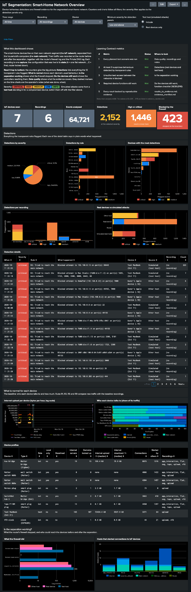
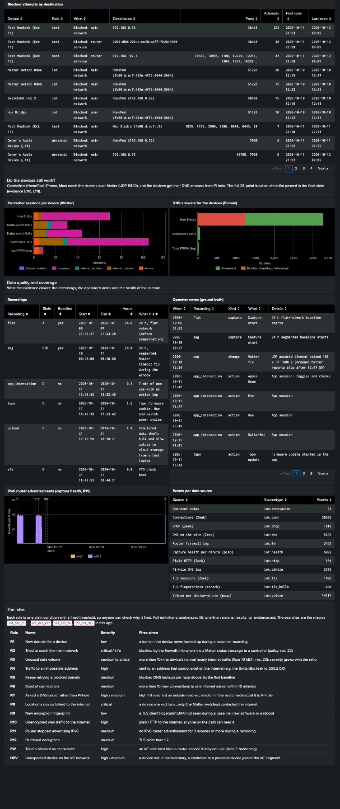
</p>

#### Header, filters and counters

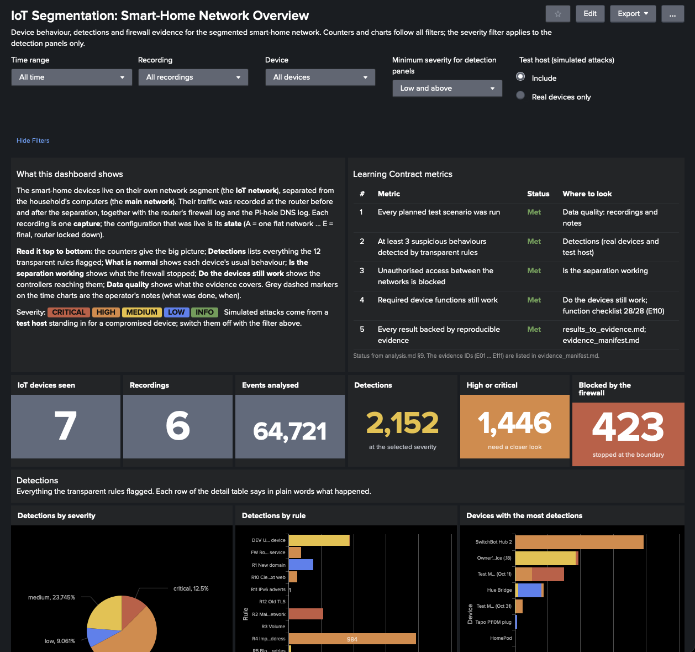

- **Read the two text panels once.** The left one explains the terms (IoT network, main network, capture, state) and the severity colours; the right one lists the Learning Contract metrics and where on the page their evidence is.
- **Counters:** **7** IoT devices, **6** recordings and **64,721** events analysed. That last number must equal the pipeline's total (`prepare_report.json`).
- **2,152 detections** is the number of *flagged events*, not of findings. One finding can cover many events: the SwitchBot's leak in the segmented recording is one row of the detail table but 931 flows. **1,446** of them are high or critical. **423** connection attempts were **blocked** at the segment boundary.

#### Detections

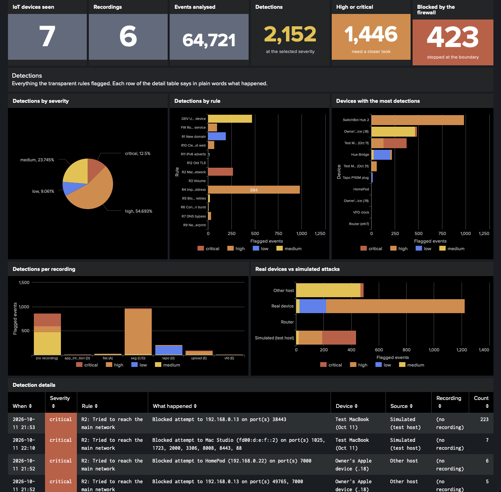

- **By severity:** high 54.7 %, medium 23.7 %, critical 12.5 %, low 9.1 %. The *info* findings (expected Matter messages) are hidden by the default filter.
- **By rule:** the long bar is **R4, 984 flows to impossible addresses**: the SwitchBot firmware bug, summed over five recordings. Splunk shortens long axis labels in the middle (`R4 Imp…ddress`); hover over a bar for the full name.
- **Devices with the most detections:** the SwitchBot (R4) leads. Next are the owner's Apple device that joined the IoT Wi-Fi through iCloud Keychain, the test laptop from the 11 October active test, and the Hue Bridge.
- **Per recording:**
  - **"(no recording)"** is the firewall log of the active tests on 11–12 October, which had no packet capture.
  - **seg** is mostly the SwitchBot leak.
  - **tapo** is the firmware update and the Hue restart.
- **Real devices vs simulated attacks** keeps the two apart. The real devices' findings are mostly high (R4, R10), the test host's largely critical (blocked lateral attempts).

#### Detection details and baselines

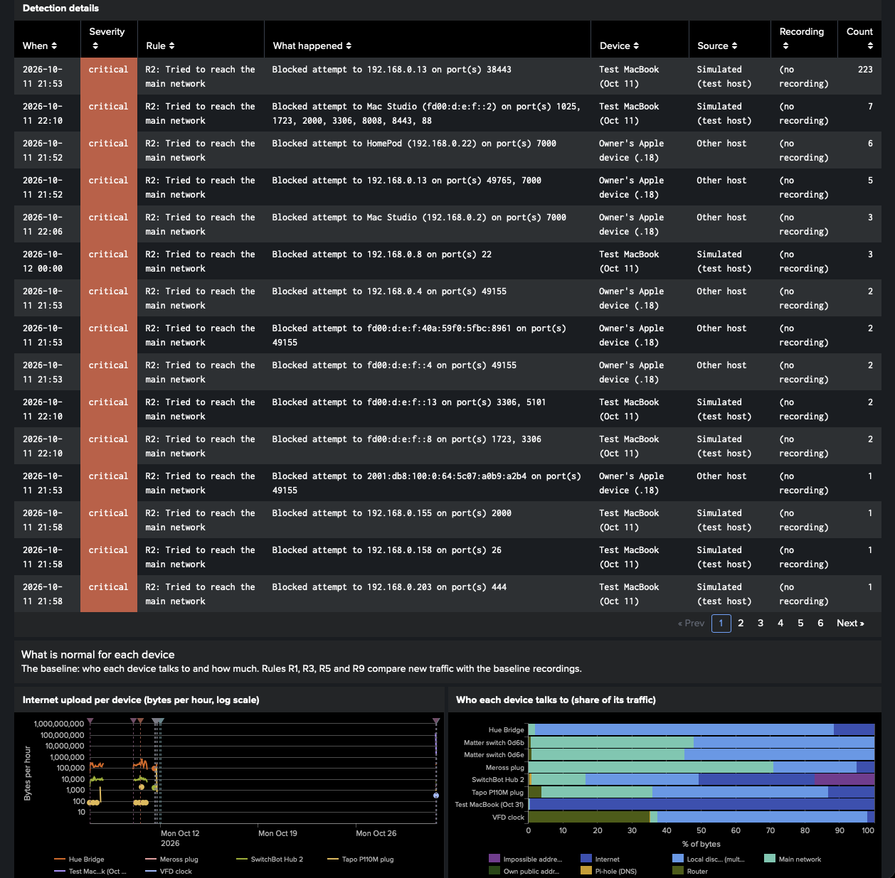

- **The detail table is sorted by severity, then by count.** Each row says in plain words what happened, on which device and in which recording. The top row is the test laptop's 223 blocked attempts to reach a main-LAN service on `192.168.0.13:38443` (the hairpin test, analysis §15.5). *Source* tells real devices from the simulated attacker.
- **Internet upload per device** (log scale) shows each device's normal hourly upload, so it's the baseline. Over All time the recordings are squeezed together; pick a recording in the filter to spread them out. The dashed markers are the operator's notes.
- **Who each device talks to:** e.g. the two Matter switches never touch the internet, only the main network (the controllers) and local discovery.

#### Device profiles and the firewall

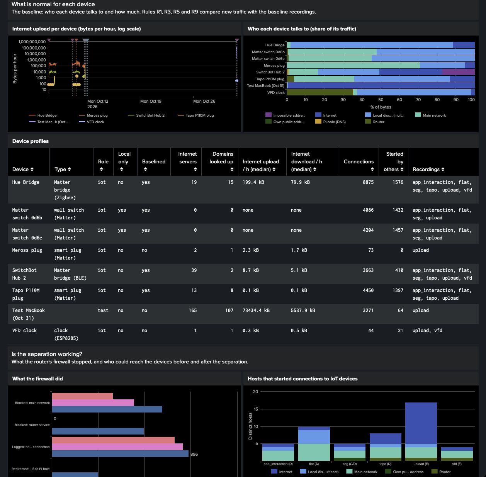

- **Device profiles:** one line per device.
  - The Hue Bridge talks to **19 internet servers** and uploads a median **199 kB per hour**.
  - The Matter switches are **local only**: 0 servers, 0 domains.
  - The test laptop's median upload is the upload test itself.
  - *Started by others* counts the connections a controller opened to the device.
- **What the firewall did** (log scale), split by real device, test host and other hosts:
  - *Logged* means a new internet connection that was allowed.
  - *Blocked* means stopped at the boundary: towards the main network, or a router service.
  - *Redirected* means DNS that was sent to Pi-hole instead.
- **Hosts that started connections to IoT devices:**
  - In the **flat** recording (state A), many main-network hosts reached the devices. After the separation only the controllers do; that is the segmentation working.
  - *Note:* the "Internet" parts of the bars are not inbound connections. The router's NAT and IPv6 firewall don't let them in. They are connections that were already running when a recording started, or replies that Zeek saw first, so the server looks like the side that started them.

#### Blocked attempts and device functions

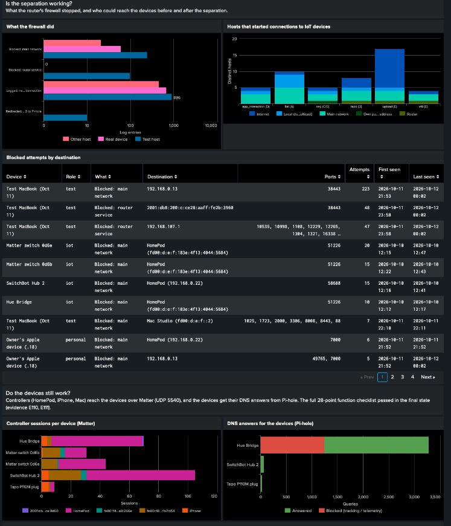

- **Blocked attempts by destination:** every blocked or redirected attempt, grouped by target:
  - the test laptop's port probes against the router (state E re-test, analysis §15.3);
  - the four devices' Matter messages to the HomePod on 10 October, 12:12–12:47 (the drops fixed by the UDP timeout change, §5.4);
  - the Keychain-joined Apple device trying AirPlay (port 7000) on the HomePod.

  The router's own public IPv6 address appears masked as `2001:db8:200:c:…` (section 10).
- **Controller sessions per device:** the HomePod (the home hub) holds most Matter sessions, and the iPhone appears when its Home app was open. This is metric 4's evidence in the traffic.
- **DNS answers:** the Hue's red part is its telemetry host `diag.meethue.com`, blocked by Pi-hole (analysis §5.2).

#### Data quality and the rules

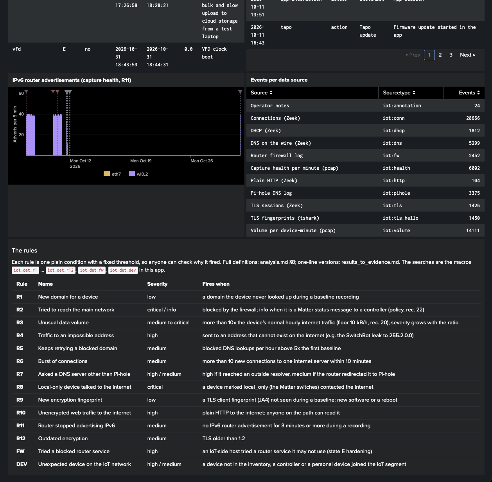

- **Recordings and operator notes:** what was recorded, when, in which state, and what was done during it.
- **IPv6 router advertisements:** about 40 per 5 minutes is normal. Select the *tapo* recording to see the 50-minute gap after the 17:03 Wi-Fi restart (R11).
- **Events per data source:** these must match `prepare_report.json`.
- **The rules table** explains every rule and its severity. The macros named there can be run in the search bar.

#### Example 1: a simulated data theft (Recording = upload)

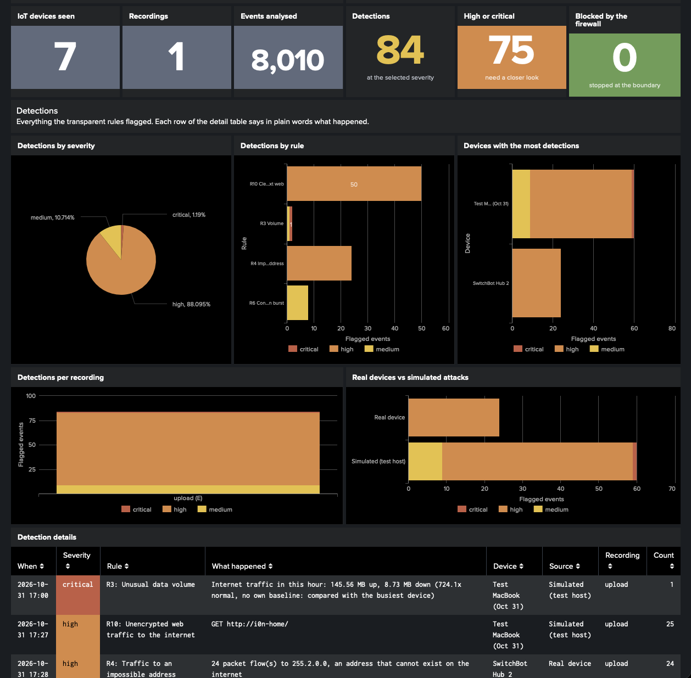

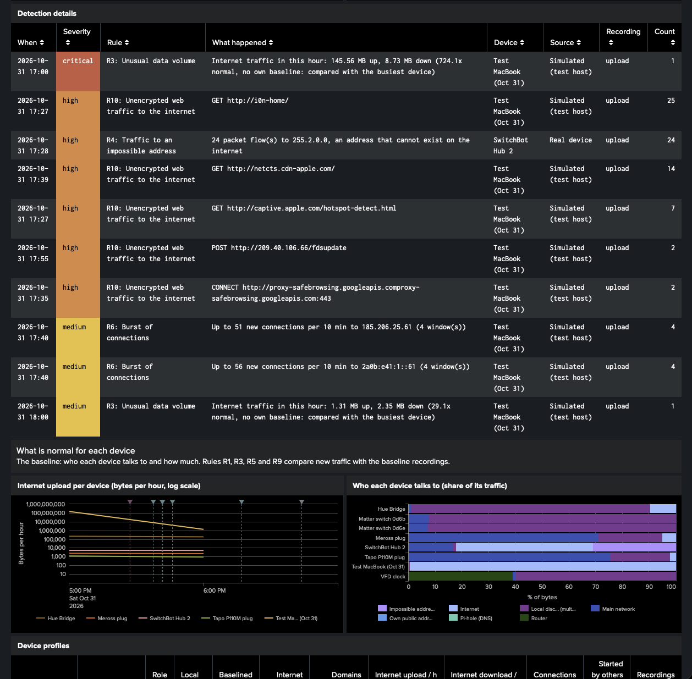

- **Counters:** with one recording selected, they shrink to **8,010** events, **84** flagged and **75** high or critical. *Blocked by the firewall* turns **green at 0**: the test laptop only uploaded to the internet, which is allowed.
- **The top finding** is R3, critical: **145.56 MB up in one hour, 724× normal** (the laptop has no baseline of its own, so it is compared with the busiest device).
- **R6** catches the slow upload: **51 and 56 new connections per 10 minutes** to the two storage-server addresses.
- **R10** flags the laptop's own plain-HTTP traffic.
- **R4** shows that the SwitchBot's leak went on during the same hour. It is a *real device* finding, which the *Source* column keeps apart from the simulation.
- **In the upload chart** the laptop's bulk hour sits two orders of magnitude above every IoT device.

#### Example 2: a quiet recording, real devices only (Recording = vfd)

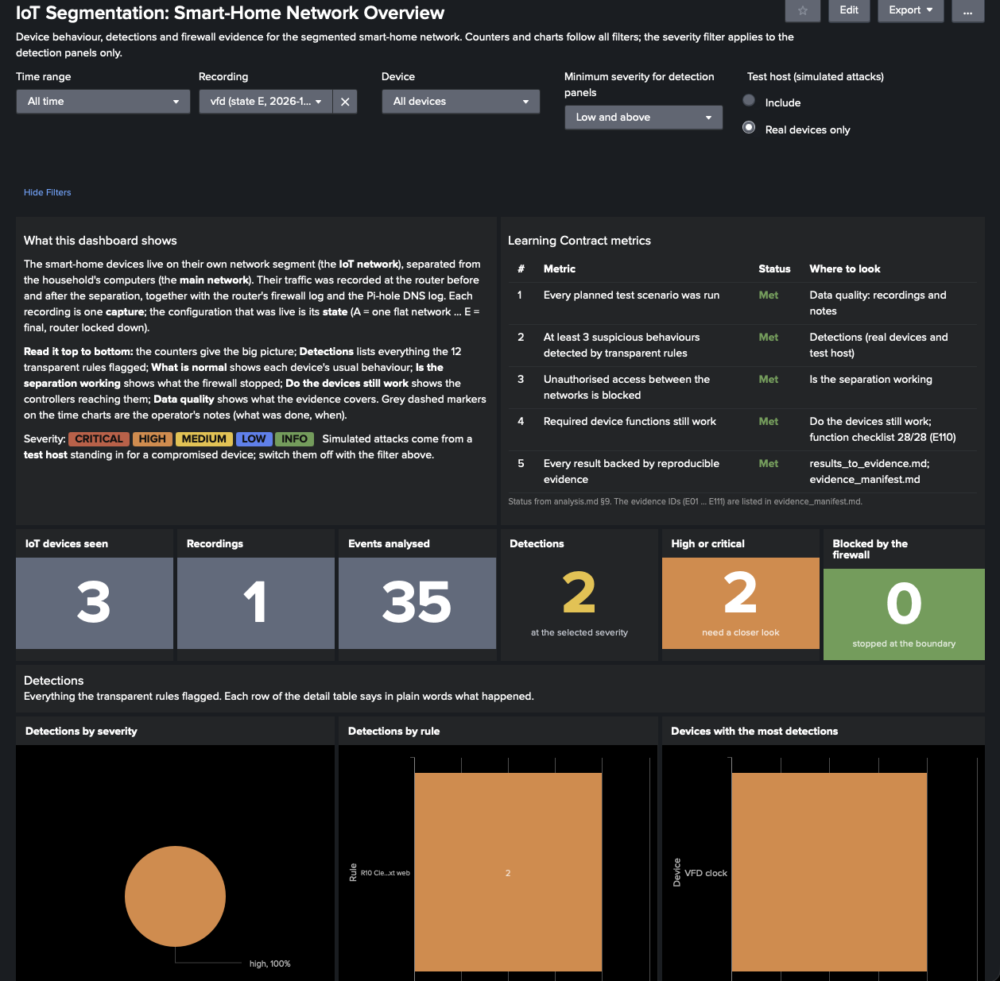

- The 40-second boot capture of the VFD clock, with the test host switched off: 3 devices, 35 events.
- **The one finding is R10, high:** the clock looks up its time zone and location over plain HTTP (analysis §16.6).
- **Blocked by the firewall** is **green at 0**.

### 7.4 The rules as macros

Every rule is a macro in the app (*Settings → Advanced search → Search macros*). Each returns the same columns: `_time`, `rule`, `rule_name`, `severity`, `device`, `device_role`, `capture`, `detail`, `count`. `` `iot_detections` `` runs them all and adds `sev_num`, `origin` (real device / simulated / router) and `rule_label`. To look at one rule in the search bar, run its macro, e.g. `` `iot_det_r3` ``.

| Macro | Rule | Severity | Fires when |
|---|---|---|---|
| `iot_det_r1` | R1 new domain | low | a baselined device looks up a domain it never used during a baseline recording (Pi-hole and on-the-wire DNS) |
| `iot_det_r2` | R2 reach the main network | critical / info | an `IOT_TO_LAN_DROP`; *info* if it's a Matter status message (source port 5540) to a controller, the expected pattern after lost connection state (rec. 22) |
| `iot_det_r3` | R3 volume | medium → critical | hourly internet upload or download above 10× the device's baseline median, with a 10 kB/h floor (rec. 20). Devices without a baseline are compared with the busiest baselined device. ≥ 30× is high, ≥ 100× critical |
| `iot_det_r4` | R4 impossible address | high | the device sends to a `bogon` address |
| `iot_det_r5` | R5 blocked retries | medium | blocked lookups per hour above 5× the device's median in the **first** baseline recording |
| `iot_det_r6` | R6 connection burst | medium | more than 10 new TCP connections to one internet server in 10 min |
| `iot_det_r7` | R7 DNS bypass | high / medium | DNS or DNS-over-TLS to anything but Pi-hole (high); *medium* when the router redirected it to Pi-hole |
| `iot_det_r8` | R8 local-only device online | critical | a `local_only` device contacts the internet |
| `iot_det_r9` | R9 new TLS fingerprint | low | a JA4 not seen during a baseline recording |
| `iot_det_r10` | R10 cleartext web | high | plain HTTP to the internet |
| `iot_det_r11` | R11 IPv6 adverts stopped | medium | 3 or more minutes without a router advertisement during a recording |
| `iot_det_r12` | R12 outdated TLS | medium | SSLv3, TLS 1.0 or 1.1 |
| `iot_det_fw` | blocked router service | high | an `IOT_TO_ROUTER_DROP` (state E hardening) |
| `iot_det_dev` | unexpected device | high / medium | an unlisted MAC, a controller or a personal device on the IoT side |

The dashboard's text and the macros are generated by `pipeline/dashboard.py`, which `iotpipe app` writes into the app. Change them there, not in Splunk, or the next upgrade overwrites your edits.

### 7.5 What you should see (reference numbers)

These were computed from the prepared events with the same logic. Use them to check that the dashboard works. With the default filters (All time, all recordings, all devices, test host included):

| Rule | Rows in the detail table | What they are (analysis section) |
|---|---|---|
| R1 | 14 | the Hue's boot-time time servers, 9 names (§13.3); the Tapo's update and cloud domains, 5 (§13.2) |
| R2 | 20 critical + 4 info | the test hosts' and the Keychain-joined Apple device's attempts (§14.2, §15.5, §16.5); the 60 Matter drops before the timeout fix as *info* (§5.4) |
| R3 | 4 | Hue firmware download, 10 Oct 15:00 (§5.3); Tapo update, 11 Oct 16:00 (§13.2); test laptop, both upload hours (§16.4). No Tapo false positive: the floor from rec. 20 removes it |
| R4 | 6 | SwitchBot to `255.2.0.0` / `254.128.0.0` in five recordings (§5.1) |
| R5 | 2 | Hue retry storm: segmented recording (21 hours) and the tapo recording (§5.2) |
| R6 | 3 | test laptop to both storage-node addresses (§16.4); SwitchBot reconnect burst, flat recording (§5.5) |
| R7 | 7 | the simulated DNS bypass from the test host, before and after state E (§14.4, §15.4) |
| R8, R9 | 0 | correct negatives: the switches never went online; no new JA4 outside reboots seen in baselines |
| R10 | 7 | Hue diagnostics (§12.3), VFD clock location lookup (§16.6), test laptop's own HTTP |
| R11 | 1 | 50 min without IPv6 adverts after the 17:03 Wi-Fi restart (§13.6) |
| R12 | 1 | Hue TLS 1.0 at boot (§13.3) |
| FW | 4 | the test host's router-access attempts in the state E re-test (§15.3) |
| DEV | 3 | the two Keychain-joined Apple devices (§14.5) and the HomePod on the IoT side (§15.6) |

The *Events analysed* counter should read **64,721**, the sum of `prepare_report.json` → `events`.

### 7.6 Reloading after a pipeline update

When the pipeline changes how events are built, as it did while the dashboard was being made, reload everything so old and new events don't mix:

1. `python3 pipeline/iotpipe.py prepare && python3 pipeline/iotpipe.py app`
2. In Splunk: delete the `iot` index and create it again (section 6.5); upgrade the app from the new `.tgz`.
3. `python3 pipeline/iotpipe.py send --url …`

## 8. Field reference

### 8.1 Fields on (almost) every event

| Field | Meaning |
|---|---|
| `_time` (`ts` in the file) | when it happened |
| `capture` | the recording it belongs to (folder label). Firewall and Pi-hole events outside any recording have it empty. |
| `state` | the configuration state of that recording (from `site.toml`) |
| `iface` | the interface the data was recorded on |
| `device`, `device_mac`, `device_role` | the device the event is about; role `iot`, `test`, `personal`, `controller` or `unknown` |
| `src_ip`, `src_port`, `dest_ip`, `dest_port` | as recorded (Zeek's `id.orig_h` etc., renamed) |

### 8.2 Peer classes

Every other-side address is classified the same way in all sourcetypes (`peer_class`; `dest_class` in `iot:fw`; the `out_*`/`in_*` columns in `iot:volume`):

| Class | Meaning |
|---|---|
| `wan` | the internet |
| `lan` | the main network (`networks.main_lan`) |
| `iot` | another address in the IoT segment |
| `router` | one of the router's own addresses |
| `dns` | the DNS filter (Pi-hole) |
| `oos` | an out-of-scope network (e.g. a flatmate's VLAN) |
| `multicast`, `broadcast`, `linklocal` | local-only traffic |
| `bogon` | an address that can't exist on the internet (reserved, `0.0.0.0/8`, `240.0.0.0/4`…), as in the SwitchBot leak |
| `own_public` | one of your own public addresses (`site.private.toml`); shown masked |
| `private_other` | a private address that isn't one of yours |

### 8.3 Per sourcetype

| Sourcetype | Key fields |
|---|---|
| `iot:conn` | `proto`, `service`, `conn_state`, `history`, `duration`, `initiated_by` (device/peer), `peer_ip`, `peer_port`, `peer_class`, `peer_name` (controller), `bytes_out`, `bytes_in` (IP bytes from the device's side), `uid`, `zeek_flipped` |
| `iot:dns` | `query`, `qtype_name`, `rcode_name`, `answers`, `uid` |
| `iot:tls` | `server_name`, `version`, `cipher`, `established`, `validation_status`, `peer_class` |
| `iot:tls_hello` | `ja4`, `ja3`, `server_name`, `peer_class` |
| `iot:http` | `method`, `host`, `uri` (redacted), `user_agent`, `status_code`, `peer_class` |
| `iot:dhcp` | `msg_types`, `assigned_addr`, `host_name`, `mac`, `lease_time` |
| `iot:volume` | `bytes_out`, `bytes_in`, `pkts_out`, `pkts_in`, `out_<class>`, `in_<class>`, `baselined`; one event per device and minute with traffic |
| `iot:health` | `frames`, `router_adverts`, `vlan_tagged_skipped`; one event per interface and minute of every recording |
| `iot:fw` | `log_prefix`, `action` (logged/blocked/redirected), `in_iface`, `out_iface`, `src_mac`, `proto`, `dest_class`, `dest_name`, `length`, `icmp_type`, `file` |
| `iot:pihole` | `client_ip`, `query`, `qtype`, `status`, `status_code`, `blocked`, `reply_time_ms`, `forward` |
| `iot:annotation` | `kind`, `label`, `text` |

### 8.4 Lookups

| Lookup | Columns |
|---|---|
| `iot_devices` | `mac`, `device`, `role`, `type`, `home_iface`, `local_only`, `baselined`, `notes` |
| `iot_controllers` | `ip`, `controller` |
| `iot_captures` | `capture`, `state`, `baseline`, `start`, `end`, `start_local`, `end_local`, `description` |

---

## 9. Pitfalls and troubleshooting

> **In short:** most problems come from the recording, not from the pipeline: hardware acceleration, log rotation and clocks. Each one cost time in this project.

| Symptom | Cause | Fix |
|---|---|---|
| Recordings show only the first few packets of each connection | the router's hardware acceleration bypasses `tcpdump` | turn it off while recording (`iot-capture.sh` does; `segmentation_report.md` 3.2) |
| Firewall log has a gap, or starts late | the router's RAM syslog rotated before you copied it | the `tail -F` command in section 3.2 |
| Fewer firewall lines than blocked packets | LOG rules are rate-limited (10–30/min) on purpose | treat the log as an alert channel; the rule counters are the full count |
| Firewall lines dated 1 January | written after a reboot, before NTP set the clock | skipped by default (`skip_unsynced`) and reported as a note |
| Firewall events in the wrong year | syslog has no year | set `[firewall] year`; otherwise the file's modification time is used |
| Times off by hours in Splunk | timezone mismatch | `[site] timezone` = the router's zone; Splunk user timezone = the same |
| The same IP shows up as two different devices | addresses get reused (`.13` was the HomePod once and a laptop later) | everything is attributed by MAC; IPs are only a fallback (`ips` in `site.toml`) |
| A device's traffic counted twice | it appeared on two capture interfaces | set its `home_iface` |
| Zeek says a device *received* a connection it actually sent | Zeek guessed the direction (history `^`) | undone automatically (`zeek_flipped=true`) |
| `not a classic pcap` | pcapng file | `editcap -F pcap in.pcapng out.pcap` |
| Other VLANs' traffic in a recording | a trunk port carries tagged frames | dropped (`skip_vlan_tagged`, Zeek `bpf = "not vlan"`); counted in `iot:health` |
| HEC: `HTTP 403` / `Invalid token` | wrong or disabled token, or HEC disabled globally | check *Global Settings → All Tokens: Enabled* |
| HEC: `HTTP 400` / `Incorrect index` | the token isn't allowed to write to `iot` | add `iot` to the token's allowed indexes |
| HEC: certificate error | Splunk's default self-signed certificate | `--insecure`, or install a proper certificate |
| Upload preview warns *"Breaking event because limit of 256 has been exceeded"*, *"MAX_EVENTS (256) was exceeded"* and *"Failed to parse timestamp. Defaulting to file modtime"* | the preview isn't using the app's rules: wrong source type selected (automatic or `_json`), or Splunk not restarted after installing the app | pick the `iot:*` source type in the dropdown; restart Splunk; check with `btool` (section 6.1). If the events were already submitted, delete and recreate the index (section 6.5) |
| Uploaded events all have the upload time, or several lines merged into one event | same as above | same as above |
| Everything appears twice | data sent twice | section 6.5 |

---

## 10. Privacy and sharing

> **In short:** the outputs describe your household's devices in detail. Keep them private, leave out anything that isn't yours, and never put the HEC token in a file.

- **What the events contain:** device MACs and names, internal addresses, the cloud services each device uses, the domains it looks up, and timestamps of what you did. Share them only with people who should know how your home network works.
- **Other people's data:** `out_of_scope` networks and the Zeek filter `not vlan` keep a flatmate's network out. Traffic of other household hosts is dropped unless `keep_unattributed = true`. The Pi-hole export is reduced to IoT clients. Double-check your config before analysing a network you share.
- **Secrets in traffic:** URL parameters listed in `[privacy] redact_url_params` are replaced with `<redacted>` (the Hue's `sso` token, for example). Cleartext protocols can carry other secrets; look at `iot:http` before sharing.
- **The HEC token** comes only from the `SPLUNK_HEC_TOKEN` environment variable. Revoke it when the project ends.
- **Your own public addresses** do appear in raw data: in this project, in 37 connection events (devices had public IPv6 addresses before segmentation) and 49 firewall events (attempts to reach the router's WAN side). List them in `site.private.toml` and every output masks them to documentation ranges (`2001:db8::/32`, `198.51.100.0/24`), keeping the host part, so different hosts stay distinguishable. `iotpipe check` shows how many prefixes are masked. Addresses of the cloud services that devices talked to are kept: they're the evidence.
- **Intermediate files:** `pipeline_out/zeek/` holds Zeek's raw logs, unmasked and unfiltered. Treat it like the pcaps; only `pipeline_out/splunk/` is meant to leave the machine.

---

## 11. How this relates to the project's evidence

> **In short:** the pipeline version that produced the dashboard is hashed evidence (E112–E118), like the analysis tools. Its output is regenerable, and its results match the analysis (analysis §18).

- **Hashed as evidence** (`evidence_manifest.md`, `SHA256SUMS`):

  | ID | What |
  |---|---|
  | E112 | `pipeline/iotpipe.py` |
  | E113 | `pipeline/dashboard.py` (detection macros and dashboard) |
  | E114 | `pipeline/zeek/iot-local.zeek` |
  | E115 | `pipeline/site.toml` |
  | E116 | `pipeline/site.example.toml` |
  | E117 | `pipeline/annotations.csv` |
  | E118 | the cropped screenshots in `pipeline/guide_images/` |
  | E119 | the original screenshots in `dashboard_screenshots/`: **High** sensitivity, because the browser bar shows the household's DDNS host name; share only E118 |

  If the pipeline changes later, re-hash and describe the new version, as with any other evidence.
- **Not hashed:**
  - This guide: a document, like the reports.
  - `pipeline/site.private.toml`: holds the household's real public prefixes; never shared.
  - `pipeline_out/`: regenerable with `python3 pipeline/iotpipe.py all`. Run from scratch, including Zeek, it reproduces the same 64,721 events.
- **Relation to the analysis tools:** the pipeline doesn't replace the tools in `tools/`, which produced the numbers in `analysis.md` and stay unchanged. It's a general, configurable re-implementation for Splunk. Rebuilt independently, it reproduces their numbers (section 5.2 and analysis §18.2). Where its rules deliberately differ from the analysis (the R3 floor, Matter messages as *info*, R1 only for baselined devices), analysis §18.3 says why.
- **Metric 5:** the dashboard closed its last gap (analysis §9, §18.5).

## 12. Command cheat sheet

```sh
# once per machine
bash tools/setup_env.sh                                  # Debian/Ubuntu: Zeek, tshark (+ nmap, jq)

# once per site
cp pipeline/site.example.toml pipeline/site.toml         # then edit it (section 4)

# every time there's new data
python3 pipeline/iotpipe.py check
python3 pipeline/iotpipe.py zeek
python3 pipeline/iotpipe.py prepare
python3 pipeline/iotpipe.py app                          # re-install the .tgz in Splunk if site.toml changed

# into Splunk over HEC
export SPLUNK_HEC_TOKEN='…'
python3 pipeline/iotpipe.py send --url https://splunk.example:8088 [--insecure]

# in Splunk
`iot_index` | stats count by sourcetype                   # compare with pipeline_out/prepare_report.json
```

On the router, during any test:

```sh
tail -F /tmp/syslog.log | grep --line-buffered -E 'IOT_' > /tmp/FW_live.log &
```
