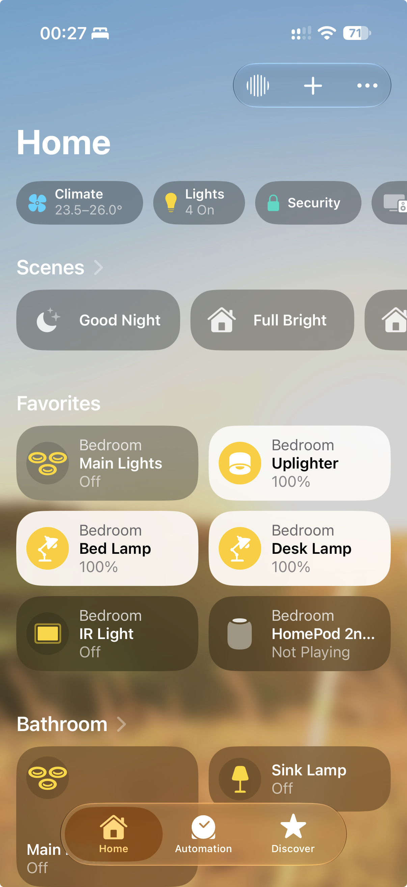
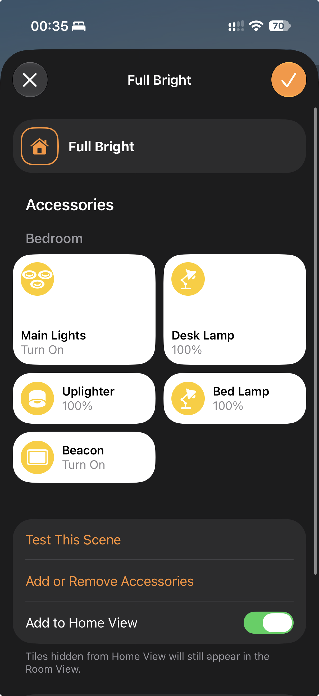
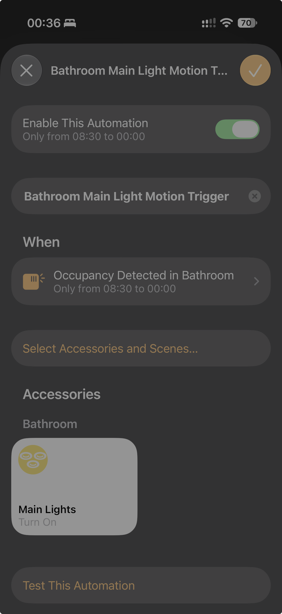
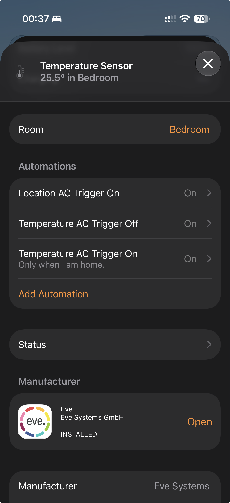
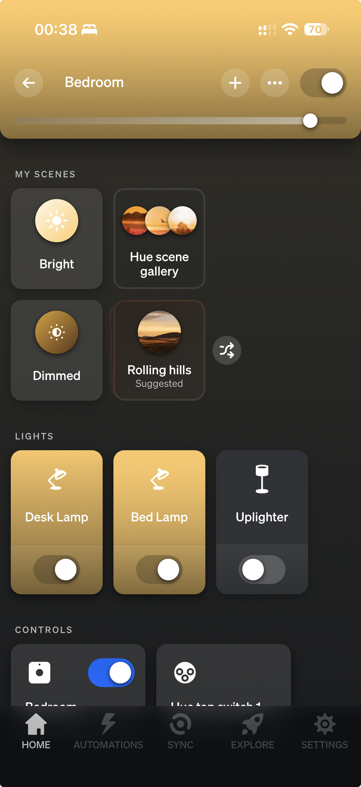
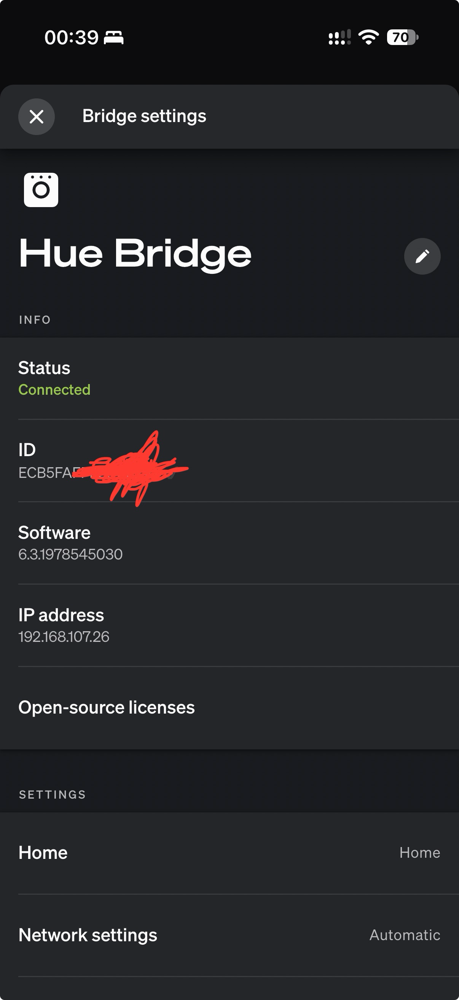
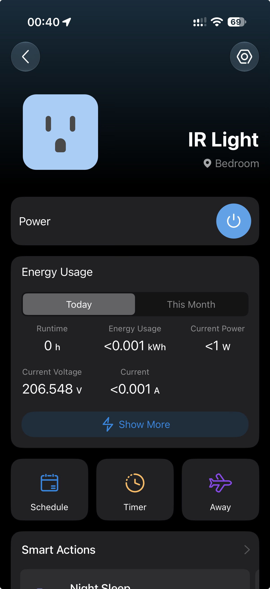
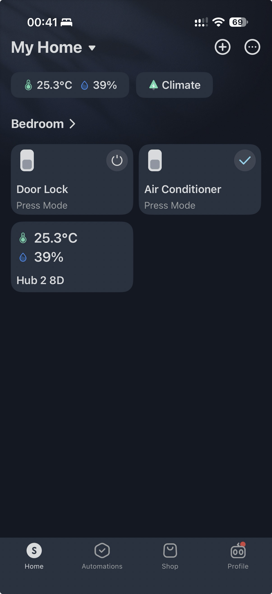
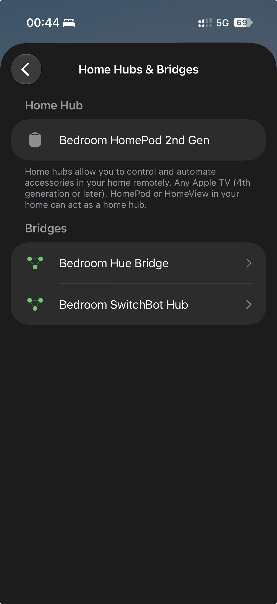
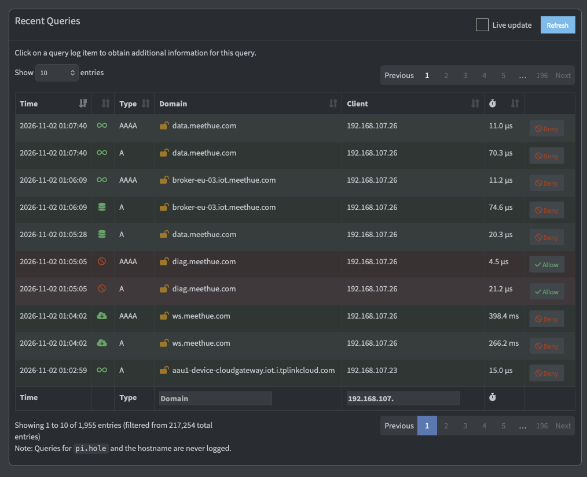

# Function checklist: state E (template)

Closes **Learning Contract metric 4** ("all documented required device functions continue after segmentation"; `analysis.md` §9, gap: *a written function checklist, including remote access via the HomePod while away*).

**How to use:** copy this file to `function_check/function_checklist_<YYYYMMDD>.md`, fill it in during the run, and put the screenshots in `function_check/screenshots/`, named after the row ID (e.g. `A3_tapo_home_app.png`). The filled copy and the screenshots become evidence (new E-IDs). This template stays in `planning/` and isn't evidence.

**Result codes:** ✅ pass · ⚠️ pass with a remark · ❌ fail · n/a not applicable (say why)

---

## 0. Run details

| Item | Value |
|---|---|
| Date | 02/11/2026 |
| Tester | Zhenfu Shi |
| Router state | E (repo `904f54d`; confirm no undeployed changes: `md5sum /jffs/scripts/firewall-start` vs the repo copy) |
| Router uptime at start (`uptime`) | 113154s |
| iPhone | on main Wi-Fi (`ASUS_BE88U_I0N*`), *not* on `I0N_IoT` |
| Start / end time | 0:17 - 1:21 |

## P. Preconditions (check before anything else)

| ID | Check | How | Expected | Result | Time | Evidence |
|---|---|---|---|---|---|---|
| P1 | HomePod is on the **main LAN** | router: `grep -i ac:bc:b5:d3:d1:dd /var/lib/misc/dnsmasq.leases` (or the web UI client list) | address `192.168.0.22`, **not** `192.168.107.x` (it drifted onto the IoT SSID once; analysis §15.6) | Pass | 0:19 | 69919 ac:bc:b5:d3:d1:dd 192.168.0.22 HomePod-2nd-Gen 01:ac:bc:b5:d3:d1:dd<br/>80028 0 fd00:d:e:f::61 HomePod-2nd-Gen 00:01:00:01:2f:6f:ea:7f:ac:bc:b5:d3:d1:dd |
| P2 | All IoT devices hold IoT leases | router: `grep 192.168.107. /var/lib/misc/dnsmasq-1.leases` | Hue `.26`, SwitchBot `.15`, Tapo `.23`, switches `.17` / `.20`; plus the two newer devices: Meross plug `.2` (`c4:e7:ae:20:54:57`), VFD clock `.22` (`d8:f1:5b:90:ee:b3`) | Pass | 0:21 | 59605 8c:87:d0:09:0d:6e 192.168.107.20 * *<br/>60539 8c:87:d0:09:0d:6b 192.168.107.17 wlan0 *<br/>80251 c4:e7:ae:20:54:57 192.168.107.2 * *<br/>62226 7c:f1:7e:10:03:a0 192.168.107.23 P110M *<br/>66660 ec:b5:fa:bc:52:10 192.168.107.26 ecb5fabc5210 *<br/>62573 d8:f1:5b:90:ee:b3 192.168.107.22 LGL-VFD-CLOCK-EEB3 01:d8:f1:5b:90:ee:b3<br/>62262 0c:4e:a0:30:22:54 192.168.107.15 SwitchBot-Hub-2-302254 01:0c:4e:a0:30:22:54 |
| P3 | No other personal device on `I0N_IoT` | same lease file, plus the web UI client list | only the seven devices in P2 (and the MacBook if it's in use for the upload scenario). Keychain is clean since 2026-10-28. | Pass | 0:22 | No entries other than the above |
| P4 | Hardening active | router: `iptables -nL IOT_INPUT \| head -3`; `iptables -t nat -nL PREROUTING \| grep -c IOT_DNS_REDIRECT` | chain present; 2 redirect LOG rules | Pass | 0:23 | Chain IOT_INPUT (1 references)<br/>target     prot opt source               destination         <br/>ACCEPT     all  --  0.0.0.0/0            0.0.0.0/0            state RELATED,ESTABLISHED<br/>2 |

## A. Local control (Apple Home / Matter)

| ID | Function | Test step | Expected | Result | Time | Evidence |
|---|---|---|---|---|---|---|
| A1 | Hue lights via Matter | Home app: toggle one Hue light on → off | changes within ~2 s, state shown correctly | Pass | 0:28 | Confirmed visually<br /> |
| A2 | SwitchBot Bot via Matter bridge | Home app: press one Bot | Bot actuates; tile updates | Pass | 0:28 | Confirmed visually |
| A3 | Tapo plug | Home app: toggle the plug on → off | relay clicks; power reading updates | Pass | 0:28 | Confirmed visually |
| A4 | Matter switch `0d6b` | Home app: toggle | switch actuates, no "No Response" | Pass | 0:28 | Confirmed visually |
| A5 | Matter switch `0d6e` | Home app: toggle | as A4 | Pass | 0:28 | Confirmed visually |
| A6 | Status reports (the Matter fix, analysis §5.4) | leave the Home app closed ≥ 5 min, then change a device **physically** (switch button / plug button), open the app | new state shown without a manual refresh; router: `grep IOT_TO_LAN_DROP /tmp/syslog.log \| grep -c 5540` = 0 for the window | Pass | 0:34 | 0; confirmed in app (2 matter switches) |
| A7 | HomeKit scene | run a scene that includes ≥ 2 IoT devices | all included devices change | Pass | 0:34 | Confimed visually<br /> |
| A8 | HomeKit automation | trigger an automation that includes an IoT device (time-based: set it 2 min ahead) | runs on time (executed by the HomePod) | Pass | 0:35 | Motion -> Light automation executes<br /> |
| A9 | Eve Room (Thread, via the HomePod) | Home app: Eve Room readings | values current (timestamp within minutes); confirms the hub's Thread side is fine | Pass | 0:36 | Confirmed in app<br /> |

## B. Vendor apps

| ID | Function | Test step | Expected | Result | Time | Evidence |
|---|---|---|---|---|---|---|
| B1 | Hue app, local | iPhone on main Wi-Fi: Hue app, toggle a light | works (local HTTPS to the bridge) | Pass | 0:38 | Confirmed visually<br /> |
| B2 | Hue app, bridge status | Hue app → Settings → Hue Bridges | bridge "connected", software up to date (or update available) | Pass | 0:39 | Connected<br /> |
| B3 | Tapo app | toggle the plug; open energy usage | works; usage data present | Pass | 0:40 | Confirmed visually<br /> |
| B4 | SwitchBot app | open the hub; press a Bot | works; hub online | Pass | 0:41 | Confirmed visually<br /> |

## C. Remote access (the explicit gap)

Turn **Wi-Fi off** on the iPhone (cellular only) for the whole section.

| ID | Function | Test step | Expected | Result | Time | Evidence |
|---|---|---|---|---|---|---|
| C1 | Home app remote control via the HomePod | toggle a Hue light, the Tapo plug and one Matter switch | each changes; Home app shows "home hub connected" | Pass | 0:47 | Confirmed visually<br /> |
| C2 | Remote status | change a device physically (someone at home, or use C1's result) and watch the Home app | state updates remotely | Pass | 0:47 | Confirmed in app |
| C3 | Hue app remote | toggle a light in the Hue app (cloud path) | works | Pass | 0:48 | Confirmed visually |
| C4 | Tapo / SwitchBot apps remote | one action each | works | Pass | 0:49 | Confirmed visually |

## D. Resilience (state E fixes under load)

Run D1 first, then D2 only if you're fine with a full reboot.

| ID | Function | Test step | Expected | Result | Time | Evidence |
|---|---|---|---|---|---|---|
| D1 | Wireless restart | router: `service restart_wireless`; wait 3 min; then `for b in br0 br52 br56; do echo $b $(cat /sys/class/net/$b/bridge/stp_state); done`; `ip -6 addr show dev br52 \| grep fd00:d:e:6b::1`; repeat A1, A3, A4, A5 | STP 1 / 0 / 1; IoT ULA present; all four controls work within 3 min (note any device that needs longer) | Pass* | 0:54 | `br0 1<br/>br52 0<br/>br56 1`<br />`   inet6 fd00:d:e:6b::1/64 scope global`<br />A1, A3, A4, A5 confirmed visually<br />Transient failure of Tapo plug: initially responsive (relay clicked) then stopped responding but remained in the home app as responding (displayed as working but relay did not click); cleared after a power cycle and no more failures. |
| D2 | Router reboot | reboot; note the time the web UI is back; then P2 and A1–A5 | all devices leased and controllable; note the slowest device's recovery time | Pass | 0:59 | Reboot initiated at 0:59:30; web ui came back at 1:01:38; all devices confirmed online at 01:02:59<br />`86327 ec:b5:fa:bc:52:10 192.168.107.26 ecb5fabc5210 *<br/>86331 d8:f1:5b:90:ee:b3 192.168.107.22 LGL-VFD-CLOCK-EEB3 01:d8:f1:5b:90:ee:b3<br/>86335 7c:f1:7e:10:03:a0 192.168.107.23 P110M *<br/>86349 8c:87:d0:09:0d:6e 192.168.107.20 * *<br/>86357 8c:87:d0:09:0d:6b 192.168.107.17 wlan0 *<br/>86357 c4:e7:ae:20:54:57 192.168.107.2 * *<br/>86357 0c:4e:a0:30:22:54 192.168.107.15 SwitchBot-Hub-2-302254 01:0c:4e:a0:30:22:54` |
| D3 | Matter sessions after D1/D2 | router: `grep -E 'port=5540' /proc/net/nf_conntrack \| grep -cE '192\.168\.107\.\|fd00:d:e:6b:'` | ≥ 5 (HomePod ↔ each Matter device) | Pass | 1:06 | 12 |

## E. Background services

| ID | Function | Test step | Expected | Result | Time | Evidence |
|---|---|---|---|---|---|---|
| E1 | NTP for IoT | router: `ps w \| grep '[n]tp -n -l -I br52'`; the counter `iptables -vnL IOT_INPUT \| grep 'dpt:123'` rises over 15 min | VLAN ntpd running; requests served | Pass | 1:07 | `13369 i0ntempe  3120 S    /usr/sbin/ntp -n -l -I br52`; counter rise confirmed (final value 21) |
| E2 | DNS via Pi-hole | Pi-hole query log, filtered on `192.168.107.` | queries from the devices in the last hour, all answered | Pass | 1:09 | Confirmed on Pi-hole web UI<br /> |
| E3 | Firmware-update path | Hue / Tapo / SwitchBot apps: "check for updates" | check succeeds (an update needn't be available) | Pass | 1:12 | All checks returns up to date; no failures |
| E4 | Newer devices (informative; not in the documented function set) | Meross plug: toggle in its app; VFD clock: shows the correct time after its NTP sync | both work; record anything unusual | Pass | 1:13 | Plug functioning; VFD clock synced and providing NTP service |

---

## Summary (fill in last)

| Section | Pass | Remarks | Fail |
|---|---|---|---|
| P preconditions | 4 | | 0 |
| A local control | 9 | | 0 |
| B vendor apps | 4 | | 0 |
| C remote access | 4 | | 0 |
| D resilience | 3 | `IOT_TO_LAN_DROP` after router reboot | 0 |
| E background | 4 | `IOT_TO_LAN_DROP` during firmware update | 0 |

**Overall:** metric 4 met.

**Router snapshot at the end** (saved with the evidence): `iptables -vnL FORWARD --line-numbers`, `iptables -vnL IOT_INPUT`, `grep -E '192\.168\.107\.|fd00:d:e:6b:' /proc/net/nf_conntrack`, and `grep -hE 'IOT_(TO_LAN_DROP|TO_ROUTER_DROP)' /tmp/syslog.log-1 /tmp/syslog.log` for the run window (expect no real-device entries).

```
num   pkts bytes target     prot opt in     out     source               destination         
1      123 11724 LOG        all  --  br52   eth1    0.0.0.0/0            0.0.0.0/0            state NEW limit: avg 30/min burst 60 LOG flags 0 level 4 prefix "IOT_TO_WAN_NEW "
2        0     0 DROP       udp  --  br52   eth1    0.0.0.0/0            0.0.0.0/0            udp dpt:853
3        0     0 DROP       tcp  --  br52   eth1    0.0.0.0/0            0.0.0.0/0            tcp dpt:853
4        0     0 ACCEPT     icmp --  br52   br0     0.0.0.0/0            0.0.0.0/0            icmptype 8
5        0     0 ACCEPT     tcp  --  br52   br0     0.0.0.0/0            192.168.0.8          tcp dpt:53
6       28  1826 ACCEPT     udp  --  br52   br0     0.0.0.0/0            192.168.0.8          udp dpt:53
7      225 26532 ACCEPT     all  --  br0    br52    0.0.0.0/0            0.0.0.0/0           
8      276  117K ACCEPT     all  --  br52   br0     0.0.0.0/0            0.0.0.0/0            state RELATED,ESTABLISHED
9       15  1035 LOG        all  --  br52   br0     0.0.0.0/0            0.0.0.0/0            limit: avg 10/min burst 5 LOG flags 0 level 4 prefix "IOT_TO_LAN_DROP "
10      15  1035 DROP       all  --  br52   br0     0.0.0.0/0            0.0.0.0/0           
11       0     0 DROP       all  --  br52   *       0.0.0.0/0            192.168.255.0/30    
12       0     0 DROP       all  --  br56   *       0.0.0.0/0            192.168.255.0/30    
13       0     0 ACCEPT     all  --  br0    *       0.0.0.0/0            192.168.255.0/30    
14   47510 8249K NWFF       all  --  *      *       0.0.0.0/0            0.0.0.0/0           
15   47510 8249K URLFF      all  --  *      *       0.0.0.0/0            0.0.0.0/0           
16   47510 8249K IPSEC_DROP_SUBNET_ICMP  all  --  *      *       0.0.0.0/0            0.0.0.0/0           
17   47510 8249K IPSECSSDN  all  --  *      *       0.0.0.0/0            0.0.0.0/0           
18   47510 8249K IPSEC_STRONGSWAN  all  --  *      *       0.0.0.0/0            0.0.0.0/0           
19    4087  233K TCPMSS     tcp  --  *      *       0.0.0.0/0            0.0.0.0/0            tcpflags: 0x06/0x02 TCPMSS clamp to PMTU
20   41100 7714K ACCEPT     all  --  *      *       0.0.0.0/0            0.0.0.0/0            state RELATED,ESTABLISHED
21    6410  535K WGSF       all  --  *      *       0.0.0.0/0            0.0.0.0/0           
22    6410  535K OVPNSF     all  --  *      *       0.0.0.0/0            0.0.0.0/0           
23       0     0 ACCEPT     all  --  br0    br0     0.0.0.0/0            0.0.0.0/0           
24      83  3580 DROP       all  --  *      *       0.0.0.0/0            0.0.0.0/0            state INVALID
25    1346 75005 ACCEPT     all  --  *      *       0.0.0.0/0            0.0.0.0/0            ctstate DNAT
26    4981  457K WGCF       all  --  *      *       0.0.0.0/0            0.0.0.0/0           
27    4981  457K OVPNCF     all  --  *      *       0.0.0.0/0            0.0.0.0/0           
28    4981  457K VPNCF      all  --  *      *       0.0.0.0/0            0.0.0.0/0           
29    4981  457K SDN_FF     all  --  *      *       0.0.0.0/0            0.0.0.0/0           
30      36  3125 ACCEPT     all  --  br0    *       0.0.0.0/0            0.0.0.0/0           
31       5   404 DROP       all  --  *      *       0.0.0.0/0            0.0.0.0/0   
```

```
Chain IOT_INPUT (1 references)
 pkts bytes target     prot opt in     out     source               destination         
    1    76 ACCEPT     all  --  *      *       0.0.0.0/0            0.0.0.0/0            state RELATED,ESTABLISHED
   22  1672 ACCEPT     udp  --  *      *       0.0.0.0/0            0.0.0.0/0            udp dpt:123
 7401 2250K ACCEPT     udp  --  *      *       0.0.0.0/0            0.0.0.0/0            udp dpt:5353
    0     0 ACCEPT     udp  --  *      *       0.0.0.0/0            0.0.0.0/0            udp dpt:67
    0     0 ACCEPT     icmp --  *      *       0.0.0.0/0            0.0.0.0/0           
    0     0 ACCEPT     2    --  *      *       0.0.0.0/0            0.0.0.0/0           
    0     0 LOG        all  --  *      *       0.0.0.0/0            0.0.0.0/0            limit: avg 10/min burst 5 LOG flags 0 level 4 prefix "IOT_TO_ROUTER_DROP "
    0     0 DROP       all  --  *      *       0.0.0.0/0            0.0.0.0/0           
```

```
ipv4     2 udp      17 1537 src=192.168.0.22 dst=192.168.107.15 sport=62864 dport=5540 src=192.168.107.15 dst=192.168.0.22 sport=5540 dport=62864 [ASSURED] mark=17504 iqprio=0 swaccel=0 hwaccel=0 use=2
ipv4     2 tcp      6 2381 ESTABLISHED src=192.168.107.2 dst=52.2.244.206 sport=58521 dport=443 src=52.2.244.206 dst=198.51.100.55 sport=443 dport=58521 [ASSURED] mark=104 iqprio=0 swaccel=3 hwaccel=0 use=2
ipv4     2 udp      17 918 src=192.168.0.221 dst=192.168.107.20 sport=59430 dport=5540 src=192.168.107.20 dst=192.168.0.221 sport=5540 dport=59430 [ASSURED] mark=15680 iqprio=0 swaccel=0 hwaccel=0 use=2
ipv4     2 udp      17 1532 src=192.168.0.22 dst=192.168.107.26 sport=62864 dport=5540 src=192.168.107.26 dst=192.168.0.22 sport=5540 dport=62864 [ASSURED] mark=13432 iqprio=0 swaccel=0 hwaccel=0 use=2
ipv4     2 udp      17 5 src=192.168.107.26 dst=162.159.200.123 sport=47896 dport=123 src=162.159.200.123 dst=198.51.100.55 sport=123 dport=47896 mark=93496 iqprio=0 swaccel=0 hwaccel=0 use=2
ipv4     2 tcp      6 2391 ESTABLISHED src=192.168.107.26 dst=34.117.13.189 sport=36296 dport=443 src=34.117.13.189 dst=198.51.100.55 sport=443 dport=36296 [ASSURED] mark=23352 iqprio=0 swaccel=0 hwaccel=0 use=2
ipv4     2 udp      17 29 src=192.168.107.26 dst=224.0.0.251 sport=5353 dport=5353 [UNREPLIED] src=224.0.0.251 dst=192.168.107.26 sport=5353 dport=5353 mark=58721340 iqprio=1 swaccel=0 hwaccel=0 use=2
ipv4     2 udp      17 29 src=192.168.107.1 dst=224.0.0.251 sport=5353 dport=5353 [UNREPLIED] src=224.0.0.251 dst=192.168.107.1 sport=5353 dport=5353 mark=2147485212 iqprio=1 swaccel=0 hwaccel=0 use=8
ipv4     2 udp      17 906 src=192.168.0.221 dst=192.168.107.26 sport=59430 dport=5540 src=192.168.107.26 dst=192.168.0.221 sport=5540 dport=59430 [ASSURED] mark=13456 iqprio=0 swaccel=0 hwaccel=0 use=2
ipv4     2 tcp      6 2387 ESTABLISHED src=192.168.107.26 dst=35.233.55.222 sport=51144 dport=443 src=35.233.55.222 dst=198.51.100.55 sport=443 dport=51144 [ASSURED] mark=16872 iqprio=0 swaccel=0 hwaccel=0 use=2
ipv4     2 udp      17 1533 src=192.168.0.22 dst=192.168.107.20 sport=62864 dport=5540 src=192.168.107.20 dst=192.168.0.22 sport=5540 dport=62864 [ASSURED] mark=71896 iqprio=0 swaccel=0 hwaccel=0 use=2
ipv4     2 udp      17 903 src=192.168.0.2 dst=192.168.107.23 sport=55686 dport=5540 src=192.168.107.23 dst=192.168.0.2 sport=5540 dport=55686 [ASSURED] mark=12344 iqprio=0 swaccel=0 hwaccel=0 use=2
ipv4     2 udp      17 903 src=192.168.0.221 dst=192.168.107.2 sport=59430 dport=5540 src=192.168.107.2 dst=192.168.0.221 sport=5540 dport=59430 [ASSURED] mark=12400 iqprio=0 swaccel=0 hwaccel=0 use=2
ipv4     2 tcp      6 2344 ESTABLISHED src=192.168.107.15 dst=98.94.143.192 sport=51654 dport=8883 src=98.94.143.192 dst=198.51.100.55 sport=8883 dport=51654 [ASSURED] mark=12056 iqprio=0 swaccel=0 hwaccel=0 use=2
```

```
Nov  2 01:02:31 kernel: IOT_TO_LAN_DROP IN=br52 OUT=br0 MAC=92:28:aa:2b:39:62:ec:b5:fa:bc:52:10:08:00 SRC=192.168.107.26 DST=192.168.0.22 LEN=153 TOS=0x00 PREC=0x00 TTL=63 ID=48920 DF PROTO=UDP SPT=5540 DPT=62864 LEN=133 
Nov  2 01:02:32 kernel: IOT_TO_LAN_DROP IN=br52 OUT=br0 MAC=92:28:aa:2b:39:62:ec:b5:fa:bc:52:10:08:00 SRC=192.168.107.26 DST=192.168.0.22 LEN=153 TOS=0x00 PREC=0x00 TTL=63 ID=48928 DF PROTO=UDP SPT=5540 DPT=62864 LEN=133 
Nov  2 01:02:33 kernel: IOT_TO_LAN_DROP IN=br52 OUT=br0 MAC=92:28:aa:2b:39:62:ec:b5:fa:bc:52:10:08:00 SRC=192.168.107.26 DST=192.168.0.22 LEN=153 TOS=0x00 PREC=0x00 TTL=63 ID=48966 DF PROTO=UDP SPT=5540 DPT=62864 LEN=133 
Nov  2 01:02:34 kernel: IOT_TO_LAN_DROP IN=br52 OUT=br0 MAC=92:28:aa:2b:39:62:ec:b5:fa:bc:52:10:08:00 SRC=192.168.107.26 DST=192.168.0.22 LEN=153 TOS=0x00 PREC=0x00 TTL=63 ID=49062 DF PROTO=UDP SPT=5540 DPT=62864 LEN=133 
Nov  2 01:02:35 kernel: IOT_TO_LAN_DROP IN=br52 OUT=br0 MAC=92:28:aa:2b:39:62:ec:b5:fa:bc:52:10:08:00 SRC=192.168.107.26 DST=192.168.0.22 LEN=153 TOS=0x00 PREC=0x00 TTL=63 ID=49116 DF PROTO=UDP SPT=5540 DPT=62864 LEN=133 
Nov  2 01:02:50 kernel: IOT_TO_LAN_DROP IN=br52 OUT=br0 MAC=92:28:aa:2b:39:62:8c:87:d0:09:0d:6b:08:00 SRC=192.168.107.17 DST=192.168.0.22 LEN=69 TOS=0x00 PREC=0x00 TTL=254 ID=27092 PROTO=UDP SPT=5540 DPT=62864 LEN=49 
Nov  2 01:02:51 kernel: IOT_TO_LAN_DROP IN=br52 OUT=br0 MAC=92:28:aa:2b:39:62:8c:87:d0:09:0d:6b:08:00 SRC=192.168.107.17 DST=192.168.0.22 LEN=69 TOS=0x00 PREC=0x00 TTL=254 ID=27093 PROTO=UDP SPT=5540 DPT=62864 LEN=49 
Nov  2 01:02:51 kernel: IOT_TO_LAN_DROP IN=br52 OUT=br0 MAC=92:28:aa:2b:39:62:8c:87:d0:09:0d:6b:08:00 SRC=192.168.107.17 DST=192.168.0.22 LEN=69 TOS=0x00 PREC=0x00 TTL=254 ID=27094 PROTO=UDP SPT=5540 DPT=62864 LEN=49 
Nov  2 01:02:52 kernel: IOT_TO_LAN_DROP IN=br52 OUT=br0 MAC=92:28:aa:2b:39:62:8c:87:d0:09:0d:6b:08:00 SRC=192.168.107.17 DST=192.168.0.22 LEN=69 TOS=0x00 PREC=0x00 TTL=254 ID=27096 PROTO=UDP SPT=5540 DPT=62864 LEN=49 
Nov  2 01:02:54 kernel: IOT_TO_LAN_DROP IN=br52 OUT=br0 MAC=92:28:aa:2b:39:62:8c:87:d0:09:0d:6b:08:00 SRC=192.168.107.17 DST=192.168.0.22 LEN=69 TOS=0x00 PREC=0x00 TTL=254 ID=27097 PROTO=UDP SPT=5540 DPT=62864 LEN=49 
Nov  2 01:12:32 kernel: IOT_TO_LAN_DROP IN=br52 OUT=br0 MAC=92:28:aa:2b:39:62:8c:87:d0:09:0d:6b:08:00 SRC=192.168.107.17 DST=192.168.0.221 LEN=69 TOS=0x00 PREC=0x00 TTL=254 ID=27118 PROTO=UDP SPT=5540 DPT=59430 LEN=49 
Nov  2 01:12:33 kernel: IOT_TO_LAN_DROP IN=br52 OUT=br0 MAC=92:28:aa:2b:39:62:8c:87:d0:09:0d:6b:86:dd SRC=fd00:000d:000e:006b:8e87:d0ff:fe09:0d6b DST=fd00:000d:000e:000f:1c6b:3f9c:ab3a:5e30 LEN=89 TC=0 HOPLIMIT=254 FLOWLBL=0 PROTO=UDP SPT=5540 DPT=55414 LEN=49 
Nov  2 01:12:34 kernel: IOT_TO_LAN_DROP IN=br52 OUT=br0 MAC=92:28:aa:2b:39:62:8c:87:d0:09:0d:6b:08:00 SRC=192.168.107.17 DST=192.168.0.221 LEN=69 TOS=0x00 PREC=0x00 TTL=254 ID=27119 PROTO=UDP SPT=5540 DPT=59430 LEN=49 
Nov  2 01:12:36 kernel: IOT_TO_LAN_DROP IN=br52 OUT=br0 MAC=92:28:aa:2b:39:62:8c:87:d0:09:0d:6b:86:dd SRC=fd00:000d:000e:006b:8e87:d0ff:fe09:0d6b DST=fd00:000d:000e:000f:1c6b:3f9c:ab3a:5e30 LEN=89 TC=0 HOPLIMIT=254 FLOWLBL=0 PROTO=UDP SPT=5540 DPT=55414 LEN=49 
Nov  2 01:12:36 kernel: IOT_TO_LAN_DROP IN=br52 OUT=br0 MAC=92:28:aa:2b:39:62:8c:87:d0:09:0d:6b:08:00 SRC=192.168.107.17 DST=192.168.0.221 LEN=69 TOS=0x00 PREC=0x00 TTL=254 ID=27120 PROTO=UDP SPT=5540 DPT=59430 LEN=49 
Nov  2 01:12:38 kernel: IOT_TO_LAN_DROP IN=br52 OUT=br0 MAC=92:28:aa:2b:39:62:8c:87:d0:09:0d:6b:86:dd SRC=fd00:000d:000e:006b:8e87:d0ff:fe09:0d6b DST=fd00:000d:000e:000f:1c6b:3f9c:ab3a:5e30 LEN=89 TC=0 HOPLIMIT=254 FLOWLBL=0 PROTO=UDP SPT=5540 DPT=55414 LEN=49 
Nov  2 01:12:40 kernel: IOT_TO_LAN_DROP IN=br52 OUT=br0 MAC=92:28:aa:2b:39:62:8c:87:d0:09:0d:6b:08:00 SRC=192.168.107.17 DST=192.168.0.221 LEN=69 TOS=0x00 PREC=0x00 TTL=254 ID=27121 PROTO=UDP SPT=5540 DPT=59430 LEN=49 
Nov  2 01:12:42 kernel: IOT_TO_LAN_DROP IN=br52 OUT=br0 MAC=92:28:aa:2b:39:62:8c:87:d0:09:0d:6b:86:dd SRC=fd00:000d:000e:006b:8e87:d0ff:fe09:0d6b DST=fd00:000d:000e:000f:1c6b:3f9c:ab3a:5e30 LEN=89 TC=0 HOPLIMIT=254 FLOWLBL=0 PROTO=UDP SPT=5540 DPT=55414 LEN=49 
Nov  2 01:12:46 kernel: IOT_TO_LAN_DROP IN=br52 OUT=br0 MAC=92:28:aa:2b:39:62:8c:87:d0:09:0d:6b:08:00 SRC=192.168.107.17 DST=192.168.0.221 LEN=69 TOS=0x00 PREC=0x00 TTL=254 ID=27122 PROTO=UDP SPT=5540 DPT=59430 LEN=49 
Nov  2 01:12:48 kernel: IOT_TO_LAN_DROP IN=br52 OUT=br0 MAC=92:28:aa:2b:39:62:8c:87:d0:09:0d:6b:86:dd SRC=fd00:000d:000e:006b:8e87:d0ff:fe09:0d6b DST=fd00:000d:000e:000f:1c6b:3f9c:ab3a:5e30 LEN=89 TC=0 HOPLIMIT=254 FLOWLBL=0 PROTO=UDP SPT=5540 DPT=55414 LEN=49 
Nov  2 01:13:03 kernel: IOT_TO_LAN_DROP IN=br52 OUT=br0 MAC=92:28:aa:2b:39:62:8c:87:d0:09:0d:6e:08:00 SRC=192.168.107.20 DST=192.168.0.22 LEN=69 TOS=0x00 PREC=0x00 TTL=254 ID=27705 PROTO=UDP SPT=5540 DPT=62864 LEN=49 
Nov  2 01:13:04 kernel: IOT_TO_LAN_DROP IN=br52 OUT=br0 MAC=92:28:aa:2b:39:62:8c:87:d0:09:0d:6e:08:00 SRC=192.168.107.20 DST=192.168.0.22 LEN=69 TOS=0x00 PREC=0x00 TTL=254 ID=27706 PROTO=UDP SPT=5540 DPT=62864 LEN=49 
Nov  2 01:13:05 kernel: IOT_TO_LAN_DROP IN=br52 OUT=br0 MAC=92:28:aa:2b:39:62:8c:87:d0:09:0d:6e:08:00 SRC=192.168.107.20 DST=192.168.0.22 LEN=69 TOS=0x00 PREC=0x00 TTL=254 ID=27707 PROTO=UDP SPT=5540 DPT=62864 LEN=49 
Nov  2 01:13:06 kernel: IOT_TO_LAN_DROP IN=br52 OUT=br0 MAC=92:28:aa:2b:39:62:8c:87:d0:09:0d:6e:08:00 SRC=192.168.107.20 DST=192.168.0.22 LEN=69 TOS=0x00 PREC=0x00 TTL=254 ID=27708 PROTO=UDP SPT=5540 DPT=62864 LEN=49 
Nov  2 01:13:07 kernel: IOT_TO_LAN_DROP IN=br52 OUT=br0 MAC=92:28:aa:2b:39:62:8c:87:d0:09:0d:6e:08:00 SRC=192.168.107.20 DST=192.168.0.22 LEN=69 TOS=0x00 PREC=0x00 TTL=254 ID=27709 PROTO=UDP SPT=5540 DPT=62864 LEN=49 
```

