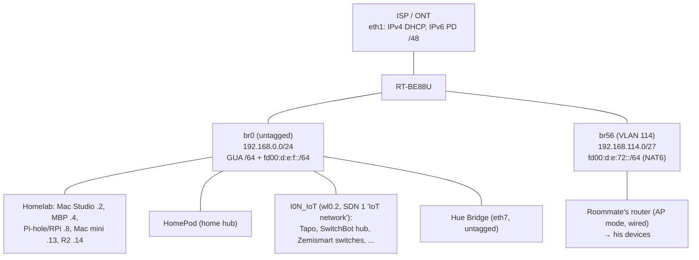
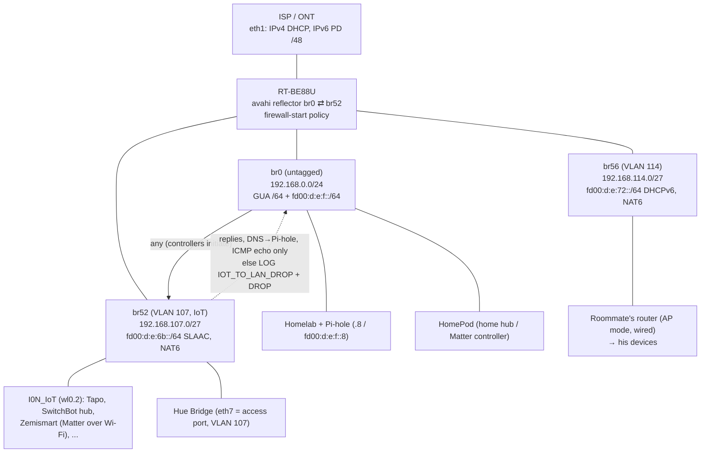

# IoT Network Segmentation: Topology, Configuration and Change Record

**Router:** ASUS RT-BE88U running Asuswrt-Merlin 3006.102.8 (`firmver=3.0.0.6`, `buildno=102.8`, `extendno=4`)
**Config repo:** `asuswrt-configs` (deployed to `/jffs/scripts` and `/jffs/configs`)

**Sources**

| State | File | Notes |
|---|---|---|
| A: flat | `Settings_RT-BE88U.CFG` → decoded to `nvram_flat.txt` | Settings backup downloaded from the web UI. Its encoding is trivially reversible: an `HDR2` header with a 3-byte length (`0x01D800`) and a 1-byte key (`0`); each byte decodes as `0xFF + key − b`, and bytes `0xFD`–`0xFF` are entry separators. 5468 entries. |
| B: VLAN created in GUI | `nvram.txt` | Text nvram dump |
| C: segmented | `nvram_seg.txt` | Text nvram dump, taken after the Hue port change and the cleanup of leftover keys |
| D (conntrack tuning) | `nvram_tweak.txt` | Text nvram dump after the Matter fix and the connection-tracking cleanup (uptime 794 s). The only nvram change in D; nvram stays the same through E. |
| Matter finding | `firewall_logs/FW_matter-5540-iot-lan-drop.log` | 60 `IOT_TO_LAN_DROP` entries, 12:12:02–12:47:59, the "before" evidence for the UDP timeout change |
| D (tapo capture, at `d0c3085`) | `20261011-164338_tapo/` capture, `router_states/` | No nvram dump: scripts only. 70-minute capture taken after the NTP and reflector changes (see 1.9). |
| D (post-capture fixes) | repo `1b36092` → `6d35945` | Scripts only, not captured. Checked on the router instead (see 1.10). |
| E: router hardening | repo `44ec09d` → `904f54d` | Scripts only. Verified after a router reboot and a wireless restart, with a re-test from the IoT test host (see 1.11): `firewall_logs/FW_hardening.log`, `router_states/hardening_before_and_after/`, `iot_retest/`. |
| Scripts | git history of `asuswrt-configs` | `c3684e6` (Init) → `904f54d` (HEAD) |

All files live in the `IoT Segmentation/` working folder.

> **Redaction:** some identifying values are replaced with placeholders:
> - `<WAN-IPv4>`: public IPv4 address from the ISP's DHCP
> - `<PD>`: the delegated IPv6 /48 prefix
> - `<WAN-RA>`: the WAN-side /64 the ISP advertises
> - `<RM-MAC>`: MAC address of the roommate's router (AP mode)
>
> No passphrases or credentials are included.
>
> **Handling:** the `.CFG` backup (and `nvram_flat.txt` decoded from it) contains the router admin credentials and other secrets in effectively plain text (see 2.1.4). Treat both files as secrets and never share them.

---

## 0. The states described

| State | Description | Evidence |
|---|---|---|
| **A: Flat (original)** | `I0N_IoT` is an Asus "IoT network" (SDN 1) sharing the main LAN `br0` / `192.168.0.0/24`. The Hue Bridge is untagged on `br0`. Roommate VLAN 114 already exists. | `nvram_flat.txt` (from `.CFG`), repo at `c3684e6` |
| **B: VLAN created in GUI** | VLAN 107 assigned to the IoT network and `I0N_IoT` moved to `br52`. Scripts still at `Init`: no IPv6, firewall policy or mDNS reflection for 107. The Hue Bridge is still on `br0`. | `nvram.txt`, repo at `c3684e6` |
| **C: Segmented** | IoT subnet shrunk to /27, `eth7` (Hue) made an access port for VLAN 107, ULA with SLAAC and NAT6, one-way firewall policy, mDNS reflector, leftover test keys cleaned up. | `nvram_seg.txt`, repo at `186e56b` |
| **D: tuning and fixes** | State C plus, rolled out in steps (scripts only, apart from the first step): **UDP assured timeout 180 → 1800 s** so Matter subscription reports from the IoT network aren't dropped, connection-tracking limits set only through nvram (`init-start` removed, `d38d5d1`), expect limit 8192 (the only nvram change); **new IoT → WAN connections logged** (`IOT_TO_WAN_NEW`, `e637e73`); **NTP to the router allowed from the IoT VLAN** with DHCP option 42 (`75807a2`); **mDNS reflector restricted to HomeKit, Matter and Hue services** (`d0c3085`); **router ULAs re-assigned after bridge rebuilds** (`1b36092`); **STP off on the IoT bridge** (`d119636`); **option 42 = each VLAN's own gateway address** (`0416f8d`, then `6d35945`); main-LAN ULA host addresses from `lan_ula_config.env` (`9ad7a21`, no functional change); **NTP server on every VLAN bridge** that follows the firmware ntpd (`a738f35`, `a86c9e2`). Sections 1.7–1.10 describe the steps; each piece of evidence notes the commit it was taken at. | `nvram_tweak.txt` and `firewall_logs/FW_matter-5540-iot-lan-drop.log` (conntrack step); `20261011-164338_tapo/` capture and `router_states/` (at `d0c3085`); router-side checks (1.10); active test from the IoT VLAN (analysis §14, at `a86c9e2`); repo at `6d35945` |
| **E: router hardening (current)** | State D plus (scripts only): **STP re-applied after bridge rebuilds**, following the web UI STP switch (`44ec09d`, `6aa7835`); **router access from the IoT VLAN limited to DHCP/NTP/mDNS/ICMP**, **SSH dropped on every VLAN bridge**, **IoT DNS forced to Pi-hole** and **DoT/DoQ blocked** (`5b0e391`); **ONT management blocked from every VLAN** (`904f54d`). | repo at `904f54d` (HEAD); re-test (1.11, analysis §15) |

---

## 1. Network topology

### 1.1 Building blocks common to all states

| Item | Value |
|---|---|
| WAN | `eth1`, IPv4 by DHCP (`wan0_proto=dhcp`), address `<WAN-IPv4>` |
| WAN IPv6 | DHCPv6 with prefix delegation (`ipv6_service=dhcp6`, `ipv6_dhcp_pd=1`) giving `<PD>::/48`. Default route learned from the ISP's router adverts (`ipv6_accept_defrtr=1`, gateway `fe80::4aa9:8aff:fecb:5e6`). WAN link prefix `<WAN-RA>::/64`. |
| ONT management | Secondary address `192.168.255.2/30` on `eth1`, plus SNAT for main LAN → ONT `192.168.255.1` (`ONT_Route.sh`; addresses in `ont_config.env` since `904f54d`). Blocked from every VLAN since `904f54d`. |
| LAN ports | `eth0`, `eth2`–`eth9`. Untagged traffic goes to `br0` by default. VLAN 114 (and 107 from state B on) is carried tagged on the trunk ports (`ethX.114`, `ethX.107`). |
| Radios | `wl0` = 2.4 GHz (`wl0_nband=2`), `wl1` = 5 GHz (`wl1_nband=1`). Virtual interfaces: `wl0_vifs=wl0.1 wl0.2 wl0.4`, `wl1_vifs=wl1.1 wl1.2` (unchanged across states). |
| DNS | Pi-hole on the main LAN: `192.168.0.8` / `fd00:d:e:f::8`, used by every network |
| IPv6 firewall | Enabled (`ipv6_fw_enable=1`) |

**SSIDs and virtual interfaces**

| Interface | SSID | Band | Bridge (A → B → C) | Notes |
|---|---|---|---|---|
| `wl0.1` | `ASUS_BE88U_I0N` | 2.4 GHz | `br0` | Main network |
| `wl1.1` | `ASUS_BE88U_I0N_5G` | 5 GHz | `br0` | Main network |
| `wl1.2` | `ASUS_BE88U_I0N_5G_Guest` | 5 GHz | `br0` | SDN 6 "Guest". Shares the main subnet, with client isolation on (`ap_isolate=1`). |
| `wl0.2` | `I0N_IoT` | 2.4 GHz | `br0` → `br52` → `br52` | IoT network (SDN 1, apg1). Security mode WPA2/WPA3 mixed (`psk2sae`). |
| `wl0.4` | (auto-generated) | 2.4 GHz | `br0` | Asus-managed internal interface. Its SSID and key are regenerated by the firmware; not user-facing. |

**VLAN 114 (roommate) has no radio on this router.** It is wired only: the roommate's own router runs in AP mode and connects through a LAN port carrying VLAN 114, and his devices connect to that AP. `apg2` (`VLAN_114`) has no Wi-Fi bands assigned (`apg2_dut_list=<…>0>`). The only static lease in VLAN 114 is the roommate's router.

**VLAN sub-interfaces `wl0.107` / `wl1.107` (and `wl0.114` / `wl1.114`)** are tagged VLAN sub-interfaces on the radios' primary interfaces (`apg_br52_fh_wlifnames=wl0.107 wl1.107`). Asus creates them so it can carry each VLAN over Wi-Fi backhaul to AiMesh nodes. This router runs standalone (`sw_mode=1`, `re_mode=0`, `asus_device_list` lists only the RT-BE88U), so no clients connect through them. IoT Wi-Fi clients attach to `wl0.2`.

**Guest Network Pro (SDN) mapping** (from `sdn_rl` / `vlan_rl` / `subnet_rl`)

| SDN | Type | VLAN (A → B/C) | Bridge (A → B/C) | Subnet | Wi-Fi |
|---|---|---|---|---|---|
| 0 | DEFAULT | untagged | `br0` | 192.168.0.0/24 | main SSIDs |
| 1 | LEGACY (Asus "IoT network") | **none (shares main LAN) → 107** | **`br0` → `br52`** | main subnet → 192.168.107.0/24 (B) → /27 (C) | `I0N_IoT` |
| 5 | Customized | 114 | `br56` | 192.168.114.0/27 | none (wired only, roommate's AP router) |
| 6 | Guest | untagged | `br0` | shares main subnet | 5 GHz guest (isolated) |

### 1.2 State A: flat (before segmentation)



**nvram evidence (`nvram_flat.txt`)**
- `lan_ifnames` includes **`wl0.2`**, so the IoT SSID is bridged into `br0`.
- `ap_wifi_rl=…<0>wl0.2>1>…`: `wl0.2` mapped to VLAN 0 (the main LAN).
- `sdn_rl` entry `<1>LEGACY>1>0>0>1…`: the IoT network exists, but with VLAN index 0 and subnet index 0, i.e. it shares the main network.
- `vlan_rl=<1>114>0>`, `subnet_rl` contains only `br56`, `apg_br_info=<114>br56>`, `vlan_trunk_iso_rl=<1>114>0`. VLAN 114 is the only custom VLAN.
- `eth7` is an untagged member of `br0`, so the Hue Bridge is on the main LAN.

**IPv4**
- `br0`: `192.168.0.1/24`, DHCP `.2`–`.254`, DNS `192.168.0.8`. Reservations: `.2` Mac Studio, `.4` MacBook Pro, `.8` Raspberry Pi (Pi-hole), `.13` Mac mini Server, `.14` iKOOLCORE-R2 (PXE/iVentoy).
- **IoT devices and the Hue Bridge got addresses from the main LAN pool** and were in the same broadcast domain as the homelab. They could reach every main-LAN host at layer 2 (no lateral containment).
- `br56` (VLAN 114): `192.168.114.1/27`, DHCP `.1`–`.30`, DNS `192.168.0.8`. One static lease (`.2`): the roommate's router in AP mode. Has intranet access (`sdn_access_rl=<0>5`).

**IPv6**
- `br0`: a GUA `/64` out of `<PD>` (router `<PD>::1`) plus the ULA `fd00:d:e:f::/64` (router `::1`). Router adverts with SLAAC, plus stateful DHCPv6 for the ULA (`::1`–`::ff`, reservations `::2`, `::4`, `::8`, `::13`, `::14`). DNS `fd00:d:e:f::8`.
- **IoT devices on `br0` therefore got publicly routable (GUA) IPv6 addresses** in addition to ULAs. Unsolicited inbound traffic was still blocked by the stateful IPv6 firewall, but the devices were globally addressed.
- IPv6 port forwards (DNAT from WAN to ULA hosts) for homelab services via `IPv6_PF.sh`.
- `br56`: ULA `fd00:d:e:72::/64`, DHCPv6 only (`::1`–`::20`), DNS via DHCPv6 option 23 (`fd00:d:e:f::8`), NAT6 (masquerade) out through `eth1`.

### 1.3 State B: VLAN created in the GUI (`nvram.txt`, repo `c3684e6`)

Differences from A:
- The IoT network (SDN 1) was assigned VLAN 107 (`sdn_rl` `<1>LEGACY>1>2>2>1…`, `vlan_rl` gains `<2>107>0>`), and `I0N_IoT` (`wl0.2`) moved out of `br0` into **`br52`** (`lan_ifnames` loses `wl0.2`; `ap_wifi_rl` maps `wl0.2` to `107`). `br52` members: `wl0.2`, `ethX.107` (tagged on all ports), `wl0.107`, `wl1.107`.
- IPv4: `192.168.107.1/24`, DHCP `.1`–`.254`, DNS `192.168.0.8`.
- **IPv6: link-local only.** The firmware's built-in IPv6 option for IoT networks wasn't enabled (`v6_enable=0` in `subnet_rl`), and no custom config existed yet, so Matter controllers on `br0` couldn't reach Matter devices. A custom ULA with NAT6 was chosen instead of the built-in option to keep the setup consistent with VLAN 114, whose network type has no such option. Section 1.6 describes what the built-in option would do.
- No mDNS reflection, so HomeKit/Matter discovery couldn't cross from `br0` to `br52`.
- No intranet access setting for 107. The GUI has no "Access Intranet" option for IoT networks, and `sdn_access_rl` lists only SDN 5.
- **The Hue Bridge was still on `br0`.** `eth7` was untagged in `br0` and carried VLAN 107 tagged only (`eth7.107`).

### 1.4 State C: segmented (`nvram_seg.txt`, repo `186e56b`)



**Port `eth7` (Hue Bridge):** now an **access port for VLAN 107**.
- `ap_lanif_rl=<107>7`, and `apg1_dut_list` gains `<CC:28:AA:2B:39:60>>L7` (LAN port 7 assigned to the IoT network).
- `eth7` was removed from `br0` (`lan_ifnames`, `br0` membership) and added **untagged** to `br52` (`lan2_ifnames` / `br2_ifnames` now contain `eth7`).
- `eth7` no longer carries the tagged VLANs: `eth7.107` was removed from `apg_br52_fh_ethifnames`, and `eth7.114` from `apg_br56_fh_ethifnames`, `lan1_ifnames` and `br1_ifnames`.
- **All other LAN ports remain trunks** (untagged main LAN, plus tagged 107 and 114).

**IPv4**

| Network | Bridge | Subnet | DHCP pool | DNS | Reachability |
|---|---|---|---|---|---|
| Main | `br0` | 192.168.0.0/24 | .2–.254 | 192.168.0.8 | Can reach IoT (any protocol) |
| IoT (107) | `br52` (`wl0.2`, `eth7`, tagged 107 on trunks) | **192.168.107.0/27** | **.1–.30** | 192.168.0.8 | To main LAN: replies, DNS to Pi-hole and ICMP echo only. Internet via Asus NAT. |
| Roommate (114) | `br56` | 192.168.114.0/27 | .1–.30 | 192.168.0.8 | Asus intranet access (`sdn_access_rl=<0>5`), unchanged |

**IPv6**

| Network | Prefix | Addressing | DNS delivery | Internet |
|---|---|---|---|---|
| Main (`br0`) | GUA `/64` from `<PD>` + `fd00:d:e:f::/64` | SLAAC + DHCPv6 (ULA reservations) | RA / DHCPv6 → `fd00:d:e:f::8` | Routed GUA, no NAT |
| IoT (`br52`) | **`fd00:d:e:6b::/64`** (107 = `0x6b`), router `::1` | **SLAAC only** (`ra-only`), RA every 10 s, router lifetime 600 s | **RDNSS** → `fd00:d:e:f::8`, lifetime 86400 s | **NAT6** (masquerade) out through `eth1` |
| Roommate (`br56`) | `fd00:d:e:72::/64` (114 = `0x72`) | DHCPv6 only (`::1`–`::20`) | DHCPv6 option 23 → `fd00:d:e:f::8` | NAT6 |

**Cross-segment services**
- **mDNS:** avahi reflects between `br0` and `br52` only (`allow-interfaces=br0,br52`), over IPv4 and IPv6. VLAN 114 is deliberately left out: the router no longer answers or reflects mDNS there, while peer-to-peer mDNS inside 114 still works.
- **Firewall (FORWARD, inserted at the top):** IoT → Pi-hole DNS (UDP/TCP 53, v4 and v6) and ICMP echo-request are accepted. Main LAN → IoT is accepted. IoT → main LAN replies (ESTABLISHED/RELATED) are accepted. Everything else from IoT to the main LAN is logged with prefix `IOT_TO_LAN_DROP` (rate-limited to 10/min) and dropped. This applies equally to the Hue Bridge, which is now in the IoT segment.
- **Firewall (INPUT):** UDP 5353 is accepted on `br52` (v4 and v6) so the avahi reflector receives IoT mDNS.

**Verified behaviour**
- An RA capture on `br52` showed the prefix option for `fd00:d:e:6b::/64` with the autonomous flag set, and `rdnss option (25) … lifetime 86400s, addr: fd00:d:e:f::8`.
- An iPhone on `I0N_IoT` accepts both the IPv4 and the IPv6 DNS server.
- **Android ignores RDNSS on ULA-only networks.** It discards DNS servers it considers unreachable, and it doesn't count a ULA as a global address. `dumpsys connectivity` lists only `192.168.0.8`. DNS visibility is preserved because Android falls back to Pi-hole over IPv4.
- The `sdn_access_rl` change (`<0>5<0>1`) was confirmed to work on a temporary VLAN. It was deliberately **not** applied: cross-segment traffic works as intended with `firewall-start` alone (see 1.5).

### 1.5 Observations

1. **Decision: the IoT network has no firmware intranet access.** `sdn_access_rl=<0>5` (only VLAN 114) in all three states, and this is intentional. In state C, main LAN ↔ IoT reachability comes entirely from `firewall-start`, and it behaves as intended. If problems come up, the policy is to add narrow firewall rules rather than change `sdn_access_rl`.
2. **The WAN link prefix is empty in both later dumps** (`ipv6_ra_prefix`): `nvram_seg.txt` at uptime 195 s and `nvram_tweak.txt` at uptime 794 s. In state B it was populated (`<WAN-RA>::/64`). The first was plausibly timing, but 794 s is well past normal ISP router-advert intervals, so this may be a reporting difference after the reboots rather than timing. IPv6 internet works; resolved in section 4 (item 5, closed).
3. **Temporary test VLANs:** state A contains a staged **VLAN 115** test and the first C dump contained a staged **VLAN 222** test, both in the `_x` (staged/pending) nvram copies. Neither was ever in the active lists, and both are cleared in the final C dump (see 2.1.2 and 2.2.2).

### 1.6 Built-in IPv6 for IoT networks (from source; not deployed)

When the Guest Network Pro IPv6 toggle is enabled for a network, its settings are stored in that network's `subnet_rl` entry. The toggle is `v6_enable`. "Auto Configuration Setting" is `v6_autoconf`. The IP pool start and end (`1000`/`2000`) are `dhcp6_min`/`dhcp6_max`, read as hexadecimal. The three DNS fields are `dns6`. In the C dump both custom networks have `v6_enable=0`.

The dnsmasq config is generated by `write_dnsmasq_conf_sdn_ra_dhcp6_range()` in Merlin's `release/src/router/rc/sdn.c`. The prefix is built by `mtlan_extend_prefix_by_subnet_idx()` in `shared/mtlan_utils.c`. Reading the current source:

**Which prefix the network gets: GUA or ULA**

| Condition | Prefix assigned to the network |
|---|---|
| WAN has a delegated prefix (`ipv6_prefix` set), another IPv6-enabled network shares the same WAN (`share_subnet`, always true while the main LAN has IPv6), and the prefix is **/56 or shorter** (or `ipv6_prefix_div` is set) | **GUA:** the delegated prefix with the network's **subnet index** placed in the next 8 bits, rounded to `/64`. |
| Delegated prefix longer than /56 (and no `ipv6_prefix_div`) | **ULA:** `ipv6_ula_random` (`fd4f:cc9f:eade::/48`) with the subnet index in the 4th hextet, `/64` |
| No delegated prefix | **ULA**, as above |
| Network doesn't share the WAN with another IPv6 network | The delegated prefix as-is (at least `/64`) |

**Applied to this router** (`ipv6_prefix_length=48`, main LAN IPv6 enabled, IoT subnet index 2): the IoT network would get the **GUA `<PD>:200::/64`**. It's routed, not NAT'd, and it's a different prefix from the custom `fd00:d:e:6b::/64`. ULA would only be used as a fallback.

Caveats:
- An older revision of the same function used the **SDN index** instead of the subnet index and had no /56 check. Under that revision the result would be `<PD>:100::/64`.
- The 3006.102.8 changelog fix ("/56 prefix ... Guest Networks wouldn't allocate a /64") matches the current logic, but the exact behaviour of the deployed build should be confirmed from the generated `/etc/dnsmasq-1.conf`.

**Addressing mode**
- **`v6_autoconf` non-zero, or a prefix longer than /64:** **stateful DHCPv6 only.** Generates `dhcp-range=br52,<prefix>1000,<prefix>2000,<len>,<lifetime>`. That range has no `ra-*` flag, so the router adverts carry only the "managed" flag and no SLAAC, and Android clients would get no IPv6 address.
- **`v6_autoconf=0`:** **SLAAC plus stateless DHCPv6.** Generates `dhcp-range=br52,::,constructor:br52,ra-stateless,64,<ra_lifetime>`.
- The code only distinguishes zero from non-zero. Which of these the GUI's **"Auto"** choice stores was not verified. Check `v6_autoconf` in `subnet_rl`, or the generated `dhcp-range` line, after enabling it.

**DNS:** the configured `dns6` servers. If those fields are empty, the default is `option6:23,[::]`, i.e. the router's own address.

**Router adverts:** `enable-ra`, `quiet-ra`, `ra-param=<bridge>,10,600` (unless `ipv6_radvd` is off).

**Interaction with the custom config:** enabling the built-in IPv6 would add a second router-advert/DHCPv6 context to the same dnsmasq instance, on top of the custom ULA block from `dnsmasq-sdn.postconf`. This combination is untested. It might even fix the Android RDNSS limitation, since clients would have a GUA. Not adopted for now.

### 1.7 State D: connection-tracking tuning (Matter fix)

**Finding.** With the state C firewall in place, the router logged repeated `IOT_TO_LAN_DROP` entries from Matter devices in the IoT network to the HomePod. The evidence is `firewall_logs/FW_matter-5540-iot-lan-drop.log`: 60 entries between 12:12:02 and 12:47:59.

| Source (MAC prefix) | Likely device | Entries | Destination |
|---|---|---|---|
| `0c:4e:a0:…` / `192.168.107.15` | SwitchBot Hub 2 (Matter bridge, IPv4) | 15 | HomePod `192.168.0.22`, UDP 58688 |
| `8c:87:d0:…:0d:6b` | Matter switch (likely Zemismart; vendor unverified) | 15 | HomePod ULA, UDP 51226 |
| `8c:87:d0:…:0d:6e` | Matter switch (likely Zemismart; vendor unverified) | 20 | HomePod ULA, UDP 51226 |
| `ec:b5:fa:…` (Philips Lighting / Signify) | Hue Bridge (Matter bridge) | 10 | HomePod ULA, UDP 51226 |

- **Every entry has source UDP port 5540**, the standard Matter port. The destination is the HomePod's Matter controller (45 entries over IPv6, 15 over IPv4).
- The entries come in **bursts of 5 within about 1–3 s**: one original plus four retries. That's Matter's retransmission (MRP) giving up on a message that was never acknowledged.
- Bursts repeat every few minutes, which matches **subscription reports**.

**Cause.** The HomePod subscribes to each device. That traffic goes main LAN → IoT, which is allowed, and the router starts tracking the connection. The device's later reports travel back on the same UDP port pair and pass the "replies" rule (ESTABLISHED) **only while the connection-tracking entry exists**. Asus's default UDP assured timeout (`ct_udp_timeout="30 180"`) is 180 s, which is shorter than the gap between reports. The entry expired, the next report was treated as a new IoT → main LAN connection, and it was logged and dropped. The visible effect is that Matter devices can show "No Response" or update late until the HomePod subscribes again.

The drops were legitimate traffic, so this was a **false positive caused by the segmentation policy**, not suspicious behaviour. It's a direct test of the contract's metric 4 (required device functions keep working after segmentation).

**Fix.** Raise the UDP assured timeout to **1800 s** through nvram (`ct_udp_timeout="30 1800"`, Administration → Tweaks → "UDP Timeout: Assured"). Option B, an explicit IoT → HomePod allow rule, was not needed. **No new firewall exception was added**, so the one-way policy is unchanged.

- A manual `echo` to `/proc/sys/net/netfilter/nf_conntrack_udp_timeout_stream` only works until the next `restart_firewall`. The firmware re-applies `ct_udp_timeout` from nvram in `setup_udp_timeout(TRUE)`, which runs from `start_nat_rules()` and the `conntrack` service (`rc/common.c`, `rc/services.c`). So nvram is the only permanent place for the value.
- **Timeline:** the timeout was tweaked shortly after 12:34:27. A tail of drops continued until **12:47:59**, because existing connection-tracking entries keep their old countdown until a packet refreshes them, and entries that expired during the changeover still dropped one report. After the HomePod subscribed again under the new timeout, **no further drops were logged**. The fix was then made permanent in nvram and confirmed stable.
- **Side effects:** the timeout applies to all UDP traffic on the router. Idle UDP entries now stay in the table for up to 30 min. This is well within the table limit: 2904 entries were in use at the time of the D dump. The limit itself also went up in D, from an effective 81920 in state C (forced by `init-start`) to the firmware's 300000.

**Connection-tracking cleanup.** `init-start` (`nf_conntrack_max=81920`, `nf_conntrack_expect_max=8192`) was carried over from an older setup. It runs **after** the firmware's `setup_conntrack()`, so in states A–C it overwrote the nvram-applied values. The live kernel values in state C were therefore **81920 / 8192**, not the nvram values of 300000 / 4096. It was removed (`d38d5d1`), and every connection-tracking value now comes from nvram:
- **Connection table limit:** the effective limit **rises from 81920 to 300000** (`ct_max` was already 300000 in nvram, but had been overridden).
- **Expect limit:** `ct_expect_max` was set to **8192** in nvram, so the effective value is **unchanged** from state C; only its source moved from `init-start` to nvram.
- With `init-start` gone, the live value of 8192 confirms that the firmware **does** apply `ct_expect_max`.

**Connection tracking: web UI ↔ nvram ↔ kernel (state D)**

Kernel variables are under `/proc/sys/net/netfilter/` unless noted.

In state C, `init-start` overrode two nvram values at boot. Where the live kernel value differed from nvram, the table shows both as "nvram / **live**".

| Web UI (Administration → Tweaks) | nvram key (field) | State C value (nvram / live) | **State D value** (nvram = live) | Kernel variable | Kernel default | Applied by the firmware |
|---|---|---|---|---|---|---|
| TCP connections limit *(actually the whole connection table, every protocol)* | `ct_max` | 300000 / **81920** (`init-start`) | 300000 | `nf_conntrack_max` | depends on table size | `setup_conntrack()` (overridden by `init-start` until `d38d5d1`) |
| TCP Timeout: Established | `ct_tcp_timeout` (2nd field) | 2400 | 2400 | `nf_conntrack_tcp_timeout_established` | 432000 | `setup_conntrack()` |
| TCP Timeout: syn_sent / syn_recv / fin_wait / time_wait / close / close_wait / last_ack | `ct_tcp_timeout` (3rd–9th) | 120 / 60 / 120 / 120 / 10 / 60 / 30 | unchanged | `nf_conntrack_tcp_timeout_*` | same as the firmware values | `setup_conntrack()` |
| *(no field)* | `ct_tcp_timeout` (1st, 10th) | 0, 0 | unchanged | — | — | unused placeholders |
| **UDP Timeout: Assured** | `ct_udp_timeout` (2nd) | 180 | **1800** | `nf_conntrack_udp_timeout_stream` | 180 | `setup_udp_timeout(TRUE)`: NAT start, `restart_firewall`, conntrack service |
| UDP Timeout: Unreplied | `ct_udp_timeout` (1st) | 30 | 30 | `nf_conntrack_udp_timeout` | 30 | same |
| *(no field)* | `ct_timeout` (2nd) | 30 | 30 | `nf_conntrack_icmp_timeout` | 30 | `setup_conntrack()` |
| *(no field)* | `ct_timeout` (1st) | 600 | 600 | `nf_conntrack_generic_timeout` | 600 | not written (commented out in source) |
| *(no field)* | `ct_hashsize` | 16384 | 16384 | `/sys/module/nf_conntrack/parameters/hashsize` (`nf_conntrack_buckets`) | depends on RAM | `setup_conntrack()` |
| *(no field)* | `ct_expect_max` | 4096 / **8192** (`init-start`) | **8192** | `nf_conntrack_expect_max` | 256 | **applied** (overridden by `init-start` until `d38d5d1`): confirmed by the live value 8192 after `init-start` was removed |
| — | — | — | — | `nf_conntrack_count` (read-only) | — | 2904 at the time of the D dump |

Not managed by the firmware: `nf_conntrack_icmpv6_timeout` stays at the kernel's 30 s. While NAT is stopped, `stop_nat_rules()` briefly sets the UDP timeouts to 1 / 6 s.

**Live values in state D (verified on the router):**

```
nf_conntrack_max                     300000
nf_conntrack_buckets                 16384
nf_conntrack_expect_max              8192
nf_conntrack_count                   2904
nf_conntrack_udp_timeout             30
nf_conntrack_udp_timeout_stream      1800
```

### 1.8 State D: IoT → WAN connection logging (`e637e73`)

Next in state D, a log-only rule was added so that IoT devices contacting the internet ("phoning home") show up in the router log, complementing `IOT_TO_LAN_DROP`. It changes scripts only, not nvram.

```sh
# Log new IoT -> WAN connections (phone-home visibility), log only, no verdict
# Interface match covers IPv4 and NAT6 alike, inserted last so it sits above all accept rules
for IPT in iptables ip6tables; do
    $IPT -I FORWARD -i $VLAN_BR -o "$WAN_IF" -m state --state NEW -m limit --limit 30/min --limit-burst 60 -j LOG --log-prefix "IOT_TO_WAN_NEW "
done
```

**Design choices**

| Choice | Reason |
|---|---|
| **Match on interfaces** (`-i br52 -o eth1`, both derived from `vlan_info.sh` / `wan0_gw_ifname`) instead of address ranges | One rule covers IPv4 and IPv6 (NAT6). "The internet" has no CIDR of its own, so an address-based rule would need a list of private ranges to exclude that breaks when networks are added. It also survives subnet changes, like the rest of the scripts. |
| **Log only, no verdict** | Purely for visibility. IoT → WAN traffic is still allowed as before; the policy is unchanged. |
| **`--state NEW`** | One log line per new connection (its first packet), not per packet. A new destination is the useful signal for phone-home detection. |
| **Inserted last** (so it ends up at the top of FORWARD) | Nothing can accept the packet before it's logged. Verified with the stand-in `iptables` that records rule order: it's the first FORWARD rule in both IPv4 and IPv6. |
| **Rate limit 30/min, burst 60** | IoT devices open many short cloud connections. Without a limit, a burst could push other entries (including `IOT_TO_LAN_DROP`) out of the RAM-backed `/tmp/syslog.log`. The log is an **alert channel**; the pcap is the complete record. |

**Properties and limits**
- **Pre-NAT source address.** FORWARD runs before NAT (POSTROUTING), so each line records the device's own address (`192.168.107.x` or `fd00:d:e:6b::…`), not the router's WAN address. Every entry can be attributed to a device.
- **Unaffected by hardware offload.** The first packet of every connection passes through netfilter before Flow Cache / Runner take over, so this log works even when offload is on (unlike the packet capture).
- **DNS isn't included.** IoT DNS goes to Pi-hole on `br0`, and Pi-hole's own queries to upstream servers come from the main LAN. The domains behind the logged addresses come from Pi-hole's query log and Zeek (`ssl.log` SNI) instead.
- **DNS bypass is visible.** A device that ignores Pi-hole (hardcoded resolver on port 53, DNS-over-TLS on 853, or DNS-over-HTTPS) appears here with its own source address. That makes it a ready-made detection trigger for a suspicious-behaviour scenario.
- **Completeness under the rate limit:** the rule logs at most 30 lines/min sustained. Cross-check log windows against new-flow counts in Zeek `conn.log` before treating the log as complete.

**Contract mapping:** a transparent, documented rule that supports suspicious-behaviour detection (metric 2) and produces firewall-log evidence (metric 5). Results and evidence from this rule are recorded separately in the evidence document, not in this configuration record.

### 1.9 State D: IoT services tuning (`75807a2`, `d0c3085`)

Two more script changes in state D follow from the analysis of the segmented capture. Both were deployed before the capture `20261011-164338_tapo` (16:43:38 → 17:53:44); the FORWARD counters in `router_states/before_tapo_capture/` had been reset shortly before. That capture is the verification evidence.

**1. NTP for the IoT VLAN (`75807a2`)**

| Where | Change |
|---|---|
| `firewall-start` (IoT section) | `iptables`/`ip6tables -I INPUT -i br52 -p udp --dport 123 -j ACCEPT`. No destination address, so it covers every router address, including a stale `192.168.0.1`. |
| `dnsmasq-sdn.postconf` (IoT block) | `dhcp-option=br52,42,192.168.107.1`, i.e. DHCP option 42 (NTP server), as the main LAN already gets |

Why: until then the Hue Bridge kept its old main-LAN NTP server (`192.168.0.1`, learnt from the main LAN's option 42) and sent ~158 unanswered NTP requests/day. The IoT DHCP handed out no option 42.

**Verification (tapo capture, `eth7`):**
- ✅ **Option 42 is delivered and used.** After its power cycle (16:46:04), the Hue Bridge's DHCP ACK at 16:46:55 carries **option 42 = `192.168.107.1`** (tshark `dhcp.option.ntp_server`). The bridge sends NTP to `192.168.107.1` throughout the capture (20 requests from 16:44:06, so it had already picked up option 42 at an earlier lease renewal), and no longer to `192.168.0.1`.
- ✅ **The INPUT rule is active.** The router no longer silently drops these packets: it answers each one with **ICMP port unreachable (type 3 code 3)**.
- ❌ **No NTP service answers on the IoT VLAN.** The port-unreachable replies mean nothing is listening there. Root cause, from Merlin's `rc/ntpd.c`: the router's NTP server runs as `ntp … -l -I <lan_ifname>`, i.e. **bound to `br0` only**. Packets arriving on `br52` aren't served, whatever their destination address.
- Time sync still works: the Hue Bridge answers itself from its public fallbacks (Google, Cloudflare, Apple and Alibaba NTP servers; 183 answered exchanges in 70 min).
- **Status: partially effective.** The firewall and DHCP parts work. Serving NTP needs a second NTP server instance bound to the IoT bridge. **Resolved later in D (1.10):** `ntpd_vlan.sh` runs one per VLAN bridge.

**2. mDNS reflector filter (`d0c3085`)**

`avahi-daemon.postconf` appends `reflect-filters=_hap._tcp,_hap._udp,_matter._tcp,_matterc._udp,_matterd._udp,_hue._tcp` to the `[reflector]` section.
- Merlin's bundled avahi supports this key (`avahi-daemon/main.c` in the 3006 tree).
- avahi filters reflected **answer** records: PTR by target name, SRV/TXT by owner name, using substring matching. A/AAAA records always pass, so service targets still resolve. **Queries aren't filtered.**

**Verification (reflected mDNS *answer* PTR types sent by the router into the IoT VLAN):**

| Capture | Service types in reflected answers | Service types in reflected queries |
|---|---|---|
| Segmented capture (before `d0c3085`, `wl0.2`, 24 h) | 38 (incl. `_smb`, `_adb`, `_airplay`, `_companion-link`, printers …) | 44 |
| Tapo capture (at `d0c3085`, `wl0.2`, first 20 min) | **5**: `_hap._tcp`, `_hap._udp`, `_hue._tcp`, `_matter._tcp`, `_services._dns-sd._udp` | 37 |
| Tapo capture (at `d0c3085`, `eth7`, 70 min) | **7**: the above plus a Matter operational subtype and `_alexa._tcp` (published by the router itself; locally published services aren't subject to the filter) | 41 |

- ✅ **The service catalogue exposed to IoT devices drops from 38 types to 5–7**, all needed for HomeKit/Matter/Hue (plus the router's own `_alexa`).
- ⚠️ **Queries from the main LAN are still reflected** (37–41 queried types). They reveal what main-LAN clients are *looking for*, not what they offer. They also keep triggering the SwitchBot hub's `255.2.0.0` leak: 5 packets in the first 20 minutes of the capture. A bogon/reserved egress drop is still needed for that (open item 6).
- No `IOT_TO_LAN_DROP` entries appear in the saved firewall log for the capture window (which has a gap where syslog rotated), and the `br52 → br0` DROP rule stayed at 0 packets in both router snapshots. The timeline records the Tapo update completing with the plug reachable afterwards. A detailed functional assessment follows in the analysis.
- ⚠️ **The Matter switches were offline when the capture started.** Neither switch (`.17`, `.20`) sent a frame on either interface until **17:10:54**. Both then rejoined together with the other Wi-Fi clients (see the caveat below), ~1.5 min before the logged switch power cycle (17:12:29). The 16:43 conntrack snapshot holds no Matter session for any IoT device; at 17:51 the HomePod has sessions to all five Matter devices. Whether deploying these two changes (service and firewall restarts) is involved isn't established yet. *Resolved later:* a wireless restart before the capture caused it, and it didn't recur after a power cycle (section 4, Closed).

**Capture caveat:** the `wl0.2` tcpdump stopped at **17:03:11** (`pcap_loop: The interface disappeared`): the virtual Wi-Fi interface was torn down, and the last frames are Broadcom driver events from the router. `eth7` still sees the VLAN's flooded broadcast/multicast. There, the SwitchBot hub and the Tapo plug rejoin (DHCP, ARP probes) at 17:03:26 and again at 17:10:45–17:10:51, consistent with two wireless restarts. `eth7` ran for the full 70 minutes. The `iot-capture.sh` run carried on until the end with one interface missing. Supervising each tcpdump and restarting it would be a worthwhile improvement to the tooling.

### 1.10 State D: post-capture fixes (`1b36092`, `d119636`, `0416f8d`, `9ad7a21`, `a738f35`, `a86c9e2`, `6d35945`)

The last step of state D: script fixes that follow from the tapo capture (analysis §13). Each is small and can be checked on the router directly, so no new capture is planned for them.

| Fix | Commit | Problem | Router-side check (no capture needed) |
|---|---|---|---|
| Router ULAs re-assigned after bridge rebuilds | `1b36092` | `restart_wireless` removes the static ULAs from **all three bridges** (`br0`, `br56`, `br52`; confirmed on the router). dnsmasq then has no prefix to advertise. In the tapo capture, IoT RAs stopped at 17:03:11 and devices that rejoined got no ULA (analysis §13.6). Before this fix, the addresses only came back with the next dnsmasq restart or DHCPv6 event. | After `service restart_wireless`: `ip -6 addr show dev br52` (and `br0`, `br56`) shows `::1/64` again; syslog has `ula_assign.sh: added …`; IoT RAs resume (`tcpdump -ni br52 -c 2 'icmp6 and ip6[40] == 134'`) |
| STP off on the IoT bridge | `d119636` | A reconnecting wired port is held in listening/learning for 30 s. After its power cycle, the Hue Bridge got no lease and fell back to `169.254.11.47` (analysis §13.3). | `cat /sys/class/net/br52/bridge/stp_state` = `0` after a firewall restart |
| Option 42 = VLAN gateway address | `0416f8d`, `6d35945` | `0416f8d` advertised the main-LAN address. `6d35945` advertises each VLAN's own gateway instead: `192.168.107.1` for IoT, and newly `192.168.114.1` for the roommate VLAN. No change in NTP behaviour, because `ntpd_vlan.sh` answers on any router address arriving on a VLAN bridge. | `sntp 192.168.107.1` and `sntp 192.168.0.1` both answered from the IoT test host (analysis §14.3) |
| NTP server on every VLAN bridge | `a738f35` | The firmware ntpd only answers on `br0`, not on `br52` or `br56` (confirmed with `sntp` from a laptop on `I0N_IoT`: neither `192.168.107.1` nor `192.168.0.1` responded) | `sntp 192.168.0.1` and `sntp 192.168.107.1` from a client on `I0N_IoT`; `ps w \| grep '[n]tp'` shows a second `ntp -n -l -I br52` |

**ULA re-assignment (`1b36092`)**
- **New helper `ula_assign.sh`:**
  - Idempotent: it skips addresses already present and logs each one it adds.
  - `br0`'s ULA comes from `lan_ula_config.env` (`LAN_ULA_*`; named `ula_config.env` until `9ad7a21`), the first real use of that file. The VLAN bridges come from the usual `vlan_info.sh` loop over the roommate and IoT VLANs, so no bridge names are hardcoded.
- **Callers:**
  - `service-event`: before dnsmasq starts, as before.
  - `dhcpc-event`: DHCPv6 bound/updated/rebound, as before.
  - **`service-event-end`, new:** after `network`/`wireless`/`lan`/`all` actions. Merlin runs this hook *after* the action completes, while `service-event` runs before it, which is too early for a rebuild.
- **No dnsmasq restart:** dnsmasq picks up new interface addresses through netlink and restarts its unsolicited RAs and DHCPv6 contexts. The check above confirms this on the router.
- **Tested** in BusyBox ash with a mocked `ip`:
  - the first run adds all three addresses
  - a second run is a no-op
  - a removed address is re-added

**STP (`d119636`)**
- `br0` and the roommate bridge (`br56`, which carries his AP-mode router) keep STP at priority 10.
- The IoT bridge has only Wi-Fi and single-device access ports, so no loop is possible, and STP is turned off there.

**Main-LAN ULA in one place (`9ad7a21`)**
- `ula_config.env` is renamed `lan_ula_config.env`, to set it apart from the per-VLAN ULAs that `vlan_info.sh` derives.
- It's now the only place the main-LAN ULA prefix is written. Every script that used a hardcoded main-LAN ULA builds it from `$LAN_ULA_PREFIX` instead:
  - `firewall-start`: the 24 IPv6 port forwards (`"$LAN_ULA_PREFIX"13`, `…8`, `…2`) and the IoT → Pi-hole DNS rules
  - `dnsmasq-sdn.postconf`: RDNSS / option 23 for both VLANs
  - `ula_assign.sh`
  - the commented-out source line in `IPv6_PF.sh`
- Every generated rule and option was checked with BusyBox `sh` against the previous commit: identical.
- `configs/dnsmasq.conf.add` still spells out the prefix (main-LAN DHCPv6 range, option 23, static leases). It's a static file that the firmware appends, not a script, so it can't source the variable.

**NTP for the VLANs (`0416f8d`, `a738f35`)**
- **Option 42 (`6d35945`):** each VLAN advertises its own gateway, `192.168.<VID>.1` (the convention the rest of `dnsmasq-sdn.postconf` already uses): `192.168.107.1` for IoT and `192.168.114.1` for the roommate VLAN. Before that, `0416f8d` advertised `nvram get lan_ipaddr` (`192.168.0.1`) to the IoT VLAN only.
- **Firewall (`a738f35`):** `firewall-start` accepts UDP 123 (v4/v6) on **every VLAN bridge** from `vlan_ids.sh`. That replaces the IoT-only rule from `75807a2`. The rules have no destination address, so every router address works.
- **Why the firmware ntpd can't serve the VLANs:**
  - Merlin's `rc/ntpd.c` starts it as `ntp -t -S /sbin/ntpd_synced -p <ntp_server0> [-p <ntp_server1>] -l -I <lan_ifname>`. The `-l -I` part is only added when `ntpd_enable=1`.
  - BusyBox `ntpd` binds the server socket to that single interface (`SO_BINDTODEVICE`), and `-I` takes just one interface.
  - So no nvram setting or config file makes it listen on more bridges. Changing `lan_ifname` isn't an option.
  - Requests arriving on `br52` get ICMP port unreachable, whatever router address they target. That's what the tapo capture showed, and `sntp` from a laptop on `I0N_IoT` confirmed it for both `192.168.107.1` and `192.168.0.1`.
- **`ntpd_vlan.sh` (new):** runs one extra `ntp -n -l -I <bridge>` for **every VLAN bridge**: today the IoT VLAN (`br52`) and the roommate VLAN (`br56`).
  - **Which bridges:** the VLANs are listed by the new helper `vlan_ids.sh`. It prints the value of every variable named `*_VLAN_ID` in `vlan_config.env`, so a new VLAN is picked up automatically. Each bridge comes from `vlan_info.sh`, and the main-LAN bridge (`lan_ifname`) is always skipped.
  - **What it serves:** with no `-p` peers, BusyBox ntpd runs as a "stratum 1 server". It serves the system clock that the firmware ntpd disciplines, and **never sets the clock**. `-n` keeps it from overwriting the firmware ntpd's pidfile.
  - **Sharing port 123:** both instances bind `*:123` with `SO_REUSEADDR` and then attach to different devices. The kernel delivers each request to the socket bound to the interface it arrived on.
  - **Reply address:** replies leave from the address the request was sent to, so `192.168.0.1` and `192.168.107.1` both work.
  - **Lifecycle, tied to the firmware ntpd:**
    - **"Enable local NTP server" (web UI, `ntpd_enable`) is the master switch.** The instances run only while it's on, the firmware ntpd is running and the clock has been set (`ntp_ready=1`). So an unsynced clock is never served at boot. Turning the switch off stops them at the next check (≤ 1 min), and `start` does nothing while it's off.
    - **Stop:** the firmware's `stop_ntpd` kills every process named `ntp`. This instance runs the same binary, so it stops at the same moment.
    - **Start and resync:** `ntpd_vlan.sh check` runs every minute from cron. It is also called from:
      - `services-start`
      - `service-event-end`, after `ntpd`/`time` actions and after network/wireless/LAN restarts. If the bridge's ifindex has changed, the old instance's binding is stale and it's restarted.
      - **`wan-event` on `connected` (`a86c9e2`)**
    - **Restarts no user hook sees:** the firmware also restarts ntpd directly, e.g. `refresh_ntpc()` on WAN up while the clock isn't set yet. That kills the VLAN instances too, and the cron job restarts them within a minute.
    - **The cron job repairs itself (`a86c9e2`):**
      - Adding it once with `cru a` in `services-start` (`a738f35`) didn't survive boot: `cru l` was empty after two test reboots.
      - The open-source Merlin code never edits or clears the crontab. `rc/init.c` only creates `/var/spool/cron/crontabs` in tmpfs; `start_cron`/`stop_cron` just restart `crond`; nothing in `rc`, `shared`, `httpd` or `others` calls `cru` or writes there. So the cause is outside the open-source part of the firmware.
      - **Fix:** every run of `ntpd_vlan.sh` re-adds its job (`#ntpd_vlan#`) if it's missing, and logs `cron job ntpd_vlan added` or `failed to add …`. Any of the hooks above therefore restores it. The syslog will now show which hook got there first, and whether the entry later vanishes again.
  - **Tested** in BusyBox ash with mocked `ntp`, `nvram` and `/sys`:
    - it doesn't start while the clock is unsynced
    - it starts once `ntp_ready=1`, and repeated checks are no-ops
    - it restarts after a bridge rebuild (changed ifindex)
    - it stops when the NTP server is disabled
    - it isn't restarted after `killall ntp` while the firmware ntpd is down
    - `start`/`restart`/`stop` work
  - **Confirmed on the router:** the extra instances start shortly after the firmware ntpd, and the cron job survives reboots. The router's `ntp` binary couldn't be exercised in this terminal (no network namespaces). To check what a client sees, run `sntp 192.168.0.1` from a laptop on `I0N_IoT`; a stratum-1 answer means it's being served.
- **Limitation:** the extra instance reports stratum 1 although its clock is really synced at a higher stratum. That's harmless for IoT clients.

### 1.11 State E: router hardening (`44ec09d`, `5b0e391`, `ca50256`, `6aa7835`, `904f54d`)

The active test from the IoT VLAN (analysis §14) showed that segmentation contained the main-LAN hosts but not the router itself. State E closes that gap. It also makes STP survive wireless restarts.

**STP (`44ec09d`, `6aa7835`)**
- `restart_wireless` resets STP on the VLAN bridges, but not on `br0` (confirmed on the router).
- The STP settings move into **`bridge_stp.sh`**, which `firewall-start` runs and `service-event-end` re-runs after network/wireless/LAN restarts.
- **`44ec09d`** set the roommate bridge on (priority 10) and the IoT bridge off. It left `brctl stp br0 on` commented out, to test whether the web UI's STP setting now takes effect on `br0`. It doesn't (tested after a reboot).
- **Why `br0` ignores the web UI:** the firmware applies `lan_stp` to `br0` only if `ext_switch_exist()` is true (`rc/lan.c`). The RT-BE88U has no external switch, so the setting never reaches `br0`.
- **`6aa7835`** makes the script follow the web UI switch instead of hardcoding it:
  - it exits unless `nvram get lan_stp` is `1` (it is `1` in every nvram dump);
  - it then turns STP on, priority 10, for `br0` and the roommate bridge;
  - it never turns STP off. Bridges are created with STP off (kernel default, also seen after `restart_wireless`), so the IoT bridge needs no entry. With the switch off, the script does nothing and rebuilt bridges keep the default.
- Rendered with stubbed `nvram`/`brctl` for `lan_stp` = 1 and 0.

**Firewall (`5b0e391`)**

| Rule | Where | Effect |
|---|---|---|
| SSH drop | INPUT, every VLAN bridge (`vlan_ids.sh`), v4 and v6, port from `sshd_port` | Inserted above the firmware's interface-less accept (`sshd_enable=1`, "LAN & WAN"). The main LAN and the WAN keep SSH; WAN access is intentional and secured. |
| `IOT_INPUT` chain | INPUT from the IoT bridge, v4 and v6 | Accepts established/related, NTP 123, mDNS 5353, DHCP 67 (v4), ICMP/IGMP (v4) and ICMPv6 (ND/RS/MLD). Drops other multicast/broadcast (e.g. SSDP) silently. Everything else is **logged (`IOT_TO_ROUTER_DROP`, 10/min) and dropped**: SSH, router DNS, DLNA 8200, haproxy 81/444/60000, UPnP, etc. |
| DNS redirect | nat PREROUTING from the IoT bridge, UDP/TCP 53, v4 and v6 | DNS to anything other than Pi-hole (an internet resolver, the router) is DNATed to Pi-hole (`192.168.0.8` / `<LAN ULA>::8`) and logged as `IOT_DNS_REDIRECT` (10/min). The existing FORWARD accepts for Pi-hole let it through, and replies look as if they came from the original destination. |
| DoT/DoQ drop | FORWARD IoT → WAN, TCP/UDP 853, v4 and v6 | Inserted below the `IOT_TO_WAN_NEW` LOG rule, so attempts are still logged. DoH on 443 can't be blocked by port; `IOT_TO_WAN_NEW` and the SNI/JA4 analysis remain the detection for it. |
| ONT drop (`904f54d`, in `ONT_Route.sh`) | FORWARD, every VLAN bridge (`vlan_ids.sh`) → `$ONT_NET_CIDR` (`192.168.255.0/30`), v4 only | The ONT management address was reachable from the IoT VLAN, confirmed by the owner: `ONT_Route.sh` only added an accept for `br0`, and VLAN → WAN is accepted in general. All ONT rules stay in `ONT_Route.sh`, which `firewall-start` runs once, first. Every later `firewall-start` rule is inserted above them, so the drops end up above the firmware's VLAN → WAN accepts and below the IoT `IOT_TO_WAN_NEW` LOG rule: IoT attempts are logged (the egress interface is `eth1`), and roommate attempts are dropped silently, like SSH. The main LAN keeps access. The ONT has no IPv6 management address. |

- The main-LAN DNS (Pi-hole) addresses are defined once, as `LAN_DNS_V4` and `LAN_DNS_V6` (`ca50256`). The IPv4 prefix comes from `nvram get lan_ipaddr` (host `.8`, /24 assumed); the IPv6 one from `lan_ula_config.env` (`::8`). The generated rules are unchanged.
- The IoT mDNS INPUT accepts moved into `IOT_INPUT`.
- **`ont_config.env` (`904f54d`, new, 644):** holds `ONT_NET`, `ONT_IP`, `ROUTER_ONT_IP`, `ONT_NET_SUFFIX` and the derived CIDRs. These were hardcoded in `ONT_Route.sh`, which now sources the file; nothing else needs the addresses. Apart from the new drops, the generated `ONT_Route.sh` commands are unchanged (checked with stubs).
- I rendered the rules with stubbed `iptables`/`brctl`/`nvram` and checked the generated commands and their order. For `904f54d`, the stubs replayed `vlan_idx.sh` (`get_mtlan_by_vid`) with the real nvram dump. The scripts ran under BusyBox `sh`: Debian's `dash` doesn't pass arguments to `.`, which `vlan_info.sh` relies on, as BusyBox `ash` does on the router. The resulting v4 FORWARD order: IoT WAN LOG → DoT/DoQ drops → … → IoT → main-LAN DROP → `br52`/`br56` → ONT DROP → `br0` → ONT ACCEPT.

**Verification (2026-10-11 23:55 → 00:02; analysis §15):**
1. **Reboot, then `service restart_wireless`:** STP was `br0` 1, IoT bridge 0, roommate bridge 1, both after boot and after the rebuild. The VLAN bridges were really recreated (new ifindexes), and all three router ULAs were present afterwards. The `IOT_INPUT` counters kept counting across the restart, so the hardening survives a bridge rebuild without a firewall reload.
2. **Router access from the MacBook on `I0N_IoT`:**
   - every router address (`192.168.107.1`, `192.168.0.1`, `192.168.114.1`, `fd00:d:e:6b::1`) now answers only DHCP, NTP, mDNS and ICMP;
   - all 65,535 TCP ports on the IoT gateway are filtered, apart from 53, which is redirected to Pi-hole;
   - `nc 192.168.0.1 22` times out and is logged as `IOT_TO_ROUTER_DROP`.
3. **DNS:**
   - queries to `1.1.1.1`, the router and `2606:4700:4700::1111` (UDP) return Pi-hole's block answer and are logged as `IOT_DNS_REDIRECT`;
   - TCP 53 to the router's IPv4 addresses is redirected;
   - DoT to `1.1.1.1` times out and is still logged.
   - **IPv6:** two follow-up runs showed UDP *and* TCP queries redirected for any destination: Cloudflare, the router, even a nonexistent ULA. TCP answers carry Pi-hole's `EDE 15 (Blocked)`, and the v6 TCP DNAT counter rose by 2. DoT over IPv6 times out. The earlier r4 negative was an nmap artefact.
4. **No real IoT device** shows up in any drop or redirect log, all five devices were active after the rebuild, and the owner confirmed that every app still works. The HomePod had joined the IoT SSID (Keychain) and was moved back (analysis §15.6).

Open items 5 and 7–9 closed with the re-test. The owner then confirmed that the ONT was reachable from the IoT VLAN (item 11), and `904f54d` blocks it. A second follow-up (2026-10-12 01:00; `iot_retest/hardening_dns6_ont_test_2.txt`, `router_states/hardening_dns6_ont_retest_2_before_and_after/`) verified the IPv6 TCP redirect and the ONT drop: `nc 192.168.255.1 80` times out, the `br52` drop counter rose, and main-LAN access continues. Items 10 and 11 are closed.

---

## 2. nvram changes

Both comparisons were done by key.

### 2.1 A → B (`nvram_flat.txt` → `nvram.txt`): VLAN 107 created

#### 2.1.1 Segmentation-relevant

| Key | A | B | Meaning |
|---|---|---|---|
| `vlan_rl` | `<1>114>0>` | `<1>114>0><2>107>0>` | VLAN 107 defined (VLAN index 2) |
| `subnet_rl` | `br56` only | adds `<2>br52>192.168.107.1>255.255.255.0>…>.1–.254>…` | IoT subnet /24 on `br52` |
| `sdn_rl` (entry 1) | `<1>LEGACY>1>0>0>1…` | `<1>LEGACY>1>2>2>1…` | IoT network bound to VLAN index 2 and subnet index 2 |
| `ap_wifi_rl` | `…<0>wl0.2>1>…` | `…<107>wl0.2>1>…` | `I0N_IoT` mapped to VLAN 107 |
| `lan_ifnames` | `… wl0.1 wl0.2 wl0.4 …` | `… wl0.1 wl0.4 …` | `wl0.2` removed from `br0` |
| `lan2_ifname`, `lan2_ifnames`, `br2_ifname`, `br2_ifnames` | *(absent)* | `br52`; `wl0.2 ethX.107 … wl0.107 wl1.107` | New IoT bridge and its members |
| `apg_br52_fh_ethifnames`, `apg_br52_fh_wlifnames` | *(absent)* | `ethX.107 …`; `wl0.107 wl1.107` | Tagged trunk members for 107 |
| `apg_br_info`, `apg_ifnames` | `<114>br56>`; `br56` | `<114>br56><107>br52>`; `br56 br52` | Bridge registry |
| `vlan_trunk_iso_rl` | `<1>114>0` | `<1>114>0<2>107>0` | 107 added to the per-VLAN trunk isolation list |

#### 2.1.2 Staged test leftovers (VLAN 115)

| Key | A | B |
|---|---|---|
| `vlan_rl_x` | `<2>115>1>` | *(empty)* |
| `subnet_rl_x` | `<2>br58>192.168.115.1>255.255.255.0>0>…` (DHCP disabled) | *(empty)* |
| `sdn_rl_x` | `<7>Customized>1>2>2>4…` | `<1>LEGACY>1>0>0>1…` (stale copy of the IoT entry) |

`apg4_ssid=VLAN_115` (`apg4_enable=0`) was unchanged between A and B. These keys behave like staging copies of the network last edited in the GUI; the active lists never referenced VLAN 115.

#### 2.1.3 GUI side effects (not functionally relevant)
- `wl1.3_*`: a **disabled** spare slot (`wl1.3_bss_enabled=0`, not in `wl1_vifs`) took on the guest network's settings (SSID `ASUS_5G_Guest3` → `ASUS_BE88U_I0N_5G_Guest`, open → SAE, `ap_isolate` 0 → 1, plus about 15 new `wl1.3_*` radio defaults). No interface is active for it.
- `asus_device_list` added (router self-description). `fb_split_files` had a duplicate entry in A. Plus runtime keys: `cfg_ver`, `login_timestamp`, `networkmap_scan_status`, `setting_update_time`, `sys_uptime_now`, `tstamp_bwdpi_alive`, `wan0_expires`.

#### 2.1.4 Keys only in the `.CFG` export (not configuration changes)
These keys are in the web-UI backup but not in the text dumps, so they show up as "removed" in a naive diff:
- **Credentials and secrets:** `http_passwd`, `acc_list`, `http_passwd_app`, `shell_passwd`, `PM_SMTP_AUTH_PASS`, `zebra_passwd`, `zebra_enpasswd`, `rip_passwd`, `chilli_uamsecret`, `cp_uamsecret`, `forget_it`, `oauth_dm_refresh_ticket`, `oauth_dm_user_ticket`, `http_oauth_clientlist`, `pptpd_clientlist`, `vpn_serverx_clientlist`
- **Opaque flags:** `6e3f7d37`, `fdbca74d`, `wanduck_start_detect`
- **Download artefact:** `httpd_handle_request=Settings_RT-BE88U.CFG`, `httpd_handle_request_fromapp`

The `.CFG` encoding is not encryption. This is why the file must be treated as a secret.

### 2.2 B → C (`nvram.txt` → `nvram_seg.txt`): segmentation finalised

#### 2.2.1 Segmentation-relevant

| Key | B | C | Meaning |
|---|---|---|---|
| `subnet_rl` (entry 2, `br52`) | `255.255.255.0`, pool `.1`–`.254` | **`255.255.255.224`**, pool **`.1`–`.30`** | IoT subnet shrunk from /24 to /27, matching VLAN 114. That leaves 29 DHCP addresses for IoT clients. |
| `ap_lanif_rl` | *(empty)* | `<107>7` | LAN port 7 is an access port for VLAN 107 |
| `apg1_dut_list` | `<*>1>` | `<*>1><CC:28:AA:2B:39:60>>L7` | IoT network includes LAN port 7 on this router |
| `lan_ifnames` | `eth0 eth2 … eth7 … wl1.2` | `eth7` removed | Hue port leaves `br0` |
| `lan2_ifnames`, `br2_ifnames` | `wl0.2 eth0.107 … eth7.107 …` | `wl0.2 eth7 eth0.107 …` (no `eth7.107`) | Hue port joins `br52` untagged |
| `apg_br52_fh_ethifnames` | includes `eth7.107` | `eth7.107` removed | `eth7` no longer a 107 trunk |
| `apg_br56_fh_ethifnames`, `lan1_ifnames`, `br1_ifnames` | include `eth7.114` | `eth7.114` removed | `eth7` no longer carries roommate VLAN 114 |

#### 2.2.2 Leftover cleanup

| Key | B | C |
|---|---|---|
| `sdn_rl_x` | `<1>LEGACY>1>0>0>1…` | *(empty)* |
| `apg4_ssid` | `VLAN_115` | *(empty)* (`apg4_enable=0`) |
| `vlan_rl_x`, `subnet_rl_x` | *(empty)* | *(empty)* (the VLAN 222 entries that were staged in between have been cleared) |

#### 2.2.3 Confirmed unchanged
`sdn_rl`, `vlan_rl`, `sdn_access_rl=<0>5`, `vlan_trunk_iso_rl`, `vlan_trunklist` (empty), `ap_wifi_rl`, `wl0.2_ssid`, `wl0.2_ap_isolate=0`, `wl*_vifs`, every main-LAN IPv4 setting (`lan_ipaddr`, `dhcp_start`/`dhcp_end`, `dhcp_dns1_x`), and every IPv6 service setting (`ipv6_service`, `ipv6_prefix*`, `ipv6_rtr_addr`, `ipv6_dns1`, `ipv6_dhcp6s_enable`, `ipv6_radvd`, `ipv6_fw_enable`, `ipv6_ula_random`).

All IPv6 segmentation behaviour is implemented in custom scripts, not in nvram.

#### 2.2.4 Runtime / housekeeping
| Group | Keys |
|---|---|
| Reboot / uptime | `sys_reboot_reason` (`rc_upg_fw` → `rbt_manual`), `sys_uptime_now`, `sys_uptime_prev`, `wan0_uptime`, `wan0_expires`, `wan1_state_t` |
| WAN IPv6 runtime | `ipv6_ra_prefix`, `ipv6_ra_prefix_length` (cleared after reboot; see 1.5) |
| Firmware / web UI | `webs_state_upgrade` (added), `login_ip`, `login_ip_str`, `login_timestamp` (removed), `fwpath`, `amas_support`, `extendno_org`, `cfg_ver`, `cfg_check`, `cfg_fwstatus`, `setting_update_time` |
| Cloud / telemetry | `aae_status`, `aae_stun`, `aae_deviceticket_expiretime`, `tstamp_bwdpi_alive` |
| DDNS | `ddns_return_code`, `ddns_return_code_chk` (`unknown_error` → `200`) |
| Radio | `radar_detected*` (DFS events on `wl1`, cleared by the reboot), `wl0.4_ssid`, `wl0.4_wpa_psk` (auto-regenerated) |
| Misc | `ntp_bf_time`, `ntp_diff_ts`, `networkmap_scan_status` |

### 2.3 C → D (`nvram_seg.txt` → `nvram_tweak.txt`): conntrack tuning

The cleanest diff of the series: no keys were added or removed.

| Key | C | D | Meaning |
|---|---|---|---|
| `ct_udp_timeout` | `30 180` | **`30 1800`** | UDP assured timeout raised for Matter subscription reports (see 1.7) |
| `ct_expect_max` | `4096` | **`8192`** | nvram now matches the expect limit `init-start` was already forcing (live value 8192 in both C and D) |

**Effective kernel values, which nvram alone doesn't show:**

| Kernel variable | C (live, `init-start` overriding nvram) | D (live, nvram only) | Effective change |
|---|---|---|---|
| `nf_conntrack_max` | 81920 | 300000 | **raised** |
| `nf_conntrack_expect_max` | 8192 | 8192 | none (source moved to nvram) |
| `nf_conntrack_udp_timeout_stream` | 180 | 1800 | **raised** (Matter fix) |

Runtime only: `aae_deviceticket_expiretime`, `aae_stun`, `ntp_bf_time`, `ntp_diff_ts`, `sys_uptime_now`, `sys_uptime_prev`, `tstamp_bwdpi_alive`, `wan0_expires`, `wan0_uptime`.

Everything segmentation-related (VLANs, SDN, subnets, port assignments, `sdn_access_rl`, Wi-Fi interfaces, IPv6 service settings) is **unchanged**. That confirms state C held stable across the change and the reboot.

---

## 3. Custom configs and scripts: before vs after, with commits

### 3.1 Commit history

| Commit | Summary | Files |
|---|---|---|
| `611339a` | Initial commit | `.gitattributes` |
| `c3684e6` | **Init**: the starting config (states A and B) | all configs and scripts |
| `961b3c6` | `vlan_info.sh`: set `VLAN_ID` when sourced | `vlan_info.sh` |
| `1b52b80` | Split VLAN config into roommate (114) and IoT (107) VLANs | `vlan_config.env`, `service-event`, `dhcpc-event`, `firewall-start`, `dnsmasq-sdn.postconf` |
| `f6dbc42` | dnsmasq-sdn: SLAAC-only IPv6 with RDNSS for the IoT VLAN | `dnsmasq-sdn.postconf` |
| `e9af7c1` | avahi postconf: mDNS reflector between main LAN and IoT VLAN | `avahi-daemon.postconf` (new) |
| `8c01b88` | firewall-start: one-way intranet access for the IoT VLAN | `firewall-start` |
| `36b6871` | `.gitignore` for macOS metadata and AppleDouble files | `.gitignore` (new) |
| `a3673d9` | firewall-start: allow ping from the IoT VLAN to the main LAN | `firewall-start` |
| `186e56b` | Drop the executable bit from sourced `.env` files | `ula_config.env` (now `lan_ula_config.env`), `vlan_config.env` (permissions only) |
| `d38d5d1` | Remove `init-start`: connection-tracking limits now managed through nvram | `init-start` (deleted) |
| `e637e73` | firewall-start: log new IoT VLAN → WAN connections | `firewall-start` |
| `75807a2` | IoT VLAN: NTP from the router | `firewall-start`, `dnsmasq-sdn.postconf` |
| `d0c3085` | avahi: reflect only HomeKit, Matter and Hue services | `avahi-daemon.postconf` |
| `1b36092` | ULA: reassign router ULAs after bridge rebuilds | `ula_assign.sh` (new), `service-event`, `dhcpc-event`, `service-event-end` |
| `d119636` | firewall-start: no STP on the IoT VLAN bridge | `firewall-start` |
| `0416f8d` | IoT VLAN: advertise the main-LAN router address as NTP server | `dnsmasq-sdn.postconf`, `firewall-start` (comment) |
| `9ad7a21` | Rename `ula_config.env` to `lan_ula_config.env`, and use it for main-LAN ULAs | `lan_ula_config.env` (renamed), `firewall-start`, `dnsmasq-sdn.postconf`, `ula_assign.sh`, `IPv6_PF.sh` (comment) |
| `a738f35` | NTP server for every VLAN, following the firmware ntpd | `ntpd_vlan.sh` (new), `vlan_ids.sh` (new), `firewall-start`, `service-event-end`, `services-start` |
| `a86c9e2` | ntpd_vlan: self-healing cron job, also run from wan-event | `ntpd_vlan.sh`, `services-start`, `wan-event` (new) |
| `6d35945` | dnsmasq-sdn: advertise each VLAN's gateway address as NTP server | `dnsmasq-sdn.postconf`, `firewall-start` (comment) |
| `44ec09d` | STP: re-apply after bridge rebuilds (`bridge_stp.sh`) | `bridge_stp.sh` (new), `firewall-start`, `service-event-end` |
| `5b0e391` | firewall-start: restrict router access from VLANs, enforce IoT DNS | `firewall-start` |
| `ca50256` | firewall-start: derive the main-LAN DNS address, rename to `LAN_DNS_*` | `firewall-start` |
| `6aa7835` | bridge_stp: follow the web UI STP switch, only turn STP on | `bridge_stp.sh` |
| `904f54d` | ONT: config in `ont_config.env`, block ONT management from every VLAN | `ont_config.env` (new), `ONT_Route.sh`, `firewall-start` (comment) |

The changes to the Hue access port and the IoT subnet size are GUI/nvram settings (section 2.2), not part of the repo.

**History rewrite (post-capture commits, state D):** the editing tool used for the post-capture changes dropped the executable bit on scripts it rewrote. `IPv6_PF.sh`, `dhcpc-event`, `dnsmasq-sdn.postconf`, `service-event` and `ula_assign.sh` ended up at 644, and other files were 644 in intermediate commits. The six commits were rewritten so that every commit keeps 755 on all scripts (the two `.env` files stay 644). File contents are unchanged. Old → new hashes: `7120515` → `1b36092`, `266ecbb` → `d119636`, `43c04d9` → `0416f8d`, `f21a65d` → `9ad7a21`, `244aada` → `a738f35`, `2e30f23` → `a86c9e2`.

**Amended commits (E):** `01b375d` ("bridge_stp: enable STP on br0 again") was amended into `6aa7835`, and `2b767b0` (ONT drops in `firewall-start`) into `904f54d` (the same drops, moved into `ONT_Route.sh`). Neither is in the history any more.

### 3.2 Per-file effect

#### `vlan_config.env`: VLAN definitions
- **Before (`c3684e6`):** `VLAN_ID=114`. A single custom VLAN, and every script sourced this one ID.
- **After (`1b52b80`):** `RM_VLAN_ID=114` and `IOT_VLAN_ID=107`. Every consumer loops over both, or picks one by role. Bridge name, SDN index and ULA prefix are still derived at runtime by `vlan_info.sh` / `vlan_idx.sh` (`get_mtlan_by_vid`), so no bridge names are hardcoded.
- `186e56b`: permissions changed to 644, since the file is only sourced.

#### `vlan_info.sh`: derives per-VLAN values
- **Before:** when sourced, it set `VLAN_HEX`, `VLAN_ULA_PREFIX[_CIDR]`, `VLAN_ULA_ADDR[_CIDR]`, `VLAN_BR` and `VLAN_SDN`. It printed `VLAN_ID` only when run directly.
- **After (`961b3c6`):** it also sets `VLAN_ID=$1` when sourced. Scripts can now source it once per VLAN in a loop, and existing `$VLAN_ID` references (comments, `192.168.$VLAN_ID.x`, the PTR rule) keep working.
- Derived values: 114 → `br56`, SDN 5, `fd00:d:e:72::/64`. 107 → `br52`, SDN 1, `fd00:d:e:6b::/64`.

#### `service-event` / `dhcpc-event`: ULA address assignment
- **Before:** on dnsmasq start/restart and on DHCPv6 bound/updated/rebound events, they added `fd00:d:e:f::1/64` to `br0` and the derived ULA `::1/64` to the single VLAN's bridge (`br56`). `service-event` sourced `vlan_info.sh` on every service event.
- **After (`1b52b80`):** they loop over 114 and 107, so `br56` gets `fd00:d:e:72::1/64` and **`br52` gets `fd00:d:e:6b::1/64`**. `service-event` now sources `vlan_info.sh` only inside the dnsmasq branch, so other service events no longer pay for the lookup.
- **`1b36092`:** both now call `ula_assign.sh` instead of their own loops, and `service-event` no longer sources `vlan_config.env`. See below and 1.10.
- **Effect:** dnsmasq can only advertise the IoT prefix if this address is on `br52`. This is a prerequisite for `f6dbc42`.

#### `dnsmasq-sdn.postconf`: dnsmasq for each guest network
- **Before:** for SDN 5 (114) it added the router-advert settings (`enable-ra`, `quiet-ra`, `interface`, `ra-param=br56,10,600`), a stateful DHCPv6 ULA range (`::1`–`::20`, 1440 min), DNS option 23 → Pi-hole, a DNS-SD PTR loop guard and the VLAN's only static lease: the roommate's AP-mode router (`<RM-MAC>` → `.2` / `::2`). SDN 1 (IoT) got no IPv6 settings.
- **After:**
  - `1b52b80`: the 114 block now sources `$RM_VLAN_ID`. Its generated output is byte-for-byte identical to before (checked).
  - `f6dbc42`: a new IoT block for SDN 1: `enable-ra`, `quiet-ra`, `interface=br52`, `except-interface=lo`, `ra-param=br52,10,600`, `dhcp-range=set:ula6,fd00:d:e:6b::,ra-only,64,1440m`, `dhcp-option=ula6,option6:23,[fd00:d:e:f::8]`, and the PTR loop guard for `0.107.168.192.in-addr.arpa`.
  - Validated with `dnsmasq --test`. The dnsmasq source confirms that the `ula6` tag puts the DNS server into the RA as RDNSS (since dnsmasq 2.61), and an RA capture on the router confirmed it.
  - `75807a2`: `dhcp-option=br52,42,192.168.107.1` (NTP server). The interface tag matches how Asus's generated config attaches options to that network. Delivered and adopted by the Hue Bridge after a power cycle (see 1.9).
  - `0416f8d`: option 42 = `$(nvram get lan_ipaddr)` (`192.168.0.1`), the same NTP server the main LAN gets. Whether the router serves it to `br52` is the caveat in 1.10.
  - `6d35945`: option 42 = `192.168.$VLAN_ID.1` in **both** VLAN blocks (IoT `107.1`, roommate `114.1`), replacing the main-LAN address. Rendered and checked for SDN 1 and 5.
  - `9ad7a21`: the Pi-hole RDNSS address (option 23) in both VLAN blocks is built from `$LAN_ULA_PREFIX`. The output is unchanged.
- **Effect:** IoT devices autoconfigure a ULA, receive a default route and get Pi-hole as their IPv6 DNS server. Matter controllers on `br0` can reach Matter-over-Wi-Fi devices over routable IPv6.

#### `firewall-start`: firewall policy, STP, NAT6
- **Before (`c3684e6`):** ONT route; STP on `br0` and the single VLAN bridge; IPv6 port forwards; NAT6 masquerade and WAN forward rules for 114's ULA; DHCPv6 (UDP 547) INPUT rule on `br56`; optional isolation rules commented out.
- **After:**
  - `1b52b80`: STP (priority 10) and NAT6 loop over 114 and 107. The DHCPv6 INPUT rule stays roommate-only, because the IoT VLAN is SLAAC-only.
  - `8c01b88`: a new IoT section: INPUT UDP 5353 on `br52` (v4 and v6) for avahi; FORWARD main LAN → IoT accept; IoT → main LAN replies accepted; IoT → Pi-hole UDP/TCP 53 (v4 and v6) accepted; everything else LOG (`IOT_TO_LAN_DROP`, 10/min) and DROP. This takes the place of the GUI "Access Intranet" option, which IoT networks don't have, and is one-way.
  - `a3673d9`: IoT → main LAN ICMP / ICMPv6 echo-request accepted, for troubleshooting.
  - `e637e73`: LOG-only rule for **new IoT → WAN connections** (`-i br52 -o eth1`, `--state NEW`, prefix `IOT_TO_WAN_NEW`, rate-limited to 30/min with a burst of 60), IPv4 and IPv6. It has no verdict and doesn't change the policy (see 1.8).
  - `75807a2`: INPUT UDP 123 on `br52` (v4 and v6), so IoT devices can reach the router's NTP server. The rule works (the router now answers with ICMP port unreachable instead of dropping silently), but the router's NTP server is bound to `br0` only, so NTP wasn't actually served (see 1.9). Resolved later in D by `ntpd_vlan.sh` (1.10).
  - `a738f35`: the NTP INPUT rule moves out of the IoT section into a loop over every VLAN bridge (`vlan_ids.sh`), since `ntpd_vlan.sh` now serves all of them.
  - `d119636`: STP stays on `br0` and the roommate bridge (priority 10), and is turned **off** on the IoT bridge (1.10). `0416f8d` changes only a comment here.
  - `44ec09d`: the STP section moves into `bridge_stp.sh` (also re-run after bridge rebuilds); `brctl stp br0 on` is commented out to test the web UI setting.
  - `6aa7835` (in `bridge_stp.sh`): `brctl stp br0 on` is back, since the web UI setting still doesn't apply to `br0`. The script now runs only when the web UI STP switch is on, and only turns STP on.
  - `5b0e391`: SSH dropped on every VLAN bridge; `IOT_INPUT` chain for router access from the IoT bridge; IoT DNS DNATed to Pi-hole; DoT/DoQ to the WAN dropped (1.11).
  - `904f54d`: comment only. `ONT_Route.sh` stays the first call, and now also drops ONT access from every VLAN (1.11).
  - `ca50256`: Pi-hole address variables renamed `LAN_DNS_V4`/`LAN_DNS_V6`; the IPv4 one is derived from `lan_ipaddr` instead of hardcoded.
  - `9ad7a21`: the IPv6 port forwards and the IoT → Pi-hole IPv6 DNS rules take main-LAN ULA hosts from `$LAN_ULA_PREFIX` (`lan_ula_config.env`). The generated rules are unchanged.
- **Final FORWARD order (top → bottom, same for v4 and v6):** IoT → WAN NEW **LOG** → DoT/DoQ DROP (`5b0e391`) → echo-request → DNS to Pi-hole (TCP, UDP) → `br0`→`br52` accept → `br52`→`br0` ESTABLISHED,RELATED → LOG → DROP → (v4 only, `904f54d`, from `ONT_Route.sh`) VLAN bridges → ONT DROP → `br0` → ONT ACCEPT → (NAT6 / other existing rules). Checked with a stand-in `iptables` that records rule order.
- **Effect:** this is what enforces lateral containment for every IoT device, including the Hue Bridge after the port change. It underpins Learning Contract metric 3 (unauthorised inter-segment reachability blocked), keeps HomeKit/Matter control working from `br0` (metric 4), and produces firewall-log evidence (metric 5).

#### `avahi-daemon.postconf`: mDNS reflector (new, `e9af7c1`)
- **Before:** the firmware's default avahi config: no reflector, `use-ipv6=no`, listening on every interface except the WAN. HomeKit/Matter discovery couldn't cross from `br0` to `br52`.
- **After:** it inserts `allow-interfaces=br0,<IoT bridge>` (bridge derived through `vlan_info.sh`), sets `use-ipv6=yes` (so AAAA records needed by Matter are reflected), and appends `[reflector] enable-reflector=yes, reflect-ipv=no`. Tested against the firmware's generated template using Merlin's own `helper.sh`.
- **Effect:** `_hap._tcp` (HomeKit, including the Hue Bridge), `_matter._tcp` and `_matterc._udp` announcements cross between the main LAN and the IoT VLAN. VLAN 114 is excluded from router mDNS entirely.
- **`d0c3085`:** appends `reflect-filters=_hap._tcp,_hap._udp,_matter._tcp,_matterc._udp,_matterd._udp,_hue._tcp`. Only answers for HomeKit, Matter and the Hue app are reflected: the service types exposed to IoT devices drop from 38 to 5–7. Queries are still reflected (avahi doesn't filter them). Verified in the tapo capture (see 1.9).

#### `ula_assign.sh` (new, `1b36092`), `ntpd_vlan.sh` and `vlan_ids.sh` (new, `a738f35`), `wan-event` (new, `a86c9e2`), `service-event-end`, `services-start`
- **`ula_assign.sh`:** idempotent (re)assignment of the router's static ULAs: `br0` from `lan_ula_config.env`, the roommate and IoT bridges through `vlan_info.sh`. It's the single place where these addresses are set (1.10).
- **`service-event-end`:** before, after network/wireless/LAN restarts it cleared the firmware's stray bridge-port isolation on `br0` members (except `wl1.2`). **After `1b36092`**, it also calls `ula_assign.sh`, because those restarts remove the ULAs from all three bridges. **`a738f35`:** after those restarts, and after `ntpd`/`time` actions, it also runs `ntpd_vlan.sh check`. **`44ec09d`:** after those restarts it also re-applies STP (`bridge_stp.sh`).
- **`ntpd_vlan.sh`:** extra NTP server per VLAN bridge, following the firmware ntpd and the "Enable local NTP server" switch (1.10).
- **`bridge_stp.sh` (new, `44ec09d`; reworked in `6aa7835`):** exits unless the web UI STP switch is on (`lan_stp=1`), then turns STP on (priority 10) for `br0` and the roommate bridge. `br0` is set here because the firmware applies `lan_stp` to it only when an external switch exists (`rc/lan.c`). It never turns STP off: bridges default to off, so the IoT bridge has no entry.
- **`vlan_ids.sh`:** prints every VLAN ID in `vlan_config.env` (variables named `*_VLAN_ID`). It's used by `ntpd_vlan.sh` and the NTP INPUT rules. The other per-VLAN loops in `firewall-start` and the ULA scripts still list `$RM_VLAN_ID $IOT_VLAN_ID` explicitly.
- **`services-start`:** at boot it forces WPA3-SAE on the primary radios, restarts wireless (which is also what drops the ULAs at boot, now restored through `service-event-end`) and starts the 60 s `channel_check.sh` loop. **`a738f35`** added the `cru` job `ntpd_vlan` directly. **`a86c9e2`** replaces that with a call to `ntpd_vlan.sh check`, which adds the job itself.
- **`wan-event` (new, `a86c9e2`):** on `connected`, runs `ntpd_vlan.sh check`. This is later in boot than `services-start`, and it also covers the firmware's ntpd restart on WAN up, which fires no service event.
- **`lan_ula_config.env`** (`ula_config.env` before `9ad7a21`): defines the main-LAN ULA (`LAN_ULA_PREFIX`, `_LEN`, `_CIDR`). Its content is unchanged. It's now sourced by `ula_assign.sh`, `firewall-start` and `dnsmasq-sdn.postconf`.

#### `IPv6_PF.sh`: IPv6 port forwards (comment change only)
- Helper called from `firewall-start` (as the `ipv6pf` alias). It creates IPv6 "port forwards": an ip6tables FORWARD accept plus a NAT PREROUTING DNAT from the WAN to a ULA host and port, optionally restricted by source address. Used for the homelab services (SSH, WireGuard, SoftEther, Splunk, Open WebUI and others) on the Mac mini, Raspberry Pi and Mac Studio.
- The DNAT matches `-i eth1` only. Its comments document why IPv6 hairpinning doesn't work with the firmware's ip6tables 1.4.15, which is also why an IoT client using the public IPv6 address ends up in INPUT (analysis §15.5).
- **`9ad7a21`:** the commented-out example `source` line now refers to `lan_ula_config.env`. No functional change.

#### `ONT_Route.sh` and `ont_config.env` (new): ONT management
- **Before (`c3684e6`):** called first in `firewall-start`. It gives the WAN interface (`eth1`) a secondary address `192.168.255.2/30` and a route to the fibre ONT's management address `192.168.255.1`, plus a FORWARD accept (`-i br0`) and SNAT so the main LAN can reach the ONT's web UI. The addresses were hardcoded. Nothing stopped the VLANs: the general VLAN → WAN accepts let them reach the ONT too (confirmed from the IoT VLAN).
- **After (`904f54d`):**
  - the addresses move to `ont_config.env` (644, sourced; `ONT_NET`, `ONT_IP`, `ROUTER_ONT_IP`, `ONT_NET_SUFFIX` and the derived CIDRs);
  - `ONT_Route.sh` also drops forwarding to the ONT subnet from every VLAN bridge (`vlan_ids.sh`), keeping every ONT command in one script;
  - it still runs once, first, so `firewall-start`'s later inserts land above its rules (FORWARD order in 1.11).
- **Effect:** ONT management is reachable from the main LAN only. Verified from the IoT VLAN (analysis §15.6).

#### `iot-capture.sh`: capture tooling (in the repo since `Init`)

Runs one `tcpdump` per interface (`wl0.2`, `eth7` by default), keeping Ethernet headers and capturing full packets. Duration is configurable; rotation is optional (`-r`). Detaches with `-b` (`setsid`) and ignores SIGHUP. Uses POSIX `sh` only (no `command`/`getopts`), checks for NTP sync, and writes `run.log` with the settings, the offload state and per-interface drop counters. Not changed during segmentation.

**Capture points in state C:** `wl0.2` carries all IoT Wi-Fi clients, and `eth7` is the IoT access port with the Hue Bridge. Together they cover the whole IoT segment. **`wl0.107` / `wl1.107` are not capture targets.** They are VLAN sub-interfaces for AiMesh Wi-Fi backhaul, and this router has no mesh nodes.

##### Major pitfall: hardware acceleration (packet offload) hides traffic from the capture

This is the single biggest trap in capturing traffic on consumer and prosumer routers. It's easy to miss because nothing fails visibly: the capture runs and produces files, they're just incomplete.

**What happens.** The RT-BE88U is a Broadcom HND platform. To reach multi-gigabit throughput, it moves established traffic flows out of the Linux network stack and onto dedicated hardware:
- **Flow Cache (`fc`)** learns a flow from its first packets. After that, packets are forwarded by the accelerator instead of the kernel.
- **Runner** is a packet-processing engine that forwards those learned flows in hardware.
- **Wi-Fi forwarding offload** (the Wi-Fi driver's fast path) can do the same between radio interfaces and the bridge.

Once a flow is offloaded, its packets **never pass through the kernel interfaces** that `tcpdump` (libpcap) and netfilter's LOG target observe.

**What a naive capture looks like:**
- Each connection appears with only its first few packets (TCP handshake, TLS ClientHello, the first request) and then goes silent, even though the session keeps running.
- DNS and short-lived UDP mostly survive, because they're over before offload kicks in. That makes the capture *look* plausible.
- Byte and packet counts, flow durations and volumes are badly undercounted. Zeek `conn.log` shows truncated flows, and volume/duration baselines (the traffic characteristics this project relies on) are wrong.
- The firewall's *decisions* are unaffected, because the first packets of a flow still go through netfilter and blocked flows are never offloaded. **Visibility** is what's lost, not enforcement.

**The workaround in `iot-capture.sh`:**
1. Before starting `tcpdump`, it records the current state (`fc status`, `runner status`) in `run.log`, then runs **`runner disable`**, **`fc disable`** and **`fc flush`**. The flush drops flows that were already learned, so they go back through the kernel.
2. Binaries are resolved by absolute path (`find_bin`). In bash, `fc` is the shell's history builtin, and without an absolute path the script would silently call that instead of Broadcom's tool.
3. At the end, or on `kill` / Ctrl-C (trapped as INT/TERM/EXIT), it runs `fc enable` and `runner enable`.
4. A marker file (`.offload-disabled`) exists while offload is off. If the script dies uncleanly (SIGKILL, power loss), the next run restores offload first. Without this, the router would be left permanently running without acceleration.
5. `-n` skips the offload toggling. Use it only if you accept incomplete captures, or if offload is already off.

**Costs and side effects of the workaround:**
- **Throughput drops** while offload is off. All forwarding is done by the CPU, so throughput can fall well below line rate on fast WAN links, and CPU load rises. For a day-long IoT capture this is acceptable, since IoT traffic volumes are tiny, but it affects every client on the router and should be noted when you compare against "normal" network conditions.
- **It's router-wide,** not per-interface. There's no supported way to disable offload only for the IoT VLAN.
- **Other firmware features may interact with offload** (QoS, traffic analysis, newer hardware-accelerated QoS in later firmware). Check `run.log` and the `fc status` after unusual events such as service restarts during a capture.

**Remaining blind spots, even with offload disabled:**
- Unicast **between two Wi-Fi clients on the same SSID** can be bridged inside the Wi-Fi driver and never reach the `wl0.2` interface. Bridge-level captures (`br52`) only see traffic addressed to the router itself, plus broadcast and multicast. IoT ↔ IoT lateral traffic on the same SSID is therefore only partly visible.
- Routed traffic to other networks (main LAN, WAN) does cross the kernel, and with offload off it is fully captured on `wl0.2` / `eth7`.

**How to verify a capture is complete:**
- Compare the interface counters over the capture window (`/sys/class/net/wl0.2/statistics/rx_packets` and `tx_packets`, sampled at start and end) with the number of packets `tcpdump` captured. They should be in the same range. A capture that is a small fraction of the counters means offload is still active.
- Look at a long-lived flow (for example a cloud keep-alive or a large download from an IoT device). It should have continuous packets for its whole duration in Zeek / Wireshark, not just a burst at the start.
- `run.log` should show the offload "before" state, the disable steps, `0 packets dropped by kernel`, and the re-enable at the end.

**Applies beyond this router.** The same problem affects most consumer and prosumer gear that does hardware or software flow offload: older Broadcom routers (CTF), Qualcomm (NSS / ECM / SFE), MediaTek (HNAT / PPE), and gateways with "hardware offload" toggles, including OpenWrt's software/hardware flow offloading. On any of these, a router-side capture or firewall log is only complete if offload is disabled for the capture window, or if the capture is taken from a mirror port or inline tap outside the router. This belongs in the playbook as a prerequisite, not a footnote.

#### `init-start`: removed (`d38d5d1`)
- **Before:** an early boot hook that set `nf_conntrack_max=81920` and `nf_conntrack_expect_max=8192`. It was carried over from an older setup, from before the firmware exposed these settings.
- **Problem:** it ran after the firmware's `setup_conntrack()` and **overwrote** the nvram-driven values (`ct_max=300000`, `ct_expect_max=4096`). The live values in states A–C were therefore 81920 / 8192, and nvram didn't reflect what was actually in effect.
- **After:** deleted from the repo and from `/jffs/scripts`. Connection tracking is configured only through nvram / Administration → Tweaks (`ct_max`, `ct_expect_max=8192`, `ct_hashsize`, `ct_tcp_timeout`, `ct_udp_timeout="30 1800"`, `ct_timeout`). See 1.7 for the full mapping and the live values.
- **Effect:** a single source for every connection-tracking setting. The Matter UDP timeout fix survives firewall restarts, WAN reconnects and reboots.

#### `.gitignore` (new, `36b6871`)
Ignores macOS metadata (`.DS_Store`, `._*` AppleDouble files, volume metadata). No effect on the router.

#### Unchanged files

These files were not modified during the segmentation work (their only commit is `c3684e6`, Init). They still shape the environment the segmentation runs in, so they're listed here grouped by purpose. "Hook" means a Merlin user script that the firmware runs automatically at a specific event.

**Main LAN DNS / DHCP (`/jffs/configs`)**

| File | Purpose |
|---|---|
| `configs/dnsmasq.conf.add` | Appended to the main LAN dnsmasq config. Turns on `dhcp-rapid-commit` and `strict-order`. Defines the main LAN's ULA DHCPv6 range (`fd00:d:e:f::1`–`::ff`, tag `ula6`) with Pi-hole as IPv6 DNS. Holds the static IPv4 + ULA reservations for the homelab hosts (Mac Studio `.2`, MacBook Pro `.4`, Raspberry Pi/Pi-hole `.8`, Mac mini Server `.13`, iKOOLCORE-R2 `.14`), the DNS-SD PTR loop guard for `0.0.168.192.in-addr.arpa`, and the PXE boot settings (BIOS/UEFI vendor classes → iVentoy on `.14`). It's the main-LAN counterpart of the per-VLAN blocks in `dnsmasq-sdn.postconf`, and the source of the `fd00:d:e:f::8` Pi-hole address that the IoT RDNSS points to. |
| `configs/rfc6761.conf` | Included by `dnsmasq.conf.add`. Keeps special-use names (`.local`, `.test`, `.invalid`, `.onion`, `.bind`, `.localhost`) from being forwarded to upstream resolvers (RFC 6761). |

**Shell environment**

| File | Purpose |
|---|---|
| `configs/profile.add` | Appended to the router's shell profile. Adds `/jffs/bin` and `/jffs/sbin` to `PATH` and defines the helper aliases `pubip` / `pubip6` (show the public IPv4/IPv6 address). |

**VLAN / IPv6 helpers**

| File | Purpose |
|---|---|
| `vlan_idx.sh` | Low-level lookup used by `vlan_info.sh`. Parses the firmware's `get_mtlan_by_vid` output to return a VLAN's bridge name (`br`) or SDN index (`sdn`). This is what keeps every script free of hardcoded bridge names: it returns `br52`/SDN 1 for 107 and `br56`/SDN 5 for 114. |
| `vlan_iface_assign_v6.sh` | A **failed experiment**: derives a public `/64` per VLAN from the main LAN's prefix (VLAN ID as the 4th hextet) and assigns it to a bridge. Not called by anything. Kept as a record; see open item 2. |

**Event hooks and wireless workarounds**

| File | Purpose |
|---|---|
| `channel_check.sh` | Keeps the 5 GHz radio (`wl1`) on its configured channel. If radar detection (DFS) has moved it elsewhere, it clears the radar state and moves it back with `dfs_ap_move` to the channel set in `wl1_chanspec`, logging under `channel_check`. Related to the `radar_detected*` keys in the nvram runtime diff. |
| `channel_check_daemon.sh` | An alternative wrapper with a lock file that runs `channel_check.sh` every 60 s and allows only one instance. `services-start` currently uses its own inline loop instead, so this file is a spare. |

**Dynamic DNS**

| File | Purpose |
|---|---|
| `ddns-start` | Merlin's custom-DDNS hook. Receives the current WAN IPv4 and IPv6 addresses and updates the DDNS host and its `v4`/`v6` aliases through `DDNS_Updater.sh`, then reports success or failure back to the firmware. Contains a plaintext DDNS credential (open item 4). |
| `DDNS_Updater.sh` | Validates whether an address is IPv4 or IPv6 and sends the matching update to the DDNS provider's IP-update API over the matching address family, treating `good`/`nochg` responses as success. |

**Storage, swap and Entware (managed by amtm)**

| File | Purpose |
|---|---|
| `post-mount` | Hook run after a USB drive is mounted. Enables the swap file on `/tmp/mnt/opt` and mounts Entware. This is the same drive that `iot-capture.sh` writes captures to. |
| `unmount` | Hook run before a drive is unmounted. Turns the swap off. |
| `services-stop` | Hook run at shutdown. Stops Entware services (`rc.unslung stop`). |

**Maintenance utility**

| File | Purpose |
|---|---|
| `clear_dhcp_leases.sh` | Deletes every dnsmasq lease file (main LAN and all guest networks) and restarts dnsmasq, forcing every client to lease again. Useful after subnet changes such as the IoT `/24` → `/27`. |

### 3.3 Summary of effects

The last column describes state C. Later changes are appended with an arrow and the state (**D**, **E**) and commit that made them: connection tracking, IoT → WAN logging (`e637e73`), NTP, the reflector, router services, ULAs, STP, DNS enforcement and ONT access. Every other row is unchanged from C through E.

| Concern | State A (flat) | State B (GUI VLAN, `c3684e6`) | State C (`186e56b`) |
|---|---|---|---|
| IoT Wi-Fi L2 domain | shared with homelab (`br0`) | isolated `br52` | isolated `br52` |
| Hue Bridge (`eth7`) | `br0` | `br0` | `br52` (access port, VLAN 107) |
| IoT IPv4 | 192.168.0.0/24 | 192.168.107.0/24 | 192.168.107.0/27 |
| IoT IPv6 | GUA + ULA (main LAN) | link-local only | ULA `fd00:d:e:6b::/64`, SLAAC, NAT6 |
| IoT IPv6 DNS | RA/DHCPv6 → Pi-hole | none | RDNSS → Pi-hole (ignored by Android) |
| IoT → main LAN | unrestricted | firmware default (no intranet access) | replies + DNS + ping only; rest logged and dropped |
| Main LAN → IoT | unrestricted | firmware default | allowed (controllers initiate) |
| HomeKit/Matter discovery | native (same link) | broken across VLANs | avahi reflector `br0` ⇄ `br52` |
| Roommate VLAN 114 (wired only, roommate's AP router) | ULA DHCPv6 + NAT6, trunked on all ports | same | same output; config renamed; excluded from mDNS; not on `eth7` |
| Capture point | `br0` member ports | `wl0.2`, `eth7` (Hue still on main LAN) | `wl0.2`, `eth7`: the whole IoT segment |
| Matter reports IoT → HomePod | same link, unaffected | no IPv6 path to IoT | dropped once idle > 180 s (`IOT_TO_LAN_DROP`) → **fixed in D** |
| Connection-tracking settings | `init-start` overrides nvram (live 81920 / 8192) | same | same → **D: nvram only**; table limit 300000, UDP assured 1800 s, expect 8192 |
| IoT → WAN visibility | none (same as any main-LAN client) | none | none → **D (`e637e73`)**: every new connection logged as `IOT_TO_WAN_NEW` (rate-limited), with the device's own source address |
| NTP for IoT devices | router via DHCP option 42 (`192.168.0.1`), answered | no option 42; stale `192.168.0.1` unanswered | same → **D (`75807a2`)**: option 42 = `192.168.107.1` and INPUT allowed, but the router's NTP server only listens on `br0` (ICMP port unreachable); public NTP fallback works → **`0416f8d`**: option 42 = `192.168.0.1` (main-LAN address); served only if `ntpd` accepts packets arriving on `br52` (1.10); **`a738f35`**: an extra `ntp -l -I <bridge>` on every VLAN bridge serves the IoT VLAN (both addresses), while the local NTP server is enabled; **`6d35945`**: option 42 = `192.168.107.1` again, now actually served |
| mDNS services reflected into the IoT VLAN | all (same link) | none (no reflector) | all main-LAN services (38 types) → **D (`d0c3085`)**: HomeKit/Matter/Hue only (5–7 types); queries still reflected |
| Router services reachable from the IoT VLAN | all (same link) | firmware default | **measured in D** (analysis §14.3): SSH on every router address (`sshd_enable=1`, "LAN & WAN"), router DNS on `192.168.107.1`, DLNA 8200, haproxy 81/444/60000; web UI not reachable → **E (`5b0e391`)**: only DHCP/NTP/mDNS/ICMP; SSH dropped on all VLANs; DNS forced to Pi-hole; verified (analysis §15.3–15.4) |
| Router ULAs after `restart_wireless` | `br0` ULA (same loss, not observed) | lost until the next dnsmasq restart | same; IoT RAs stopped (seen in the tapo capture) → **D (`1b36092`)**: re-assigned after every bridge rebuild |
| STP on the IoT bridge | n/a (`br0`, on) | on (priority 10) | on (30 s delay for reconnecting ports) → **D (`d119636`)**: off; **E (`44ec09d`, `6aa7835`)**: stays off after wireless restarts (bridges are rebuilt with STP off); `bridge_stp.sh` re-enables STP only on `br0` and the roommate bridge |
| IoT DNS resolver choice | Pi-hole by DHCP/RDNSS, not enforced | same | same (hardcoded resolvers and DoT bypass Pi-hole; seen in D, analysis §14.4) → **E (`5b0e391`)**: DNS to any destination redirected to Pi-hole (v4/v6, UDP/TCP), DoT/DoQ dropped; verified (analysis §15.4) |
| ONT management (`192.168.255.1`) | reachable (same link as the main LAN) | reachable from the VLANs | reachable from the IoT VLAN (owner-confirmed) → **E (`904f54d`)**: dropped from every VLAN, main LAN only; verified (analysis §15.6) |

---

## 4. Open items

1. **Android and ULA-only networks:** record as a client limitation. DNS visibility is kept through IPv4.
2. **Public /64 per VLAN (deferred):** the likeliest cause of "IPv6 lost everywhere" is `net.ipv6.conf.all.forwarding=1` turning off RA acceptance on the WAN (`eth1`) while `accept_ra=1`. Check `accept_ra` on `eth1` before trying again.
3. **Built-in IoT IPv6 (optional):** if it's ever tried, confirm the prefix and mode in `/etc/dnsmasq-1.conf` (see 1.6) and check how it interacts with the custom ULA block.
4. **Secrets hygiene:** `ddns-start` contains a plaintext DDNS credential. The repo is local only and never pushed, so this matters only for the shared bundle: leave `ddns-start` out or redact it there. The `.CFG` backup and `nvram_flat.txt` contain the router admin credentials; store them access-restricted and keep them out of any shared evidence bundle.

### Closed

Items 5–11 keep their original numbers, because the analysis refers to them.

- **Item 5, WAN link prefix not recorded:** `eth1` holds a SLAAC address from the ISP's RA (`<WAN-RA>` /64), with preferred lifetime 0 (deprecated) and a 2 h valid lifetime (`router_states/hardening_before_and_after/*/ipv6_addr_*`). The router learns the prefix, and the empty `ipv6_ra_prefix` is cosmetic.
- **Item 6, SwitchBot `255.2.0.0` leak:** vendor firmware bug, workaround documented but not deployed.
   - **The bug:** the SwitchBot Hub 2 answers IPv6 mDNS queries with IPv4 packets addressed to the first 32 bits of the IPv6 destination (`ff02::fb` → `255.2.0.0`, `fe80::` → `254.128.0.0`). The router forwards these to the WAN (analysis §5.1). It's an additional finding of the analysis, and the owner will report it to SwitchBot.
   - **Why the reflector filter can't fix it:** avahi filters reflected answers, not queries. Main-LAN Matter queries still reach the hub and trigger the bad replies.
   - **Workaround:** drop reserved and multicast destinations from the IoT bridge to the WAN. In `firewall-start`, add it as an `iptables`-only line right after the DoT/DoQ loop, before the LOG insert. It then ends up below the `IOT_TO_WAN_NEW` LOG rule, so R4 keeps detecting the bug:
     ```sh
     iptables -I FORWARD -i $VLAN_BR -o "$WAN_IF" -d 224.0.0.0/3 -j DROP   # multicast 224/4 + reserved 240/4 (incl. 255.2.0.0)
     ```
     IPv4 only, since the bug produces IPv4 packets. Legitimate multicast never needs to be routed to the WAN, so nothing functional depends on it.
   - **Until it's deployed:** the packets leave the house and are dropped upstream (ICMP host unreachable from the ISP). R4 detects them in the `IOT_TO_WAN_NEW` log.
- **Item 7, STP after bridge rebuilds (1.11):** after `restart_wireless`, `bridge_stp.sh` restored STP on `br0` and the roommate bridge; the IoT bridge stayed off.
- **Item 8, router services reachable from the VLANs (1.11, analysis §15.3):** closed for the IoT VLAN. Only DHCP, NTP, mDNS and ICMP answer on every router address. The roommate VLAN deliberately gets only the SSH drop (item 9).
- **Item 9, SSH from the VLANs (analysis §15.3):** dropped and logged from the IoT VLAN on every router address. The roommate bridge's rule is in place (v4 and v6) but can't be exercised without an owned host there. WAN SSH stays on purpose (secured).
- **Item 10, DNS enforcement (analysis §15.4):** IoT DNS is redirected to Pi-hole for IPv4 and IPv6, UDP and TCP, to any destination; DoT/DoQ is dropped on both families and still logged. The IPv6 TCP gap seen in r4 was an nmap artefact: `dig +tcp` over IPv6 got Pi-hole's block answer (`EDE 15`), and the v6 TCP DNAT counter rose.
- **Item 11, ONT management from the VLANs (`904f54d`, analysis §15.6):** from the IoT VLAN `nc 192.168.255.1 80` times out and the `br52` drop counter rises (23 → 49). The main-LAN accept keeps counting. The roommate VLAN has the same drop (not exercised).
- **Matter switches offline before the tapo capture (1.9):** caused by a wireless restart the owner ran before the capture. After a power cycle they haven't dropped again.
- **NTP for the VLANs** (`0416f8d`, `a738f35`, `a86c9e2`): confirmed on the router. The extra `ntp -n -l -I <bridge>` processes start shortly after the firmware ntpd, and the self-healing cron job survives reboots (1.10).
- **Router ULAs lost after `restart_wireless`** (`1b36092`): re-assigned by `service-event-end`. Confirmed after a wireless restart in state E (1.11).
- **STP delay on the IoT bridge** (`d119636`): STP off on the IoT bridge.
- **mDNS reflector restricted** (`d0c3085`): HomeKit/Matter/Hue only; exposed service types 38 → 5–7, verified in the tapo capture (1.9).
- **Matter subscription reports dropped (`IOT_TO_LAN_DROP`, source port 5540).** Root cause: 180 s UDP assured timeout. Fixed in state D with `ct_udp_timeout="30 1800"` in nvram, with no new firewall exception. Evidence: `firewall_logs/FW_matter-5540-iot-lan-drop.log` (before), no further drops after 12:47:59 (after), `nvram_tweak.txt`, live `/proc` values (see 1.7).
- **Connection-tracking settings consolidated:** `init-start` removed (`d38d5d1`); every value now comes from nvram; `ct_expect_max=8192` confirmed applied by the firmware.
- `sdn_access_rl` kept at `<0>5`. The IoT network gets no firmware intranet access; cross-segment traffic is governed only by `firewall-start` and works as intended. Any future problems will be handled with additional narrow firewall rules.
- Hue Bridge moved to the IoT segment (`eth7` access port for VLAN 107), confirmed in `nvram_seg.txt`.
- Leftover test keys for VLANs 115 and 222 (`vlan_rl_x`, `subnet_rl_x`, `sdn_rl_x`, `apg4_ssid`) cleared, confirmed in `nvram_seg.txt`.
